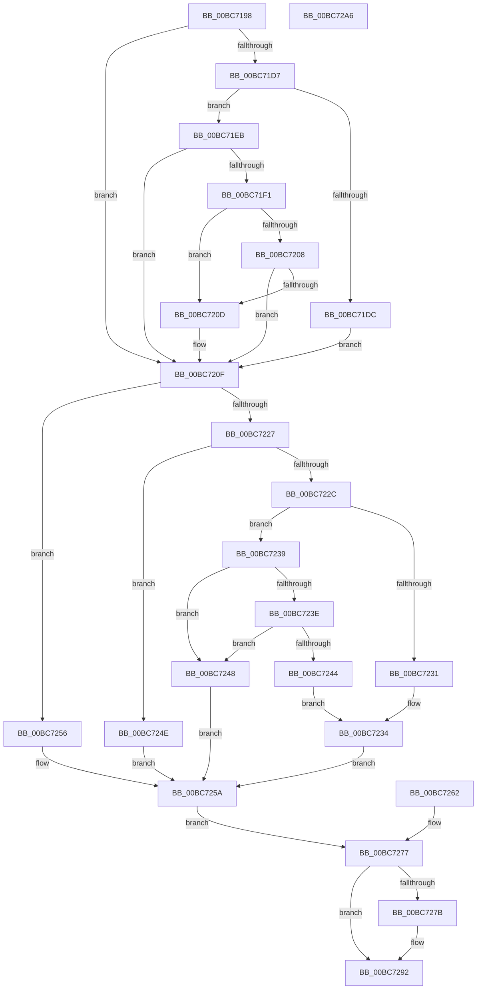

# RtlpIcAccessMemory

- RVA: `0x00BC7198`–`0x00BC72A7` (길이 `271` bytes)
- VA: `0x0000000140BC7198`
- 실행 섹션: `TRACESUP`
- PDB 이름 있음: `예`; PDB Function 태그: `아니요`
- unwind 정보 RVA: `0x000D007C`
- 디코드: `86`개 명령, `271/271` bytes 표시
- 미해석 바이트: `0` (있으면 어셈블리에 `.byte`로 보존)

> 이 문서는 커널 이미지의 기계어와 PDB 기호를 분석해 생성했습니다. 4번과 5번은 함수 원형과 자료형을 바이너리 사용 방식에서 추정한 C 해석이며 원본 소스 복구 결과는 아닙니다.

## 1. Dependencies

- 직접 호출 지점: **1**; 고유 호출 대상: **1**
- 직접 호출자로 확인된 함수: **7**
- RIP 상대 이미지 참조: **0**

### Outgoing calls
- `0x00BC71E4` → [ProbeForWrite](../../page/8E/ProbeForWrite_function_008E91C0.md) (function, `0x008E91C0`)

### Direct callers
- [RtlpIcEmulateGroup0Instruction](RtlpIcEmulateGroup0Instruction_function_00BC74F8.md) at `0x00BC7724`
- [RtlpIcEmulateGroup11Instruction](RtlpIcEmulateGroup11Instruction_function_00BC7750.md) at `0x00BC77FA`
- [RtlpIcEmulateGroup1Instruction](RtlpIcEmulateGroup1Instruction_function_00BC7818.md) at `0x00BC79E3`
- [RtlpIcEmulateInstruction](RtlpIcEmulateInstruction_function_00BC7A08.md) at `0x00BC7E2F`
- [RtlpIcEmulateInstruction](RtlpIcEmulateInstruction_function_00BC7A08.md) at `0x00BC7F17`
- [RtlpIcEmulateInstruction](RtlpIcEmulateInstruction_function_00BC7A08.md) at `0x00BC807C`
- [RtlpIcEmulateInstruction](RtlpIcEmulateInstruction_function_00BC7A08.md) at `0x00BC8142`
- [RtlpIcEmulateMovzx](RtlpIcEmulateMovzx_function_00BC81FC.md) at `0x00BC8292`
- [RtlpIcEmulateRegisterPushPop](RtlpIcEmulateRegisterPushPop_function_00BC830C.md) at `0x00BC8398`
- [RtlpIcReadOperandValue](RtlpIcReadOperandValue_function_00BC8634.md) at `0x00BC8666`

### Static image references
- 디코드된 RIP-relative 메모리 참조가 없습니다.

## 2. Other-region calls and transfers

- 다른 실행 섹션으로 향하는 call: **1**
  - `0x00BC71E4` → [ProbeForWrite](../../page/8E/ProbeForWrite_function_008E91C0.md) (`TRACESUP` → `PAGE`)
- 별도 외부 분기/꼬리 이동을 확인하지 못했습니다.

## 3. Assembly (complete function range)

```asm
00BC7198  48 8B C4                        mov rax, rsp
00BC719B  48 89 58 10                     mov qword ptr [rax + 0x10], rbx
00BC719F  48 89 70 20                     mov qword ptr [rax + 0x20], rsi
00BC71A3  4C 89 40 18                     mov qword ptr [rax + 0x18], r8
00BC71A7  48 89 48 08                     mov qword ptr [rax + 8], rcx
00BC71AB  57                              push rdi
00BC71AC  41 56                           push r14
00BC71AE  41 57                           push r15
00BC71B0  48 83 EC 30                     sub rsp, 0x30
00BC71B4  49 8B F0                        mov rsi, r8
00BC71B7  48 8B FA                        mov rdi, rdx
00BC71BA  4C 8B F9                        mov r15, rcx
00BC71BD  44 8A B4 24 80 00 00 00         mov r14b, byte ptr [rsp + 0x80]
00BC71C5  44 88 74 24 20                  mov byte ptr [rsp + 0x20], r14b
00BC71CA  41 B8 01 00 00 00               mov r8d, 1
00BC71D0  33 DB                           xor ebx, ebx
00BC71D2  45 3A C8                        cmp r9b, r8b
00BC71D5  75 38                           jne 0x140bc720f
00BC71D7  45 84 F6                        test r14b, r14b
00BC71DA  74 0F                           je 0x140bc71eb
00BC71DC  0F B6 54 24 78                  movzx edx, byte ptr [rsp + 0x78]
00BC71E1  48 8B CE                        mov rcx, rsi
00BC71E4  E8 D7 1F D2 FF                  call 0x1408e91c0
00BC71E9  EB 24                           jmp 0x140bc720f
00BC71EB  38 5C 24 78                     cmp byte ptr [rsp + 0x78], bl
00BC71EF  74 1E                           je 0x140bc720f
00BC71F1  0F B6 4C 24 78                  movzx ecx, byte ptr [rsp + 0x78]
00BC71F6  48 03 CE                        add rcx, rsi
00BC71F9  48 B8 00 00 FF FF FF 7F 00 00   movabs rax, 0x7fffffff0000
00BC7203  48 3B C8                        cmp rcx, rax
00BC7206  77 05                           ja 0x140bc720d
00BC7208  48 3B CE                        cmp rcx, rsi
00BC720B  73 02                           jae 0x140bc720f
00BC720D  8A 00                           mov al, byte ptr [rax]
00BC720F  48 8B CE                        mov rcx, rsi
00BC7212  45 84 F6                        test r14b, r14b
00BC7215  48 0F 44 CF                     cmove rcx, rdi
00BC7219  48 0F 44 FE                     cmove rdi, rsi
00BC721D  0F B6 54 24 78                  movzx edx, byte ptr [rsp + 0x78]
00BC7222  83 EA 01                        sub edx, 1
00BC7225  74 2F                           je 0x140bc7256
00BC7227  83 EA 01                        sub edx, 1
00BC722A  74 22                           je 0x140bc724e
00BC722C  83 FA 02                        cmp edx, 2
00BC722F  74 08                           je 0x140bc7239
00BC7231  48 8B 07                        mov rax, qword ptr [rdi]
00BC7234  48 89 01                        mov qword ptr [rcx], rax
00BC7237  EB 21                           jmp 0x140bc725a
00BC7239  45 84 F6                        test r14b, r14b
00BC723C  74 0A                           je 0x140bc7248
00BC723E  38 5C 24 70                     cmp byte ptr [rsp + 0x70], bl
00BC7242  74 04                           je 0x140bc7248
00BC7244  8B 07                           mov eax, dword ptr [rdi]
00BC7246  EB EC                           jmp 0x140bc7234
00BC7248  8B 07                           mov eax, dword ptr [rdi]
00BC724A  89 01                           mov dword ptr [rcx], eax
00BC724C  EB 0C                           jmp 0x140bc725a
00BC724E  0F B7 07                        movzx eax, word ptr [rdi]
00BC7251  66 89 01                        mov word ptr [rcx], ax
00BC7254  EB 04                           jmp 0x140bc725a
00BC7256  8A 07                           mov al, byte ptr [rdi]
00BC7258  88 01                           mov byte ptr [rcx], al
00BC725A  8B C3                           mov eax, ebx
00BC725C  89 5C 24 24                     mov dword ptr [rsp + 0x24], ebx
00BC7260  EB 15                           jmp 0x140bc7277
00BC7262  89 44 24 24                     mov dword ptr [rsp + 0x24], eax
00BC7266  33 DB                           xor ebx, ebx
00BC7268  48 8B 74 24 60                  mov rsi, qword ptr [rsp + 0x60]
00BC726D  4C 8B 7C 24 50                  mov r15, qword ptr [rsp + 0x50]
00BC7272  44 8A 74 24 20                  mov r14b, byte ptr [rsp + 0x20]
00BC7277  85 C0                           test eax, eax
00BC7279  79 17                           jns 0x140bc7292
00BC727B  49 8B 0F                        mov rcx, qword ptr [r15]
00BC727E  C7 01 05 00 00 C0               mov dword ptr [rcx], 0xc0000005
00BC7284  45 84 F6                        test r14b, r14b
00BC7287  0F 95 C3                        setne bl
00BC728A  48 89 59 20                     mov qword ptr [rcx + 0x20], rbx
00BC728E  48 89 71 28                     mov qword ptr [rcx + 0x28], rsi
00BC7292  48 8B 5C 24 58                  mov rbx, qword ptr [rsp + 0x58]
00BC7297  48 8B 74 24 68                  mov rsi, qword ptr [rsp + 0x68]
00BC729C  48 83 C4 30                     add rsp, 0x30
00BC72A0  41 5F                           pop r15
00BC72A2  41 5E                           pop r14
00BC72A4  5F                              pop rdi
00BC72A5  C3                              ret
00BC72A6  CC                              int3
```

## 4. C-style interpretation (structured pseudocode)

```c
__int64 __fastcall RtlpIcAccessMemory(__int64 a1, __int64 a2, __int64 a3, unsigned __int8 a4, unsigned __int8 a5, unsigned __int8 a6, unsigned __int8 a7)
{
    __int64 result;
    __int64 v_rbx;
    __int64 v_rsp;
    unsigned int v_stack_m24;
    unsigned __int8 v_stack_m28;
    unsigned __int64 v_stack_p10;
    unsigned __int64 v_stack_p18;
    unsigned __int64 v_stack_p20;
    unsigned __int64 v_stack_p8;

    *(unsigned __int64 *)(v_rsp + 16) = v_rbx;
    *(unsigned __int64 *)(v_rsp + 32) = v_rsi;
    *(unsigned __int64 *)(v_rsp + 24) = a3;
    *(unsigned __int64 *)(v_rsp + 8) = a1;
    v_rsp = (v_rsp) - (48);
    v_stack_m28 = a7;
    v_rbx = 0;
    if (a4 != 1) goto loc_00BC720F;
    if (a7 == 0) goto loc_00BC71EB;
    result = ProbeForWrite(a3, a6, 1, a4);
    goto loc_00BC720F;
loc_00BC71EB:
    if (a6 == 0) goto loc_00BC720F;
    a1 = (a6) + (a3);
    if (a1 > result) goto loc_00BC720D;
    if (a1 < a3) {
        result = *(unsigned __int8 *)(result);
    }
    if (a7 == 0) {
        a3 = a2;
        a2 = a3;
    }
    a2 = (unsigned int)((a6) - (1));
    if (condition_is_equal) goto loc_00BC7256;
    a2 = (unsigned int)((a2) - (1));
    if (condition_is_equal) goto loc_00BC724E;
    if (((unsigned int)(a2)) == 2) goto loc_00BC7239;
loc_00BC7234:
    *(unsigned __int64 *)(a3) = *(unsigned __int64 *)(a2);
    goto loc_00BC725A;
loc_00BC7239:
    if (a7 == 0) goto loc_00BC7248;
    if (a5 == 0) goto loc_00BC7248;
    goto loc_00BC7234;
loc_00BC7248:
    *(unsigned int *)(a3) = (unsigned int)((unsigned int)(*(unsigned int *)(a2)));
    goto loc_00BC725A;
loc_00BC724E:
    *(unsigned __int16 *)(a3) = (unsigned __int16)(*(unsigned __int16 *)(a2));
    goto loc_00BC725A;
loc_00BC7256:
    *(unsigned __int8 *)(a3) = (unsigned __int8)(*(unsigned __int8 *)(a2));
loc_00BC725A:
    v_stack_m24 = 0;
    goto loc_00BC7277;
loc_00BC7277:
    if (sign_flag) {
        a1 = *(unsigned __int64 *)(a1);
        *(unsigned int *)(a1) = 0xC0000005ULL;
        v_rbx = (a7 != 0) ? 1 : 0;
        *(unsigned __int64 *)(a1 + 32) = v_rbx;
        *(unsigned __int64 *)(a1 + 40) = a3;
    }
    v_rsp = (v_rsp) + (48);
    return 0;
}
```

## 5. (Beta) C Style

```c
int64_t RtlpIcAccessMemory(void *Arg1, int64_t Arg2, int64_t Arg3, uint8_t Arg4, uint8_t Arg5, uint8_t Arg6, uint8_t Arg7)
{
    uint8_t *arg1 = (uint8_t *)Arg1;

    int64_t result;
    int64_t local_rbx;
    int64_t local_rsp;
    uint32_t v_stack_m24;
    uint8_t v_stack_m28;
    uint64_t v_stack_p10;
    uint64_t v_stack_p18;
    uint64_t v_stack_p20;
    uint64_t v_stack_p8;

    *(uint64_t *)(local_rsp + 0x10) = local_rbx;
    *(uint64_t *)(local_rsp + 0x20) = local_rsi;
    *(uint64_t *)(local_rsp + 0x18) = Arg3;
    *(void **)(local_rsp + 0x8) = Arg1;
    local_rsp = (local_rsp) - (48);
    v_stack_m28 = Arg7;
    local_rbx = 0;
    if (Arg4 != 1) goto loc_00BC720F;
    if (Arg7 == 0) goto loc_00BC71EB;
    result = ProbeForWrite(Arg3, Arg6, 1, Arg4);
    goto loc_00BC720F;
loc_00BC71EB:
    if (Arg6 == 0) goto loc_00BC720F;
    Arg1 = (Arg6) + (Arg3);
    if (Arg1 > result) goto loc_00BC720D;
    if (Arg1 < Arg3) {
        result = *(uint8_t *)(result);
    }
    if (Arg7 == 0) {
        Arg3 = Arg2;
        Arg2 = Arg3;
    }
    Arg2 = (uint32_t)((Arg6) - (1));
    if (condition_is_equal) goto loc_00BC7256;
    Arg2 = (uint32_t)((Arg2) - (1));
    if (condition_is_equal) goto loc_00BC724E;
    if (((uint32_t)(Arg2)) == 2) goto loc_00BC7239;
loc_00BC7234:
    *(uint64_t *)(Arg3) = *(uint64_t *)(Arg2);
    goto loc_00BC725A;
loc_00BC7239:
    if (Arg7 == 0) goto loc_00BC7248;
    if (Arg5 == 0) goto loc_00BC7248;
    goto loc_00BC7234;
loc_00BC7248:
    *(uint32_t *)(Arg3) = (uint32_t)((uint32_t)(*(uint32_t *)(Arg2)));
    goto loc_00BC725A;
loc_00BC724E:
    *(uint16_t *)(Arg3) = (uint16_t)(*(uint16_t *)(Arg2));
    goto loc_00BC725A;
loc_00BC7256:
    *(uint8_t *)(Arg3) = (uint8_t)(*(uint8_t *)(Arg2));
loc_00BC725A:
    v_stack_m24 = 0;
    goto loc_00BC7277;
loc_00BC7277:
    if (sign_flag) {
        Arg1 = *(uint64_t *)(arg1);
        *(uint32_t *)(arg1) = 0xC0000005ULL;
        local_rbx = (Arg7 != 0) ? 1 : 0;
        *(uint64_t *)(arg1 + 0x20) = local_rbx;
        *(uint64_t *)(arg1 + 0x28) = Arg3;
    }
    local_rsp = (local_rsp) + (48);
    return 0;
}
```

### 관측된 메모리 오프셋

구조체 형식이 확인되지 않은 접근은 인자 기준의 오프셋으로만 기록했습니다.

| 기준 인자 | 오프셋 표현 | 폭 (bit) | 접근 |
|---|---:|---:|---|
| `Arg1` | `+ 0x0` | `64` | `R` |

## 6. Execution-region graph

[열기: 2D/3D 그래프와 함수 탐색 컨트롤 패널](../../../control-panel.html?section=tracesup&rva=0x00BC7198&view=graph)

- 2D 그래프는 위에서 아래로 흐르고, 3D 그래프는 빈 공간을 드래그해 회전합니다. Shift+드래그는 이동, 휠은 확대·축소, 함수 노드 선택은 대상 보고서 이동입니다.

### Static fallback


