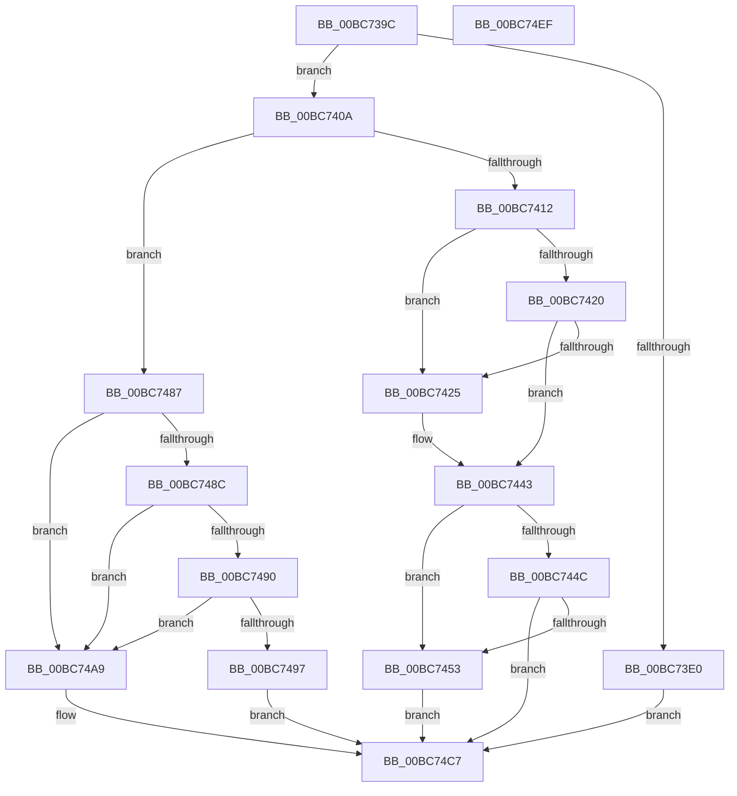

# RtlpIcDecodeModRmOperand

- RVA: `0x00BC739C`–`0x00BC74F0` (길이 `340` bytes)
- VA: `0x0000000140BC739C`
- 실행 섹션: `TRACESUP`
- PDB 이름 있음: `예`; PDB Function 태그: `아니요`
- unwind 정보 RVA: `0x000BDE90`
- 디코드: `103`개 명령, `340/340` bytes 표시
- 미해석 바이트: `0` (있으면 어셈블리에 `.byte`로 보존)

> 이 문서는 커널 이미지의 기계어와 PDB 기호를 분석해 생성했습니다. 4번과 5번은 함수 원형과 자료형을 바이너리 사용 방식에서 추정한 C 해석이며 원본 소스 복구 결과는 아닙니다.

## 1. Dependencies

- 직접 호출 지점: **4**; 고유 호출 대상: **1**
- 직접 호출자로 확인된 함수: **5**
- RIP 상대 이미지 참조: **0**

### Outgoing calls
- `0x00BC73F7` → [RtlpIcGetRegisterAddressByIndex](RtlpIcGetRegisterAddressByIndex_function_00BC8498.md) (function, `0x00BC8498`)
- `0x00BC743B` → [RtlpIcGetRegisterAddressByIndex](RtlpIcGetRegisterAddressByIndex_function_00BC8498.md) (function, `0x00BC8498`)
- `0x00BC7473` → [RtlpIcGetRegisterAddressByIndex](RtlpIcGetRegisterAddressByIndex_function_00BC8498.md) (function, `0x00BC8498`)
- `0x00BC74BF` → [RtlpIcGetRegisterAddressByIndex](RtlpIcGetRegisterAddressByIndex_function_00BC8498.md) (function, `0x00BC8498`)

### Direct callers
- [RtlpIcEmulateGroup0Instruction](RtlpIcEmulateGroup0Instruction_function_00BC74F8.md) at `0x00BC757B`
- [RtlpIcEmulateGroup11Instruction](RtlpIcEmulateGroup11Instruction_function_00BC7750.md) at `0x00BC77C0`
- [RtlpIcEmulateGroup1Instruction](RtlpIcEmulateGroup1Instruction_function_00BC7818.md) at `0x00BC7892`
- [RtlpIcEmulateInstruction](RtlpIcEmulateInstruction_function_00BC7A08.md) at `0x00BC7C4D`
- [RtlpIcEmulateInstruction](RtlpIcEmulateInstruction_function_00BC7A08.md) at `0x00BC7D4D`
- [RtlpIcEmulateInstruction](RtlpIcEmulateInstruction_function_00BC7A08.md) at `0x00BC7DCA`
- [RtlpIcEmulateInstruction](RtlpIcEmulateInstruction_function_00BC7A08.md) at `0x00BC7E85`
- [RtlpIcEmulateInstruction](RtlpIcEmulateInstruction_function_00BC7A08.md) at `0x00BC7F90`
- [RtlpIcEmulateMovzx](RtlpIcEmulateMovzx_function_00BC81FC.md) at `0x00BC8264`

### Static image references
- 디코드된 RIP-relative 메모리 참조가 없습니다.

## 2. Other-region calls and transfers

- 다른 실행 섹션으로 향하는 call: **0**
- 별도 외부 분기/꼬리 이동을 확인하지 못했습니다.

## 3. Assembly (complete function range)

```asm
00BC739C  48 8B C4                        mov rax, rsp
00BC739F  48 89 58 08                     mov qword ptr [rax + 8], rbx
00BC73A3  48 89 70 10                     mov qword ptr [rax + 0x10], rsi
00BC73A7  48 89 78 18                     mov qword ptr [rax + 0x18], rdi
00BC73AB  4C 89 70 20                     mov qword ptr [rax + 0x20], r14
00BC73AF  41 57                           push r15
00BC73B1  48 83 EC 30                     sub rsp, 0x30
00BC73B5  8A 42 10                        mov al, byte ptr [rdx + 0x10]
00BC73B8  33 DB                           xor ebx, ebx
00BC73BA  4C 8B 74 24 60                  mov r14, qword ptr [rsp + 0x60]
00BC73BF  4C 8B D1                        mov r10, rcx
00BC73C2  0F B6 49 1A                     movzx ecx, byte ptr [rcx + 0x1a]
00BC73C6  49 8B F1                        mov rsi, r9
00BC73C9  41 88 01                        mov byte ptr [r9], al
00BC73CC  4D 8B F8                        mov r15, r8
00BC73CF  8A C1                           mov al, cl
00BC73D1  48 8B FA                        mov rdi, rdx
00BC73D4  24 C0                           and al, 0xc0
00BC73D6  41 88 1E                        mov byte ptr [r14], bl
00BC73D9  44 8B DB                        mov r11d, ebx
00BC73DC  3C C0                           cmp al, 0xc0
00BC73DE  75 2A                           jne 0x140bc740a
00BC73E0  45 8A 4A 19                     mov r9b, byte ptr [r10 + 0x19]
00BC73E4  44 8B C1                        mov r8d, ecx
00BC73E7  41 80 E1 01                     and r9b, 1
00BC73EB  C6 44 24 20 01                  mov byte ptr [rsp + 0x20], 1
00BC73F0  41 83 E0 07                     and r8d, 7
00BC73F4  49 8B CA                        mov rcx, r10
00BC73F7  E8 9C 10 00 00                  call 0x140bc8498
00BC73FC  4C 8B D8                        mov r11, rax
00BC73FF  88 1E                           mov byte ptr [rsi], bl
00BC7401  41 C6 06 01                     mov byte ptr [r14], 1
00BC7405  E9 BD 00 00 00                  jmp 0x140bc74c7
00BC740A  8A C1                           mov al, cl
00BC740C  24 07                           and al, 7
00BC740E  3C 04                           cmp al, 4
00BC7410  75 75                           jne 0x140bc7487
00BC7412  41 0F B6 72 1B                  movzx esi, byte ptr [r10 + 0x1b]
00BC7417  40 8A C6                        mov al, sil
00BC741A  24 07                           and al, 7
00BC741C  3C 05                           cmp al, 5
00BC741E  75 05                           jne 0x140bc7425
00BC7420  80 F9 40                        cmp cl, 0x40
00BC7423  72 1E                           jb 0x140bc7443
00BC7425  45 8A 4A 19                     mov r9b, byte ptr [r10 + 0x19]
00BC7429  44 8B C6                        mov r8d, esi
00BC742C  41 80 E1 01                     and r9b, 1
00BC7430  88 5C 24 20                     mov byte ptr [rsp + 0x20], bl
00BC7434  41 83 E0 07                     and r8d, 7
00BC7438  49 8B CA                        mov rcx, r10
00BC743B  E8 58 10 00 00                  call 0x140bc8498
00BC7440  4C 8B 18                        mov r11, qword ptr [rax]
00BC7443  40 8A C6                        mov al, sil
00BC7446  24 38                           and al, 0x38
00BC7448  3C 20                           cmp al, 0x20
00BC744A  75 07                           jne 0x140bc7453
00BC744C  41 F6 42 19 02                  test byte ptr [r10 + 0x19], 2
00BC7451  74 74                           je 0x140bc74c7
00BC7453  45 8A 4A 19                     mov r9b, byte ptr [r10 + 0x19]
00BC7457  44 8B C6                        mov r8d, esi
00BC745A  41 C1 E8 03                     shr r8d, 3
00BC745E  48 8B D7                        mov rdx, rdi
00BC7461  41 D0 E9                        shr r9b, 1
00BC7464  41 83 E0 07                     and r8d, 7
00BC7468  41 80 E1 01                     and r9b, 1
00BC746C  88 5C 24 20                     mov byte ptr [rsp + 0x20], bl
00BC7470  49 8B CA                        mov rcx, r10
00BC7473  E8 20 10 00 00                  call 0x140bc8498
00BC7478  48 8B CE                        mov rcx, rsi
00BC747B  48 C1 E9 06                     shr rcx, 6
00BC747F  48 8B 18                        mov rbx, qword ptr [rax]
00BC7482  48 D3 E3                        shl rbx, cl
00BC7485  EB 40                           jmp 0x140bc74c7
00BC7487  80 F9 40                        cmp cl, 0x40
00BC748A  73 1D                           jae 0x140bc74a9
00BC748C  3C 05                           cmp al, 5
00BC748E  75 19                           jne 0x140bc74a9
00BC7490  41 F6 42 19 01                  test byte ptr [r10 + 0x19], 1
00BC7495  75 12                           jne 0x140bc74a9
00BC7497  48 8B 42 08                     mov rax, qword ptr [rdx + 8]
00BC749B  45 0F B6 5A 18                  movzx r11d, byte ptr [r10 + 0x18]
00BC74A0  4C 03 98 F8 00 00 00            add r11, qword ptr [rax + 0xf8]
00BC74A7  EB 1E                           jmp 0x140bc74c7
00BC74A9  45 8A 4A 19                     mov r9b, byte ptr [r10 + 0x19]
00BC74AD  44 8B C1                        mov r8d, ecx
00BC74B0  41 80 E1 01                     and r9b, 1
00BC74B4  88 5C 24 20                     mov byte ptr [rsp + 0x20], bl
00BC74B8  41 83 E0 07                     and r8d, 7
00BC74BC  49 8B CA                        mov rcx, r10
00BC74BF  E8 D4 0F 00 00                  call 0x140bc8498
00BC74C4  4C 8B 18                        mov r11, qword ptr [rax]
00BC74C7  49 63 42 1C                     movsxd rax, dword ptr [r10 + 0x1c]
00BC74CB  48 8B 74 24 48                  mov rsi, qword ptr [rsp + 0x48]
00BC74D0  48 03 C3                        add rax, rbx
00BC74D3  48 8B 5C 24 40                  mov rbx, qword ptr [rsp + 0x40]
00BC74D8  49 03 C3                        add rax, r11
00BC74DB  48 8B 7C 24 50                  mov rdi, qword ptr [rsp + 0x50]
00BC74E0  4C 8B 74 24 58                  mov r14, qword ptr [rsp + 0x58]
00BC74E5  49 89 07                        mov qword ptr [r15], rax
00BC74E8  48 83 C4 30                     add rsp, 0x30
00BC74EC  41 5F                           pop r15
00BC74EE  C3                              ret
00BC74EF  CC                              int3
```

## 4. C-style interpretation (structured pseudocode)

```c
__int64 __fastcall RtlpIcDecodeModRmOperand(__int64 a1, __int64 a2, __int64 a3, __int64 a4, __int64 a5)
{
    __int64 result;
    __int64 v_r11;
    __int64 v_rbx;
    __int64 v_rsp;
    unsigned __int8 v_stack_m18;
    unsigned __int64 v_stack_p10;
    unsigned __int64 v_stack_p18;
    unsigned __int64 v_stack_p20;
    unsigned __int64 v_stack_p8;

    *(unsigned __int64 *)(v_rsp + 8) = v_rbx;
    *(unsigned __int64 *)(v_rsp + 16) = v_rsi;
    *(unsigned __int64 *)(v_rsp + 24) = v_rdi;
    *(unsigned __int64 *)(v_rsp + 32) = v_r14;
    v_rsp = (v_rsp) - (48);
    v_rbx = 0;
    *(unsigned __int8 *)(a4) = (unsigned __int8)(*(unsigned __int8 *)(a2 + 16));
    result = (unsigned __int8)(((unsigned __int8)(*(unsigned __int8 *)(a1 + 26))) & (192));
    *(unsigned __int8 *)(a5) = 0;
    if (((unsigned __int8)(result)) != 192) goto loc_00BC740A;
    a4 = (unsigned __int8)((*(unsigned __int8 *)(a1 + 25)) & (1));
    v_stack_m18 = 1;
    a3 = (unsigned int)(((unsigned int)((unsigned int)(*(unsigned __int8 *)(a1 + 26)))) & (7));
    result = RtlpIcGetRegisterAddressByIndex(a1, a2, a3, a4);
    *(unsigned __int8 *)(a4) = 0;
    *(unsigned __int8 *)(a5) = 1;
    goto loc_00BC74C7;
loc_00BC740A:
    result = (unsigned __int8)(((unsigned __int8)(a1)) & (7));
    if (((unsigned __int8)(result)) != 4) goto loc_00BC7487;
    result = (unsigned __int8)(((unsigned __int8)(*(unsigned __int8 *)(a1 + 27))) & (7));
    if (((unsigned __int8)(result)) != 5) goto loc_00BC7425;
    v_r11 = result;
    if (((unsigned __int8)(a1)) >= 64) {
        a4 = *(unsigned __int8 *)(a1 + 25);
        a3 = (unsigned int)(*(unsigned __int8 *)(a1 + 27));
        a4 = (unsigned __int8)((a4) & (1));
        v_stack_m18 = 0;
        a3 = (unsigned int)((a3) & (7));
        a1 = a1;
        result = RtlpIcGetRegisterAddressByIndex(a1, a2, a3, a4);
        v_r11 = *(unsigned __int64 *)(result);
    }
    result = (unsigned __int8)(((unsigned __int8)(*(unsigned __int8 *)(a1 + 27))) & (56));
    if (((unsigned __int8)(result)) != 32) goto loc_00BC7453;
    if (((*(unsigned __int8 *)(a1 + 25)) & (2)) == 0) goto loc_00BC74C7;
loc_00BC7453:
    a3 = (unsigned int)(((unsigned int)((unsigned int)(*(unsigned __int8 *)(a1 + 27)))) >> (3));
    a4 = (unsigned __int8)((*(unsigned __int8 *)(a1 + 25)) >> (1));
    a3 = (unsigned int)((a3) & (7));
    a4 = (unsigned __int8)((a4) & (1));
    v_stack_m18 = 0;
    result = RtlpIcGetRegisterAddressByIndex(a1, a2, a3, a4);
    a1 = (*(unsigned __int8 *)(a1 + 27)) >> (6);
    v_rbx = (*(unsigned __int64 *)(result)) << ((unsigned __int8)(a1));
    goto loc_00BC74C7;
loc_00BC7487:
    if (((unsigned __int8)(a1)) >= 64) goto loc_00BC74A9;
    if (((unsigned __int8)(result)) != 5) goto loc_00BC74A9;
    if (((*(unsigned __int8 *)(a1 + 25)) & (1)) != 0) goto loc_00BC74A9;
    v_r11 = (*(unsigned __int8 *)(a1 + 24)) + (*(unsigned __int64 *)(*(unsigned __int64 *)(a2 + 8) + 248));
    goto loc_00BC74C7;
loc_00BC74A9:
    a4 = (unsigned __int8)((*(unsigned __int8 *)(a1 + 25)) & (1));
    v_stack_m18 = (unsigned __int8)(v_rbx);
    a3 = (unsigned int)(((unsigned int)((unsigned int)(a1))) & (7));
    result = RtlpIcGetRegisterAddressByIndex(a1, a2, a3, a4);
loc_00BC74C7:
    result = ((int)(*(unsigned int *)(a1 + 28))) + (v_rbx);
    result = (result) + (*(unsigned __int64 *)(result));
    *(unsigned __int64 *)(a3) = result;
    v_rsp = (v_rsp) + (48);
    return result;
}
```

## 5. (Beta) C Style

```c
int64_t RtlpIcDecodeModRmOperand(void *Arg1, void *Arg2, void *Arg3, void *Arg4, void *Arg5)
{
    uint8_t *arg1 = (uint8_t *)Arg1;
    uint8_t *arg2 = (uint8_t *)Arg2;
    uint8_t *arg3 = (uint8_t *)Arg3;
    uint8_t *arg4 = (uint8_t *)Arg4;
    uint8_t *arg5 = (uint8_t *)Arg5;

    int64_t result;
    int64_t local_r11;
    int64_t local_rbx;
    int64_t local_rsp;
    uint8_t v_stack_m18;
    uint64_t v_stack_p10;
    uint64_t v_stack_p18;
    uint64_t v_stack_p20;
    uint64_t v_stack_p8;

    *(uint64_t *)(local_rsp + 0x8) = local_rbx;
    *(uint64_t *)(local_rsp + 0x10) = local_rsi;
    *(uint64_t *)(local_rsp + 0x18) = local_rdi;
    *(uint64_t *)(local_rsp + 0x20) = local_r14;
    local_rsp = (local_rsp) - (48);
    local_rbx = 0;
    *(uint8_t *)(arg4) = (uint8_t)(*(uint8_t *)(arg2 + 0x10));
    result = (uint8_t)(((uint8_t)(*(uint8_t *)(arg1 + 0x1A))) & (192));
    *(uint8_t *)(arg5) = 0;
    if (((uint8_t)(result)) != 192) goto loc_00BC740A;
    Arg4 = (uint8_t)((*(uint8_t *)(arg1 + 0x19)) & (1));
    v_stack_m18 = 1;
    Arg3 = (uint32_t)(((uint32_t)((uint32_t)(*(uint8_t *)(arg1 + 0x1A)))) & (7));
    result = RtlpIcGetRegisterAddressByIndex(Arg1, Arg2, Arg3, Arg4);
    *(uint8_t *)(arg4) = 0;
    *(uint8_t *)(arg5) = 1;
    goto loc_00BC74C7;
loc_00BC740A:
    result = (uint8_t)(((uint8_t)(Arg1)) & (7));
    if (((uint8_t)(result)) != 4) goto loc_00BC7487;
    result = (uint8_t)(((uint8_t)(*(uint8_t *)(arg1 + 0x1B))) & (7));
    if (((uint8_t)(result)) != 5) goto loc_00BC7425;
    local_r11 = result;
    if (((uint8_t)(Arg1)) >= 64) {
        Arg4 = *(uint8_t *)(arg1 + 0x19);
        Arg3 = (uint32_t)(*(uint8_t *)(arg1 + 0x1B));
        Arg4 = (uint8_t)((Arg4) & (1));
        v_stack_m18 = 0;
        Arg3 = (uint32_t)((Arg3) & (7));
        Arg1 = Arg1;
        result = RtlpIcGetRegisterAddressByIndex(Arg1, Arg2, Arg3, Arg4);
        local_r11 = *(uint64_t *)(result);
    }
    result = (uint8_t)(((uint8_t)(*(uint8_t *)(arg1 + 0x1B))) & (56));
    if (((uint8_t)(result)) != 32) goto loc_00BC7453;
    if (((*(uint8_t *)(arg1 + 0x19)) & (2)) == 0) goto loc_00BC74C7;
loc_00BC7453:
    Arg3 = (uint32_t)(((uint32_t)((uint32_t)(*(uint8_t *)(arg1 + 0x1B)))) >> (3));
    Arg4 = (uint8_t)((*(uint8_t *)(arg1 + 0x19)) >> (1));
    Arg3 = (uint32_t)((Arg3) & (7));
    Arg4 = (uint8_t)((Arg4) & (1));
    v_stack_m18 = 0;
    result = RtlpIcGetRegisterAddressByIndex(Arg1, Arg2, Arg3, Arg4);
    Arg1 = (*(uint8_t *)(arg1 + 0x1B)) >> (6);
    local_rbx = (*(uint64_t *)(result)) << ((uint8_t)(Arg1));
    goto loc_00BC74C7;
loc_00BC7487:
    if (((uint8_t)(Arg1)) >= 64) goto loc_00BC74A9;
    if (((uint8_t)(result)) != 5) goto loc_00BC74A9;
    if (((*(uint8_t *)(arg1 + 0x19)) & (1)) != 0) goto loc_00BC74A9;
    local_r11 = (*(uint8_t *)(arg1 + 0x18)) + (*(uint64_t *)(*(uint64_t *)(arg2 + 0x8) + 0xF8));
    goto loc_00BC74C7;
loc_00BC74A9:
    Arg4 = (uint8_t)((*(uint8_t *)(arg1 + 0x19)) & (1));
    v_stack_m18 = (uint8_t)(local_rbx);
    Arg3 = (uint32_t)(((uint32_t)((uint32_t)(Arg1))) & (7));
    result = RtlpIcGetRegisterAddressByIndex(Arg1, Arg2, Arg3, Arg4);
loc_00BC74C7:
    result = ((int32_t)(*(uint32_t *)(arg1 + 0x1C))) + (local_rbx);
    result = (result) + (*(uint64_t *)(result));
    *(uint64_t *)(arg3) = result;
    local_rsp = (local_rsp) + (48);
    return result;
}
```

### 관측된 메모리 오프셋

구조체 형식이 확인되지 않은 접근은 인자 기준의 오프셋으로만 기록했습니다.

| 기준 인자 | 오프셋 표현 | 폭 (bit) | 접근 |
|---|---:|---:|---|
| `Arg1` | `+ 0x18` | `8` | `R` |
| `Arg1` | `+ 0x19` | `8` | `R` |
| `Arg1` | `+ 0x1A` | `8` | `R` |
| `Arg1` | `+ 0x1B` | `8` | `R` |
| `Arg2` | `+ 0x8` | `64` | `R` |
| `Arg2` | `+ 0x10` | `8` | `R` |
| `Arg3` | `+ 0x0` | `64` | `W` |
| `Arg4` | `+ 0x0` | `8` | `W` |
| `Arg5` | `+ 0x0` | `8` | `W` |

## 6. Execution-region graph

[열기: 2D/3D 그래프와 함수 탐색 컨트롤 패널](../../../control-panel.html?section=tracesup&rva=0x00BC739C&view=graph)

- 2D 그래프는 위에서 아래로 흐르고, 3D 그래프는 빈 공간을 드래그해 회전합니다. Shift+드래그는 이동, 휠은 확대·축소, 함수 노드 선택은 대상 보고서 이동입니다.

### Static fallback


