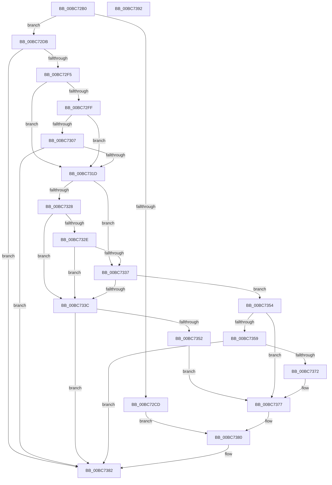

# RtlpIcDecodeModRm

- RVA: `0x00BC72B0`–`0x00BC7393` (길이 `227` bytes)
- VA: `0x0000000140BC72B0`
- 실행 섹션: `TRACESUP`
- PDB 이름 있음: `예`; PDB Function 태그: `아니요`
- unwind 정보 RVA: `0x00060BC4`
- 디코드: `75`개 명령, `227/227` bytes 표시
- 미해석 바이트: `0` (있으면 어셈블리에 `.byte`로 보존)

> 이 문서는 커널 이미지의 기계어와 PDB 기호를 분석해 생성했습니다. 4번과 5번은 함수 원형과 자료형을 바이너리 사용 방식에서 추정한 C 해석이며 원본 소스 복구 결과는 아닙니다.

## 1. Dependencies

- 직접 호출 지점: **4**; 고유 호출 대상: **1**
- 직접 호출자로 확인된 함수: **5**
- RIP 상대 이미지 참조: **0**

### Outgoing calls
- `0x00BC72E8` → [RtlpIcFetchInstructionBytes](RtlpIcFetchInstructionBytes_function_00BC8454.md) (function, `0x00BC8454`)
- `0x00BC7314` → [RtlpIcFetchInstructionBytes](RtlpIcFetchInstructionBytes_function_00BC8454.md) (function, `0x00BC8454`)
- `0x00BC7349` → [RtlpIcFetchInstructionBytes](RtlpIcFetchInstructionBytes_function_00BC8454.md) (function, `0x00BC8454`)
- `0x00BC7369` → [RtlpIcFetchInstructionBytes](RtlpIcFetchInstructionBytes_function_00BC8454.md) (function, `0x00BC8454`)

### Direct callers
- [RtlpIcEmulateGroup0Instruction](RtlpIcEmulateGroup0Instruction_function_00BC74F8.md) at `0x00BC752B`
- [RtlpIcEmulateGroup11Instruction](RtlpIcEmulateGroup11Instruction_function_00BC7750.md) at `0x00BC7768`
- [RtlpIcEmulateGroup1Instruction](RtlpIcEmulateGroup1Instruction_function_00BC7818.md) at `0x00BC7836`
- [RtlpIcEmulateInstruction](RtlpIcEmulateInstruction_function_00BC7A08.md) at `0x00BC7B74`
- [RtlpIcEmulateInstruction](RtlpIcEmulateInstruction_function_00BC7A08.md) at `0x00BC7D1E`
- [RtlpIcEmulateInstruction](RtlpIcEmulateInstruction_function_00BC7A08.md) at `0x00BC7D9B`
- [RtlpIcEmulateInstruction](RtlpIcEmulateInstruction_function_00BC7A08.md) at `0x00BC7E56`
- [RtlpIcEmulateInstruction](RtlpIcEmulateInstruction_function_00BC7A08.md) at `0x00BC7F61`
- [RtlpIcEmulateMovzx](RtlpIcEmulateMovzx_function_00BC81FC.md) at `0x00BC821F`

### Static image references
- 디코드된 RIP-relative 메모리 참조가 없습니다.

## 2. Other-region calls and transfers

- 다른 실행 섹션으로 향하는 call: **0**
- 별도 외부 분기/꼬리 이동을 확인하지 못했습니다.

## 3. Assembly (complete function range)

```asm
00BC72B0  48 89 5C 24 08                  mov qword ptr [rsp + 8], rbx
00BC72B5  48 89 74 24 10                  mov qword ptr [rsp + 0x10], rsi
00BC72BA  57                              push rdi
00BC72BB  48 83 EC 20                     sub rsp, 0x20
00BC72BF  41 8B 30                        mov esi, dword ptr [r8]
00BC72C2  4D 8B C8                        mov r9, r8
00BC72C5  48 8B D9                        mov rbx, rcx
00BC72C8  48 85 D2                        test rdx, rdx
00BC72CB  74 0E                           je 0x140bc72db
00BC72CD  0F B6 41 16                     movzx eax, byte ptr [rcx + 0x16]
00BC72D1  03 C6                           add eax, esi
00BC72D3  41 89 00                        mov dword ptr [r8], eax
00BC72D6  E9 A5 00 00 00                  jmp 0x140bc7380
00BC72DB  48 8D 79 1A                     lea rdi, [rcx + 0x1a]
00BC72DF  41 B8 01 00 00 00               mov r8d, 1
00BC72E5  48 8B D7                        mov rdx, rdi
00BC72E8  E8 67 11 00 00                  call 0x140bc8454
00BC72ED  85 C0                           test eax, eax
00BC72EF  0F 88 8D 00 00 00               js 0x140bc7382
00BC72F5  8A 0F                           mov cl, byte ptr [rdi]
00BC72F7  8A C1                           mov al, cl
00BC72F9  24 C0                           and al, 0xc0
00BC72FB  3C C0                           cmp al, 0xc0
00BC72FD  74 1E                           je 0x140bc731d
00BC72FF  80 E1 07                        and cl, 7
00BC7302  80 F9 04                        cmp cl, 4
00BC7305  75 16                           jne 0x140bc731d
00BC7307  48 8D 53 1B                     lea rdx, [rbx + 0x1b]
00BC730B  41 B8 01 00 00 00               mov r8d, 1
00BC7311  48 8B CB                        mov rcx, rbx
00BC7314  E8 3B 11 00 00                  call 0x140bc8454
00BC7319  85 C0                           test eax, eax
00BC731B  78 65                           js 0x140bc7382
00BC731D  8A 07                           mov al, byte ptr [rdi]
00BC731F  8A C8                           mov cl, al
00BC7321  C0 E9 06                        shr cl, 6
00BC7324  84 C9                           test cl, cl
00BC7326  75 0F                           jne 0x140bc7337
00BC7328  24 07                           and al, 7
00BC732A  3C 05                           cmp al, 5
00BC732C  74 0E                           je 0x140bc733c
00BC732E  8A 43 1B                        mov al, byte ptr [rbx + 0x1b]
00BC7331  24 07                           and al, 7
00BC7333  3C 05                           cmp al, 5
00BC7335  74 05                           je 0x140bc733c
00BC7337  80 F9 02                        cmp cl, 2
00BC733A  75 18                           jne 0x140bc7354
00BC733C  48 8D 53 1C                     lea rdx, [rbx + 0x1c]
00BC7340  41 B8 04 00 00 00               mov r8d, 4
00BC7346  48 8B CB                        mov rcx, rbx
00BC7349  E8 06 11 00 00                  call 0x140bc8454
00BC734E  85 C0                           test eax, eax
00BC7350  78 30                           js 0x140bc7382
00BC7352  EB 23                           jmp 0x140bc7377
00BC7354  80 F9 01                        cmp cl, 1
00BC7357  75 1E                           jne 0x140bc7377
00BC7359  48 8D 7B 1C                     lea rdi, [rbx + 0x1c]
00BC735D  41 B8 01 00 00 00               mov r8d, 1
00BC7363  48 8B D7                        mov rdx, rdi
00BC7366  48 8B CB                        mov rcx, rbx
00BC7369  E8 E6 10 00 00                  call 0x140bc8454
00BC736E  85 C0                           test eax, eax
00BC7370  78 10                           js 0x140bc7382
00BC7372  0F BE 07                        movsx eax, byte ptr [rdi]
00BC7375  89 07                           mov dword ptr [rdi], eax
00BC7377  41 8A 01                        mov al, byte ptr [r9]
00BC737A  40 2A C6                        sub al, sil
00BC737D  88 43 16                        mov byte ptr [rbx + 0x16], al
00BC7380  33 C0                           xor eax, eax
00BC7382  48 8B 5C 24 30                  mov rbx, qword ptr [rsp + 0x30]
00BC7387  48 8B 74 24 38                  mov rsi, qword ptr [rsp + 0x38]
00BC738C  48 83 C4 20                     add rsp, 0x20
00BC7390  5F                              pop rdi
00BC7391  C3                              ret
00BC7392  CC                              int3
```

## 4. C-style interpretation (structured pseudocode)

```c
__int64 __fastcall RtlpIcDecodeModRm(__int64 a1, __int64 a2, __int64 a3)
{
    __int64 result;
    __int64 v_rsp;
    unsigned __int64 v_stack_p10;
    unsigned __int64 v_stack_p8;

    v_stack_p8 = v_rbx;
    v_stack_p10 = v_rsi;
    v_rsp = (v_rsp) - (32);
    if (a2 == 0) goto loc_00BC72DB;
    result = (unsigned int)((*(unsigned __int8 *)(a1 + 22)) + ((unsigned int)((unsigned int)(*(unsigned int *)(a3)))));
    *(unsigned int *)(a3) = (unsigned int)(result);
    goto loc_00BC7380;
loc_00BC72DB:
    result = RtlpIcFetchInstructionBytes(a1, a1 + 26, 1, a3);
    if (sign_flag) goto loc_00BC7382;
    result = (unsigned __int8)(((unsigned __int8)(*(unsigned __int8 *)(a1 + 26))) & (192));
    if (((unsigned __int8)(result)) == 192) goto loc_00BC731D;
    a1 = (unsigned __int8)((*(unsigned __int8 *)(a1 + 26)) & (7));
    if (((unsigned __int8)(a1)) != 4) goto loc_00BC731D;
    result = RtlpIcFetchInstructionBytes(a1, a1 + 27, 1, a3);
    if (sign_flag) goto loc_00BC7382;
loc_00BC731D:
    a1 = (unsigned __int8)(((unsigned __int8)(*(unsigned __int8 *)(a1 + 26))) >> (6));
    if ((unsigned __int8)(a1) != 0) goto loc_00BC7337;
    result = (unsigned __int8)((*(unsigned __int8 *)(a1 + 26)) & (7));
    if (((unsigned __int8)(result)) == 5) goto loc_00BC733C;
    result = (unsigned __int8)((*(unsigned __int8 *)(a1 + 27)) & (7));
    if (((unsigned __int8)(result)) == 5) goto loc_00BC733C;
loc_00BC7337:
    if (((unsigned __int8)(a1)) != 2) goto loc_00BC7354;
loc_00BC733C:
    result = RtlpIcFetchInstructionBytes(a1, a1 + 28, 4, a3);
    if (sign_flag) goto loc_00BC7382;
    goto loc_00BC7377;
loc_00BC7354:
    if (((unsigned __int8)(a1)) != 1) goto loc_00BC7377;
    result = RtlpIcFetchInstructionBytes(a1, a1 + 28, 1, a3);
    if (sign_flag) goto loc_00BC7382;
    *(unsigned int *)(a1 + 28) = (unsigned int)((__int8)(*(unsigned __int8 *)(a1 + 28)));
loc_00BC7377:
    result = (unsigned __int8)((*(unsigned __int8 *)(a3)) - ((unsigned __int8)((unsigned int)(*(unsigned int *)(a3)))));
    *(unsigned __int8 *)(a1 + 22) = (unsigned __int8)(result);
loc_00BC7380:
    result = 0;
loc_00BC7382:
    v_rsp = (v_rsp) + (32);
    return result;
}
```

## 5. (Beta) C Style

```c
int64_t RtlpIcDecodeModRm(void *Arg1, int64_t Arg2, void *Arg3)
{
    uint8_t *arg1 = (uint8_t *)Arg1;
    uint8_t *arg3 = (uint8_t *)Arg3;

    int64_t result;
    int64_t local_rsp;
    uint64_t v_stack_p10;
    uint64_t v_stack_p8;

    v_stack_p8 = local_rbx;
    v_stack_p10 = local_rsi;
    local_rsp = (local_rsp) - (32);
    if (Arg2 == 0) goto loc_00BC72DB;
    result = (uint32_t)((*(uint8_t *)(arg1 + 0x16)) + ((uint32_t)((uint32_t)(*(uint32_t *)(arg3)))));
    *(uint32_t *)(arg3) = (uint32_t)(result);
    goto loc_00BC7380;
loc_00BC72DB:
    result = RtlpIcFetchInstructionBytes(Arg1, Arg1 + 26, 1, Arg3);
    if (sign_flag) goto loc_00BC7382;
    result = (uint8_t)(((uint8_t)(*(uint8_t *)(arg1 + 0x1A))) & (192));
    if (((uint8_t)(result)) == 192) goto loc_00BC731D;
    Arg1 = (uint8_t)((*(uint8_t *)(arg1 + 0x1A)) & (7));
    if (((uint8_t)(Arg1)) != 4) goto loc_00BC731D;
    result = RtlpIcFetchInstructionBytes(Arg1, Arg1 + 27, 1, Arg3);
    if (sign_flag) goto loc_00BC7382;
loc_00BC731D:
    Arg1 = (uint8_t)(((uint8_t)(*(uint8_t *)(arg1 + 0x1A))) >> (6));
    if ((uint8_t)(Arg1) != 0) goto loc_00BC7337;
    result = (uint8_t)((*(uint8_t *)(arg1 + 0x1A)) & (7));
    if (((uint8_t)(result)) == 5) goto loc_00BC733C;
    result = (uint8_t)((*(uint8_t *)(arg1 + 0x1B)) & (7));
    if (((uint8_t)(result)) == 5) goto loc_00BC733C;
loc_00BC7337:
    if (((uint8_t)(Arg1)) != 2) goto loc_00BC7354;
loc_00BC733C:
    result = RtlpIcFetchInstructionBytes(Arg1, Arg1 + 28, 4, Arg3);
    if (sign_flag) goto loc_00BC7382;
    goto loc_00BC7377;
loc_00BC7354:
    if (((uint8_t)(Arg1)) != 1) goto loc_00BC7377;
    result = RtlpIcFetchInstructionBytes(Arg1, Arg1 + 28, 1, Arg3);
    if (sign_flag) goto loc_00BC7382;
    *(uint32_t *)(arg1 + 0x1C) = (uint32_t)((int8_t)(*(uint8_t *)(arg1 + 0x1C)));
loc_00BC7377:
    result = (uint8_t)((*(uint8_t *)(arg3)) - ((uint8_t)((uint32_t)(*(uint32_t *)(arg3)))));
    *(uint8_t *)(arg1 + 0x16) = (uint8_t)(result);
loc_00BC7380:
    result = 0;
loc_00BC7382:
    local_rsp = (local_rsp) + (32);
    return result;
}
```

### 관측된 메모리 오프셋

구조체 형식이 확인되지 않은 접근은 인자 기준의 오프셋으로만 기록했습니다.

| 기준 인자 | 오프셋 표현 | 폭 (bit) | 접근 |
|---|---:|---:|---|
| `Arg1` | `+ 0x0` | `8` | `R` |
| `Arg1` | `+ 0x0` | `32` | `W` |
| `Arg1` | `+ 0x16` | `8` | `R` |
| `Arg1` | `+ 0x16` | `8` | `W` |
| `Arg1` | `+ 0x1A` | `64` | `R` |
| `Arg1` | `+ 0x1B` | `8` | `R` |
| `Arg1` | `+ 0x1B` | `64` | `R` |
| `Arg1` | `+ 0x1C` | `64` | `R` |
| `Arg3` | `+ 0x0` | `32` | `R` |
| `Arg3` | `+ 0x0` | `32` | `W` |

## 6. Execution-region graph

[열기: 2D/3D 그래프와 함수 탐색 컨트롤 패널](../../../control-panel.html?section=tracesup&rva=0x00BC72B0&view=graph)

- 2D 그래프는 위에서 아래로 흐르고, 3D 그래프는 빈 공간을 드래그해 회전합니다. Shift+드래그는 이동, 휠은 확대·축소, 함수 노드 선택은 대상 보고서 이동입니다.

### Static fallback


