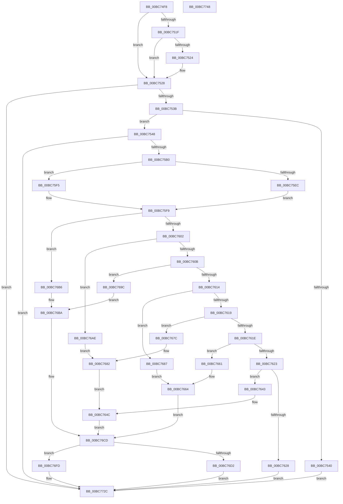

# RtlpIcEmulateGroup0Instruction

- RVA: `0x00BC74F8`–`0x00BC7749` (길이 `593` bytes)
- VA: `0x0000000140BC74F8`
- 실행 섹션: `TRACESUP`
- PDB 이름 있음: `예`; PDB Function 태그: `아니요`
- unwind 정보 RVA: `0x000D0034`
- 디코드: `172`개 명령, `593/593` bytes 표시
- 미해석 바이트: `0` (있으면 어셈블리에 `.byte`로 보존)

> 이 문서는 커널 이미지의 기계어와 PDB 기호를 분석해 생성했습니다. 4번과 5번은 함수 원형과 자료형을 바이너리 사용 방식에서 추정한 C 해석이며 원본 소스 복구 결과는 아닙니다.

## 1. Dependencies

- 직접 호출 지점: **11**; 고유 호출 대상: **10**
- 직접 호출자로 확인된 함수: **1**
- RIP 상대 이미지 참조: **0**

### Outgoing calls
- `0x00BC752B` → [RtlpIcDecodeModRm](RtlpIcDecodeModRm_function_00BC72B0.md) (function, `0x00BC72B0`)
- `0x00BC757B` → [RtlpIcDecodeModRmOperand](RtlpIcDecodeModRmOperand_function_00BC739C.md) (function, `0x00BC739C`)
- `0x00BC75A0` → [RtlpIcReadOperandValue](RtlpIcReadOperandValue_function_00BC8634.md) (function, `0x00BC8634`)
- `0x00BC75D4` → [RtlpIcGetRegisterAddressByIndex](RtlpIcGetRegisterAddressByIndex_function_00BC8498.md) (function, `0x00BC8498`)
- `0x00BC75DF` → [RtlpIcSignExtendOperandValue](RtlpIcSignExtendOperandValue_function_00BC8928.md) (function, `0x00BC8928`)
- `0x00BC7639` → [RtlpIcSetFlagsSub](RtlpIcSetFlagsSub_function_00BC8784.md) (function, `0x00BC8784`)
- `0x00BC765A` → [RtlpIcSetFlagsZeroSignParity](RtlpIcSetFlagsZeroSignParity_function_00BC8888.md) (function, `0x00BC8888`)
- `0x00BC7675` → [RtlpIcSetFlagsSub](RtlpIcSetFlagsSub_function_00BC8784.md) (function, `0x00BC8784`)
- `0x00BC76C8` → [RtlpIcSetFlagsAdd](RtlpIcSetFlagsAdd_function_00BC8698.md) (function, `0x00BC8698`)
- `0x00BC76F6` → [RtlpIcWriteRegisterValue](RtlpIcWriteRegisterValue_function_00BC8954.md) (function, `0x00BC8954`)
- `0x00BC7724` → [RtlpIcAccessMemory](RtlpIcAccessMemory_function_00BC7198.md) (function, `0x00BC7198`)

### Direct callers
- [RtlpIcEmulateInstruction](RtlpIcEmulateInstruction_function_00BC7A08.md) at `0x00BC7B0F`

### Static image references
- 디코드된 RIP-relative 메모리 참조가 없습니다.

## 2. Other-region calls and transfers

- 다른 실행 섹션으로 향하는 call: **0**
- 별도 외부 분기/꼬리 이동을 확인하지 못했습니다.

## 3. Assembly (complete function range)

```asm
00BC74F8  48 89 5C 24 08                  mov qword ptr [rsp + 8], rbx
00BC74FD  48 89 74 24 18                  mov qword ptr [rsp + 0x18], rsi
00BC7502  55                              push rbp
00BC7503  57                              push rdi
00BC7504  41 54                           push r12
00BC7506  41 56                           push r14
00BC7508  41 57                           push r15
00BC750A  48 8B EC                        mov rbp, rsp
00BC750D  48 83 EC 60                     sub rsp, 0x60
00BC7511  41 8B D8                        mov ebx, r8d
00BC7514  48 8B FA                        mov rdi, rdx
00BC7517  48 8B F1                        mov rsi, rcx
00BC751A  48 85 D2                        test rdx, rdx
00BC751D  75 09                           jne 0x140bc7528
00BC751F  F6 C3 01                        test bl, 1
00BC7522  75 04                           jne 0x140bc7528
00BC7524  C6 41 01 08                     mov byte ptr [rcx + 1], 8
00BC7528  4D 8B C1                        mov r8, r9
00BC752B  E8 80 FD FF FF                  call 0x140bc72b0
00BC7530  44 8B F0                        mov r14d, eax
00BC7533  85 C0                           test eax, eax
00BC7535  0F 88 F1 01 00 00               js 0x140bc772c
00BC753B  48 85 FF                        test rdi, rdi
00BC753E  75 08                           jne 0x140bc7548
00BC7540  45 33 F6                        xor r14d, r14d
00BC7543  E9 E4 01 00 00                  jmp 0x140bc772c
00BC7548  48 83 65 E8 00                  and qword ptr [rbp - 0x18], 0
00BC754D  48 8D 45 E0                     lea rax, [rbp - 0x20]
00BC7551  48 83 65 F0 00                  and qword ptr [rbp - 0x10], 0
00BC7556  4C 8D 4D 38                     lea r9, [rbp + 0x38]
00BC755A  44 8B FB                        mov r15d, ebx
00BC755D  C6 45 38 00                     mov byte ptr [rbp + 0x38], 0
00BC7561  41 D1 EF                        shr r15d, 1
00BC7564  4C 8D 45 F0                     lea r8, [rbp - 0x10]
00BC7568  48 8B D7                        mov rdx, rdi
00BC756B  C6 45 E0 00                     mov byte ptr [rbp - 0x20], 0
00BC756F  48 8B CE                        mov rcx, rsi
00BC7572  48 89 44 24 20                  mov qword ptr [rsp + 0x20], rax
00BC7577  41 80 E7 01                     and r15b, 1
00BC757B  E8 1C FE FF FF                  call 0x140bc739c
00BC7580  44 8A 65 E0                     mov r12b, byte ptr [rbp - 0x20]
00BC7584  48 8D 45 E8                     lea rax, [rbp - 0x18]
00BC7588  44 8A 4D 38                     mov r9b, byte ptr [rbp + 0x38]
00BC758C  48 8B D7                        mov rdx, rdi
00BC758F  4C 8B 45 F0                     mov r8, qword ptr [rbp - 0x10]
00BC7593  48 8B CE                        mov rcx, rsi
00BC7596  48 89 44 24 28                  mov qword ptr [rsp + 0x28], rax
00BC759B  44 88 64 24 20                  mov byte ptr [rsp + 0x20], r12b
00BC75A0  E8 8F 10 00 00                  call 0x140bc8634
00BC75A5  44 8B F0                        mov r14d, eax
00BC75A8  85 C0                           test eax, eax
00BC75AA  0F 88 7C 01 00 00               js 0x140bc772c
00BC75B0  44 0F B6 46 1A                  movzx r8d, byte ptr [rsi + 0x1a]
00BC75B5  48 8B D7                        mov rdx, rdi
00BC75B8  44 8A 4E 19                     mov r9b, byte ptr [rsi + 0x19]
00BC75BC  48 8B CE                        mov rcx, rsi
00BC75BF  41 C1 E8 03                     shr r8d, 3
00BC75C3  41 C0 E9 02                     shr r9b, 2
00BC75C7  41 83 E0 07                     and r8d, 7
00BC75CB  41 80 E1 01                     and r9b, 1
00BC75CF  C6 44 24 20 01                  mov byte ptr [rsp + 0x20], 1
00BC75D4  E8 BF 0E 00 00                  call 0x140bc8498
00BC75D9  48 8B CE                        mov rcx, rsi
00BC75DC  48 8B 10                        mov rdx, qword ptr [rax]
00BC75DF  E8 44 13 00 00                  call 0x140bc8928
00BC75E4  4C 8B C8                        mov r9, rax
00BC75E7  45 84 FF                        test r15b, r15b
00BC75EA  74 09                           je 0x140bc75f5
00BC75EC  4C 8B 4D E8                     mov r9, qword ptr [rbp - 0x18]
00BC75F0  48 8B D0                        mov rdx, rax
00BC75F3  EB 04                           jmp 0x140bc75f9
00BC75F5  48 8B 55 E8                     mov rdx, qword ptr [rbp - 0x18]
00BC75F9  83 E3 38                        and ebx, 0x38
00BC75FC  0F 84 B4 00 00 00               je 0x140bc76b6
00BC7602  83 FB 08                        cmp ebx, 8
00BC7605  0F 84 A3 00 00 00               je 0x140bc76ae
00BC760B  83 FB 10                        cmp ebx, 0x10
00BC760E  0F 84 88 00 00 00               je 0x140bc769c
00BC7614  83 FB 18                        cmp ebx, 0x18
00BC7617  74 6E                           je 0x140bc7687
00BC7619  83 FB 20                        cmp ebx, 0x20
00BC761C  74 5E                           je 0x140bc767c
00BC761E  83 FB 28                        cmp ebx, 0x28
00BC7621  74 3E                           je 0x140bc7661
00BC7623  83 FB 30                        cmp ebx, 0x30
00BC7626  74 1B                           je 0x140bc7643
00BC7628  4C 8B C2                        mov r8, rdx
00BC762B  4C 89 4C 24 20                  mov qword ptr [rsp + 0x20], r9
00BC7630  4D 2B C1                        sub r8, r9
00BC7633  4C 8B CA                        mov r9, rdx
00BC7636  48 8B D7                        mov rdx, rdi
00BC7639  E8 46 11 00 00                  call 0x140bc8784
00BC763E  E9 E9 00 00 00                  jmp 0x140bc772c
00BC7643  4C 33 CA                        xor r9, rdx
00BC7646  49 8B D9                        mov rbx, r9
00BC7649  4D 8B C1                        mov r8, r9
00BC764C  48 8B 47 08                     mov rax, qword ptr [rdi + 8]
00BC7650  48 8B D7                        mov rdx, rdi
00BC7653  81 60 44 FE F7 FF FF            and dword ptr [rax + 0x44], 0xfffff7fe
00BC765A  E8 29 12 00 00                  call 0x140bc8888
00BC765F  EB 6C                           jmp 0x140bc76cd
00BC7661  48 8B DA                        mov rbx, rdx
00BC7664  49 2B D9                        sub rbx, r9
00BC7667  4C 89 4C 24 20                  mov qword ptr [rsp + 0x20], r9
00BC766C  4C 8B CA                        mov r9, rdx
00BC766F  4C 8B C3                        mov r8, rbx
00BC7672  48 8B D7                        mov rdx, rdi
00BC7675  E8 0A 11 00 00                  call 0x140bc8784
00BC767A  EB 51                           jmp 0x140bc76cd
00BC767C  49 8B D9                        mov rbx, r9
00BC767F  48 23 DA                        and rbx, rdx
00BC7682  4C 8B C3                        mov r8, rbx
00BC7685  EB C5                           jmp 0x140bc764c
00BC7687  48 8B 47 08                     mov rax, qword ptr [rdi + 8]
00BC768B  48 8B DA                        mov rbx, rdx
00BC768E  8B 48 44                        mov ecx, dword ptr [rax + 0x44]
00BC7691  83 E1 01                        and ecx, 1
00BC7694  48 2B D9                        sub rbx, rcx
00BC7697  48 8B CE                        mov rcx, rsi
00BC769A  EB C8                           jmp 0x140bc7664
00BC769C  48 8B 47 08                     mov rax, qword ptr [rdi + 8]
00BC76A0  8B 58 44                        mov ebx, dword ptr [rax + 0x44]
00BC76A3  83 E3 01                        and ebx, 1
00BC76A6  49 03 D9                        add rbx, r9
00BC76A9  48 03 DA                        add rbx, rdx
00BC76AC  EB 0C                           jmp 0x140bc76ba
00BC76AE  49 8B D9                        mov rbx, r9
00BC76B1  48 0B DA                        or rbx, rdx
00BC76B4  EB CC                           jmp 0x140bc7682
00BC76B6  49 8D 1C 11                     lea rbx, [r9 + rdx]
00BC76BA  4C 89 4C 24 20                  mov qword ptr [rsp + 0x20], r9
00BC76BF  4C 8B C3                        mov r8, rbx
00BC76C2  4C 8B CA                        mov r9, rdx
00BC76C5  48 8B D7                        mov rdx, rdi
00BC76C8  E8 CB 0F 00 00                  call 0x140bc8698
00BC76CD  45 84 FF                        test r15b, r15b
00BC76D0  74 2B                           je 0x140bc76fd
00BC76D2  44 8A 4E 19                     mov r9b, byte ptr [rsi + 0x19]
00BC76D6  48 8B D7                        mov rdx, rdi
00BC76D9  44 0F B6 46 1A                  movzx r8d, byte ptr [rsi + 0x1a]
00BC76DE  48 8B CE                        mov rcx, rsi
00BC76E1  41 C0 E9 02                     shr r9b, 2
00BC76E5  41 C1 E8 03                     shr r8d, 3
00BC76E9  41 80 E1 01                     and r9b, 1
00BC76ED  41 83 E0 07                     and r8d, 7
00BC76F1  48 89 5C 24 20                  mov qword ptr [rsp + 0x20], rbx
00BC76F6  E8 59 12 00 00                  call 0x140bc8954
00BC76FB  EB 2F                           jmp 0x140bc772c
00BC76FD  8A 46 01                        mov al, byte ptr [rsi + 1]
00BC7700  48 8D 55 F8                     lea rdx, [rbp - 8]
00BC7704  44 8A 4D 38                     mov r9b, byte ptr [rbp + 0x38]
00BC7708  48 8B CF                        mov rcx, rdi
00BC770B  4C 8B 45 F0                     mov r8, qword ptr [rbp - 0x10]
00BC770F  C0 E8 03                        shr al, 3
00BC7712  C6 44 24 30 01                  mov byte ptr [rsp + 0x30], 1
00BC7717  88 44 24 28                     mov byte ptr [rsp + 0x28], al
00BC771B  44 88 64 24 20                  mov byte ptr [rsp + 0x20], r12b
00BC7720  48 89 5D F8                     mov qword ptr [rbp - 8], rbx
00BC7724  E8 6F FA FF FF                  call 0x140bc7198
00BC7729  44 8B F0                        mov r14d, eax
00BC772C  4C 8D 5C 24 60                  lea r11, [rsp + 0x60]
00BC7731  41 8B C6                        mov eax, r14d
00BC7734  49 8B 5B 30                     mov rbx, qword ptr [r11 + 0x30]
00BC7738  49 8B 73 40                     mov rsi, qword ptr [r11 + 0x40]
00BC773C  49 8B E3                        mov rsp, r11
00BC773F  41 5F                           pop r15
00BC7741  41 5E                           pop r14
00BC7743  41 5C                           pop r12
00BC7745  5F                              pop rdi
00BC7746  5D                              pop rbp
00BC7747  C3                              ret
00BC7748  CC                              int3
```

## 4. C-style interpretation (structured pseudocode)

```c
__int64 __fastcall RtlpIcEmulateGroup0Instruction(__int64 a1, __int64 a2, int a3, __int64 a4)
{
    __int64 result;
    __int64 v_r14;
    __int64 v_r15;
    __int64 v_rbx;
    __int64 v_rsp;
    unsigned __int64 v_stack_m28;
    unsigned __int64 v_stack_m30;
    unsigned __int64 v_stack_m38;
    unsigned __int64 v_stack_m40;
    unsigned __int64 v_stack_m48;
    unsigned __int8 v_stack_m58;
    unsigned __int64 v_stack_m60;
    unsigned __int64 v_stack_m68;
    unsigned __int64 v_stack_p10;
    unsigned __int64 v_stack_p18;
    unsigned __int64 v_stack_p8;

    v_stack_p8 = v_rbx;
    v_stack_p18 = v_rsi;
    v_rsp = (v_rsp) - (96);
    if (a2 != 0) goto loc_00BC7528;
    if ((((unsigned __int8)((unsigned int)(a3))) & (1)) == 0) {
        *(unsigned __int8 *)(a1 + 1) = 8;
    }
    result = RtlpIcDecodeModRm(a1, a2, a4, a4);
    if (sign_flag) goto loc_00BC772C;
    if (a2 != 0) goto loc_00BC7548;
    v_r14 = 0;
    goto loc_00BC772C;
loc_00BC7548:
    v_stack_p10 = 0;
    v_r15 = (unsigned int)(((unsigned int)((unsigned int)((unsigned int)(a3)))) >> (1));
    v_stack_m48 = 0;
    v_stack_m68 = v_stack_m48;
    v_r15 = (unsigned __int8)((v_r15) & (1));
    result = RtlpIcDecodeModRmOperand(a1, a2, v_stack_m38, v_stack_p10);
    v_stack_m60 = v_stack_m40;
    v_stack_m68 = (unsigned __int8)(v_stack_m48);
    result = RtlpIcReadOperandValue(a1, a2, v_stack_m38, v_stack_p10);
    if (sign_flag) goto loc_00BC772C;
    a3 = (unsigned int)((*(unsigned __int8 *)(a1 + 26)) >> (3));
    a4 = (unsigned __int8)((*(unsigned __int8 *)(a1 + 25)) >> (2));
    a3 = (unsigned int)((a3) & (7));
    a4 = (unsigned __int8)((a4) & (1));
    v_stack_m68 = 1;
    result = RtlpIcGetRegisterAddressByIndex(a1, a2, a3, a4);
    result = RtlpIcSignExtendOperandValue(a1, *(unsigned __int64 *)(result), a3, a4);
    if ((unsigned __int8)(v_r15) == 0) goto loc_00BC75F5;
    goto loc_00BC75F9;
loc_00BC75F5:
loc_00BC75F9:
    v_rbx = (unsigned int)(((unsigned int)(a3)) & (56));
    if (condition_is_equal) goto loc_00BC76B6;
    if (((unsigned int)(v_rbx)) == 8) goto loc_00BC76AE;
    if (((unsigned int)(v_rbx)) == 16) goto loc_00BC769C;
    if (((unsigned int)(v_rbx)) == 24) goto loc_00BC7687;
    if (((unsigned int)(v_rbx)) == 32) goto loc_00BC767C;
    if (((unsigned int)(v_rbx)) == 40) goto loc_00BC7661;
    if (((unsigned int)(v_rbx)) == 48) goto loc_00BC7643;
    v_stack_m68 = v_stack_m40;
    a3 = (v_stack_m40) - (v_stack_m40);
    result = RtlpIcSetFlagsSub(a1, a2, a3, v_stack_m40);
    goto loc_00BC772C;
loc_00BC7643:
    a4 = (v_stack_m40) ^ (a2);
loc_00BC764C:
    result = RtlpIcSetFlagsZeroSignParity(a1, a2, a4, a4);
    goto loc_00BC76CD;
loc_00BC7661:
loc_00BC7664:
    v_rbx = (a2) - (a4);
    v_stack_m68 = a4;
    result = RtlpIcSetFlagsSub(a1, a2, v_rbx, a2);
    goto loc_00BC76CD;
loc_00BC767C:
    v_rbx = (a2) & (a2);
loc_00BC7682:
    goto loc_00BC764C;
loc_00BC7687:
    a1 = (unsigned int)(((unsigned int)(*(unsigned int *)(*(unsigned __int64 *)(a2 + 8) + 68))) & (1));
    v_rbx = (a2) - (a1);
    goto loc_00BC7664;
loc_00BC769C:
    v_rbx = (unsigned int)(((unsigned int)(*(unsigned int *)(*(unsigned __int64 *)(a2 + 8) + 68))) & (1));
    v_rbx = (v_rbx) + (a2);
    v_rbx = (v_rbx) + (a2);
    goto loc_00BC76BA;
loc_00BC76AE:
    v_rbx = (a2) | (a2);
    goto loc_00BC7682;
loc_00BC76B6:
loc_00BC76BA:
    v_stack_m68 = a2;
    result = RtlpIcSetFlagsAdd(a1, a2, a2 + a2 * 1, a2);
loc_00BC76CD:
    if ((unsigned __int8)(v_r15) == 0) goto loc_00BC76FD;
    a4 = (unsigned __int8)((*(unsigned __int8 *)(a1 + 25)) >> (2));
    a3 = (unsigned int)((*(unsigned __int8 *)(a1 + 26)) >> (3));
    a4 = (unsigned __int8)((a4) & (1));
    a3 = (unsigned int)((a3) & (7));
    v_stack_m68 = a2 + a2 * 1;
    result = RtlpIcWriteRegisterValue(a1, a2, a3, a4);
    goto loc_00BC772C;
loc_00BC76FD:
    result = (unsigned __int8)((*(unsigned __int8 *)(a1 + 1)) >> (3));
    v_stack_m58 = 1;
    v_stack_m60 = (unsigned __int8)(result);
    v_stack_m68 = (unsigned __int8)(v_stack_m48);
    v_stack_m30 = a2 + a2 * 1;
    result = RtlpIcAccessMemory(a2, v_stack_m30, v_stack_m38, v_stack_p10);
loc_00BC772C:
    return (unsigned int)((unsigned int)((unsigned int)((unsigned int)(result))));
}
```

## 5. (Beta) C Style

```c
int64_t RtlpIcEmulateGroup0Instruction(void *Arg1, int64_t Arg2, int32_t Arg3, int64_t Arg4)
{
    uint8_t *arg1 = (uint8_t *)Arg1;

    int64_t result;
    int64_t local_r14;
    int64_t local_r15;
    int64_t local_rbx;
    int64_t local_rsp;
    uint64_t v_stack_m28;
    uint64_t v_stack_m30;
    uint64_t v_stack_m38;
    uint64_t v_stack_m40;
    uint64_t v_stack_m48;
    uint8_t v_stack_m58;
    uint64_t v_stack_m60;
    uint64_t v_stack_m68;
    uint64_t v_stack_p10;
    uint64_t v_stack_p18;
    uint64_t v_stack_p8;

    v_stack_p8 = local_rbx;
    v_stack_p18 = local_rsi;
    local_rsp = (local_rsp) - (96);
    if (Arg2 != 0) goto loc_00BC7528;
    if ((((uint8_t)((uint32_t)(Arg3))) & (1)) == 0) {
        *(uint8_t *)(arg1 + 0x1) = 8;
    }
    result = RtlpIcDecodeModRm(Arg1, Arg2, Arg4, Arg4);
    if (sign_flag) goto loc_00BC772C;
    if (Arg2 != 0) goto loc_00BC7548;
    local_r14 = 0;
    goto loc_00BC772C;
loc_00BC7548:
    v_stack_p10 = 0;
    local_r15 = (uint32_t)(((uint32_t)((uint32_t)((uint32_t)(Arg3)))) >> (1));
    v_stack_m48 = 0;
    v_stack_m68 = v_stack_m48;
    local_r15 = (uint8_t)((local_r15) & (1));
    result = RtlpIcDecodeModRmOperand(Arg1, Arg2, v_stack_m38, v_stack_p10);
    v_stack_m60 = v_stack_m40;
    v_stack_m68 = (uint8_t)(v_stack_m48);
    result = RtlpIcReadOperandValue(Arg1, Arg2, v_stack_m38, v_stack_p10);
    if (sign_flag) goto loc_00BC772C;
    Arg3 = (uint32_t)((*(uint8_t *)(arg1 + 0x1A)) >> (3));
    Arg4 = (uint8_t)((*(uint8_t *)(arg1 + 0x19)) >> (2));
    Arg3 = (uint32_t)((Arg3) & (7));
    Arg4 = (uint8_t)((Arg4) & (1));
    v_stack_m68 = 1;
    result = RtlpIcGetRegisterAddressByIndex(Arg1, Arg2, Arg3, Arg4);
    result = RtlpIcSignExtendOperandValue(Arg1, *(uint64_t *)(result), Arg3, Arg4);
    if ((uint8_t)(local_r15) == 0) goto loc_00BC75F5;
    goto loc_00BC75F9;
loc_00BC75F5:
loc_00BC75F9:
    local_rbx = (uint32_t)(((uint32_t)(Arg3)) & (56));
    if (condition_is_equal) goto loc_00BC76B6;
    if (((uint32_t)(local_rbx)) == 8) goto loc_00BC76AE;
    if (((uint32_t)(local_rbx)) == 16) goto loc_00BC769C;
    if (((uint32_t)(local_rbx)) == 24) goto loc_00BC7687;
    if (((uint32_t)(local_rbx)) == 32) goto loc_00BC767C;
    if (((uint32_t)(local_rbx)) == 40) goto loc_00BC7661;
    if (((uint32_t)(local_rbx)) == 48) goto loc_00BC7643;
    v_stack_m68 = v_stack_m40;
    Arg3 = (v_stack_m40) - (v_stack_m40);
    result = RtlpIcSetFlagsSub(Arg1, Arg2, Arg3, v_stack_m40);
    goto loc_00BC772C;
loc_00BC7643:
    Arg4 = (v_stack_m40) ^ (Arg2);
loc_00BC764C:
    result = RtlpIcSetFlagsZeroSignParity(Arg1, Arg2, Arg4, Arg4);
    goto loc_00BC76CD;
loc_00BC7661:
loc_00BC7664:
    local_rbx = (Arg2) - (Arg4);
    v_stack_m68 = Arg4;
    result = RtlpIcSetFlagsSub(Arg1, Arg2, local_rbx, Arg2);
    goto loc_00BC76CD;
loc_00BC767C:
    local_rbx = (Arg2) & (Arg2);
loc_00BC7682:
    goto loc_00BC764C;
loc_00BC7687:
    Arg1 = (uint32_t)(((uint32_t)(*(uint32_t *)(*(uint64_t *)(Arg2 + 0x8) + 0x44))) & (1));
    local_rbx = (Arg2) - (Arg1);
    goto loc_00BC7664;
loc_00BC769C:
    local_rbx = (uint32_t)(((uint32_t)(*(uint32_t *)(*(uint64_t *)(Arg2 + 0x8) + 0x44))) & (1));
    local_rbx = (local_rbx) + (Arg2);
    local_rbx = (local_rbx) + (Arg2);
    goto loc_00BC76BA;
loc_00BC76AE:
    local_rbx = (Arg2) | (Arg2);
    goto loc_00BC7682;
loc_00BC76B6:
loc_00BC76BA:
    v_stack_m68 = Arg2;
    result = RtlpIcSetFlagsAdd(Arg1, Arg2, Arg2 + Arg2 * 1, Arg2);
loc_00BC76CD:
    if ((uint8_t)(local_r15) == 0) goto loc_00BC76FD;
    Arg4 = (uint8_t)((*(uint8_t *)(arg1 + 0x19)) >> (2));
    Arg3 = (uint32_t)((*(uint8_t *)(arg1 + 0x1A)) >> (3));
    Arg4 = (uint8_t)((Arg4) & (1));
    Arg3 = (uint32_t)((Arg3) & (7));
    v_stack_m68 = Arg2 + Arg2 * 1;
    result = RtlpIcWriteRegisterValue(Arg1, Arg2, Arg3, Arg4);
    goto loc_00BC772C;
loc_00BC76FD:
    result = (uint8_t)((*(uint8_t *)(arg1 + 0x1)) >> (3));
    v_stack_m58 = 1;
    v_stack_m60 = (uint8_t)(result);
    v_stack_m68 = (uint8_t)(v_stack_m48);
    v_stack_m30 = Arg2 + Arg2 * 1;
    result = RtlpIcAccessMemory(Arg2, v_stack_m30, v_stack_m38, v_stack_p10);
loc_00BC772C:
    return (uint32_t)((uint32_t)((uint32_t)((uint32_t)(result))));
}
```

### 관측된 메모리 오프셋

구조체 형식이 확인되지 않은 접근은 인자 기준의 오프셋으로만 기록했습니다.

| 기준 인자 | 오프셋 표현 | 폭 (bit) | 접근 |
|---|---:|---:|---|
| `Arg1` | `+ 0x1` | `8` | `R` |
| `Arg1` | `+ 0x1` | `8` | `W` |
| `Arg1` | `+ 0x19` | `8` | `R` |
| `Arg1` | `+ 0x1A` | `8` | `R` |

## 6. Execution-region graph

[열기: 2D/3D 그래프와 함수 탐색 컨트롤 패널](../../../control-panel.html?section=tracesup&rva=0x00BC74F8&view=graph)

- 2D 그래프는 위에서 아래로 흐르고, 3D 그래프는 빈 공간을 드래그해 회전합니다. Shift+드래그는 이동, 휠은 확대·축소, 함수 노드 선택은 대상 보고서 이동입니다.

### Static fallback


