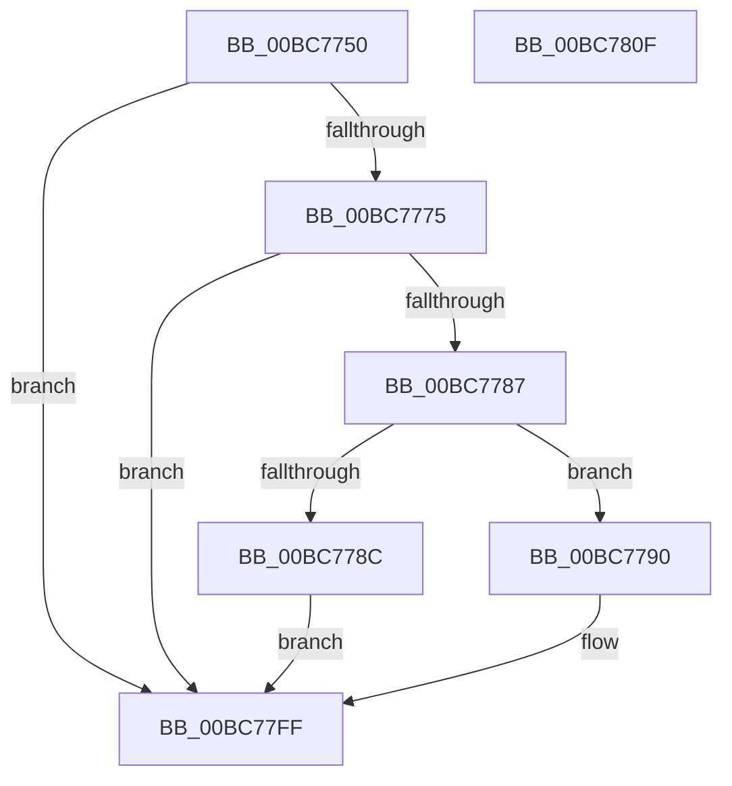

# RtlpIcEmulateGroup11Instruction

- RVA: `0x00BC7750`–`0x00BC7810` (길이 `192` bytes)
- VA: `0x0000000140BC7750`
- 실행 섹션: `TRACESUP`
- PDB 이름 있음: `예`; PDB Function 태그: `아니요`
- unwind 정보 RVA: `0x000D0050`
- 디코드: `49`개 명령, `192/192` bytes 표시
- 미해석 바이트: `0` (있으면 어셈블리에 `.byte`로 보존)

> 이 문서는 커널 이미지의 기계어와 PDB 기호를 분석해 생성했습니다. 4번과 5번은 함수 원형과 자료형을 바이너리 사용 방식에서 추정한 C 해석이며 원본 소스 복구 결과는 아닙니다.

## 1. Dependencies

- 직접 호출 지점: **4**; 고유 호출 대상: **4**
- 직접 호출자로 확인된 함수: **1**
- RIP 상대 이미지 참조: **0**

### Outgoing calls
- `0x00BC7768` → [RtlpIcDecodeModRm](RtlpIcDecodeModRm_function_00BC72B0.md) (function, `0x00BC72B0`)
- `0x00BC777E` → [RtlpIcFetchImmediateOperand](RtlpIcFetchImmediateOperand_function_00BC83D8.md) (function, `0x00BC83D8`)
- `0x00BC77C0` → [RtlpIcDecodeModRmOperand](RtlpIcDecodeModRmOperand_function_00BC739C.md) (function, `0x00BC739C`)
- `0x00BC77FA` → [RtlpIcAccessMemory](RtlpIcAccessMemory_function_00BC7198.md) (function, `0x00BC7198`)

### Direct callers
- [RtlpIcEmulateInstruction](RtlpIcEmulateInstruction_function_00BC7A08.md) at `0x00BC8027`

### Static image references
- 디코드된 RIP-relative 메모리 참조가 없습니다.

## 2. Other-region calls and transfers

- 다른 실행 섹션으로 향하는 call: **0**
- 별도 외부 분기/꼬리 이동을 확인하지 못했습니다.

## 3. Assembly (complete function range)

```asm
00BC7750  48 89 5C 24 08                  mov qword ptr [rsp + 8], rbx
00BC7755  48 89 74 24 10                  mov qword ptr [rsp + 0x10], rsi
00BC775A  57                              push rdi
00BC775B  48 83 EC 60                     sub rsp, 0x60
00BC775F  49 8B F0                        mov rsi, r8
00BC7762  48 8B DA                        mov rbx, rdx
00BC7765  48 8B F9                        mov rdi, rcx
00BC7768  E8 43 FB FF FF                  call 0x140bc72b0
00BC776D  85 C0                           test eax, eax
00BC776F  0F 88 8A 00 00 00               js 0x140bc77ff
00BC7775  4C 8B C6                        mov r8, rsi
00BC7778  48 8B D3                        mov rdx, rbx
00BC777B  48 8B CF                        mov rcx, rdi
00BC777E  E8 55 0C 00 00                  call 0x140bc83d8
00BC7783  85 C0                           test eax, eax
00BC7785  78 78                           js 0x140bc77ff
00BC7787  48 85 DB                        test rbx, rbx
00BC778A  75 04                           jne 0x140bc7790
00BC778C  33 C0                           xor eax, eax
00BC778E  EB 6F                           jmp 0x140bc77ff
00BC7790  48 83 64 24 48 00               and qword ptr [rsp + 0x48], 0
00BC7796  48 8D 84 24 88 00 00 00         lea rax, [rsp + 0x88]
00BC779E  4C 8D 4C 24 40                  lea r9, [rsp + 0x40]
00BC77A3  48 89 44 24 20                  mov qword ptr [rsp + 0x20], rax
00BC77A8  4C 8D 44 24 48                  lea r8, [rsp + 0x48]
00BC77AD  C6 44 24 40 00                  mov byte ptr [rsp + 0x40], 0
00BC77B2  48 8B D3                        mov rdx, rbx
00BC77B5  C6 84 24 88 00 00 00 00         mov byte ptr [rsp + 0x88], 0
00BC77BD  48 8B CF                        mov rcx, rdi
00BC77C0  E8 D7 FB FF FF                  call 0x140bc739c
00BC77C5  48 8B 47 20                     mov rax, qword ptr [rdi + 0x20]
00BC77C9  48 8D 54 24 50                  lea rdx, [rsp + 0x50]
00BC77CE  44 8A 4C 24 40                  mov r9b, byte ptr [rsp + 0x40]
00BC77D3  48 8B CB                        mov rcx, rbx
00BC77D6  4C 8B 44 24 48                  mov r8, qword ptr [rsp + 0x48]
00BC77DB  48 89 44 24 50                  mov qword ptr [rsp + 0x50], rax
00BC77E0  8A 47 01                        mov al, byte ptr [rdi + 1]
00BC77E3  C0 E8 03                        shr al, 3
00BC77E6  C6 44 24 30 01                  mov byte ptr [rsp + 0x30], 1
00BC77EB  88 44 24 28                     mov byte ptr [rsp + 0x28], al
00BC77EF  8A 84 24 88 00 00 00            mov al, byte ptr [rsp + 0x88]
00BC77F6  88 44 24 20                     mov byte ptr [rsp + 0x20], al
00BC77FA  E8 99 F9 FF FF                  call 0x140bc7198
00BC77FF  48 8B 5C 24 70                  mov rbx, qword ptr [rsp + 0x70]
00BC7804  48 8B 74 24 78                  mov rsi, qword ptr [rsp + 0x78]
00BC7809  48 83 C4 60                     add rsp, 0x60
00BC780D  5F                              pop rdi
00BC780E  C3                              ret
00BC780F  CC                              int3
```

## 4. C-style interpretation (structured pseudocode)

```c
__int64 __fastcall RtlpIcEmulateGroup11Instruction(__int64 a1, __int64 a2, __int64 a3)
{
    __int64 result;
    __int64 v_rsp;
    unsigned __int64 v_stack_m18;
    unsigned __int64 v_stack_m20;
    unsigned __int64 v_stack_m28;
    unsigned __int8 v_stack_m38;
    unsigned __int8 v_stack_m40;
    unsigned __int64 v_stack_m48;
    unsigned __int64 v_stack_p10;
    unsigned __int64 v_stack_p20;
    unsigned __int64 v_stack_p8;

    v_stack_p8 = v_rbx;
    v_stack_p10 = v_rsi;
    v_rsp = (v_rsp) - (96);
    result = RtlpIcDecodeModRm(a1, a2, a3, a4);
    if (sign_flag) goto loc_00BC77FF;
    result = RtlpIcFetchImmediateOperand(a1, a2, a3, a4);
    if (sign_flag) goto loc_00BC77FF;
    if (a2 != 0) goto loc_00BC7790;
    result = 0;
    goto loc_00BC77FF;
loc_00BC7790:
    v_stack_m48 = v_stack_p20;
    v_stack_m28 = 0;
    v_stack_p20 = 0;
    result = RtlpIcDecodeModRmOperand(a1, a2, v_stack_m20, v_stack_m28);
    v_stack_m18 = *(unsigned __int64 *)(a1 + 32);
    result = (unsigned __int8)((*(unsigned __int8 *)(a1 + 1)) >> (3));
    v_stack_m38 = 1;
    v_stack_m40 = (unsigned __int8)(result);
    v_stack_m48 = (unsigned __int8)(v_stack_p20);
    result = RtlpIcAccessMemory(a2, v_stack_m18, v_stack_m20, v_stack_m28);
loc_00BC77FF:
    v_rsp = (v_rsp) + (96);
    return result;
}
```

## 5. (Beta) C Style

```c
int64_t RtlpIcEmulateGroup11Instruction(void *Arg1, int64_t Arg2, int64_t Arg3)
{
    uint8_t *arg1 = (uint8_t *)Arg1;

    int64_t result;
    int64_t local_rsp;
    uint64_t v_stack_m18;
    uint64_t v_stack_m20;
    uint64_t v_stack_m28;
    uint8_t v_stack_m38;
    uint8_t v_stack_m40;
    uint64_t v_stack_m48;
    uint64_t v_stack_p10;
    uint64_t v_stack_p20;
    uint64_t v_stack_p8;

    v_stack_p8 = local_rbx;
    v_stack_p10 = local_rsi;
    local_rsp = (local_rsp) - (96);
    result = RtlpIcDecodeModRm(Arg1, Arg2, Arg3, a4);
    if (sign_flag) goto loc_00BC77FF;
    result = RtlpIcFetchImmediateOperand(Arg1, Arg2, Arg3, a4);
    if (sign_flag) goto loc_00BC77FF;
    if (Arg2 != 0) goto loc_00BC7790;
    result = 0;
    goto loc_00BC77FF;
loc_00BC7790:
    v_stack_m48 = v_stack_p20;
    v_stack_m28 = 0;
    v_stack_p20 = 0;
    result = RtlpIcDecodeModRmOperand(Arg1, Arg2, v_stack_m20, v_stack_m28);
    v_stack_m18 = *(uint64_t *)(arg1 + 0x20);
    result = (uint8_t)((*(uint8_t *)(arg1 + 0x1)) >> (3));
    v_stack_m38 = 1;
    v_stack_m40 = (uint8_t)(result);
    v_stack_m48 = (uint8_t)(v_stack_p20);
    result = RtlpIcAccessMemory(Arg2, v_stack_m18, v_stack_m20, v_stack_m28);
loc_00BC77FF:
    local_rsp = (local_rsp) + (96);
    return result;
}
```

### 관측된 메모리 오프셋

구조체 형식이 확인되지 않은 접근은 인자 기준의 오프셋으로만 기록했습니다.

| 기준 인자 | 오프셋 표현 | 폭 (bit) | 접근 |
|---|---:|---:|---|
| `Arg1` | `+ 0x1` | `8` | `R` |
| `Arg1` | `+ 0x20` | `64` | `R` |

## 6. Execution-region graph

[열기: 2D/3D 그래프와 함수 탐색 컨트롤 패널](../../../control-panel.html?section=tracesup&rva=0x00BC7750&view=graph)

- 2D 그래프는 위에서 아래로 흐르고, 3D 그래프는 빈 공간을 드래그해 회전합니다. Shift+드래그는 이동, 휠은 확대·축소, 함수 노드 선택은 대상 보고서 이동입니다.

### Static fallback


