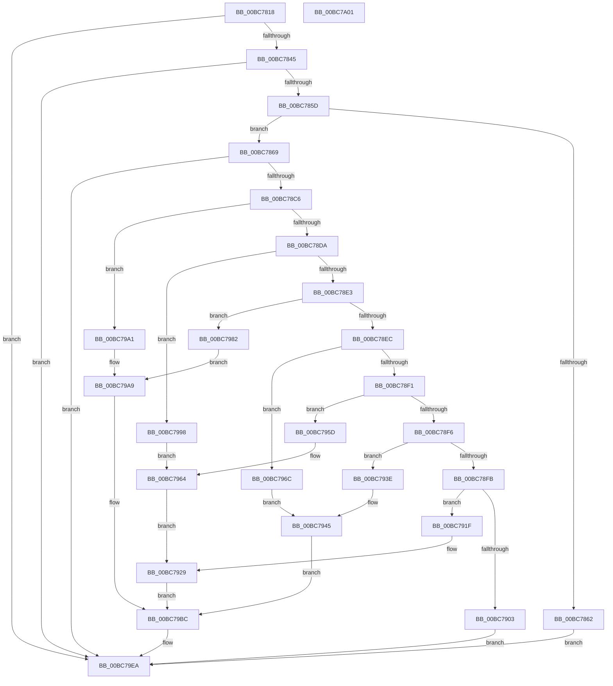

# RtlpIcEmulateGroup1Instruction

- RVA: `0x00BC7818`–`0x00BC7A02` (길이 `490` bytes)
- VA: `0x0000000140BC7818`
- 실행 섹션: `TRACESUP`
- PDB 이름 있음: `예`; PDB Function 태그: `아니요`
- unwind 정보 RVA: `0x000D0064`
- 디코드: `141`개 명령, `490/490` bytes 표시
- 미해석 바이트: `0` (있으면 어셈블리에 `.byte`로 보존)

> 이 문서는 커널 이미지의 기계어와 PDB 기호를 분석해 생성했습니다. 4번과 5번은 함수 원형과 자료형을 바이너리 사용 방식에서 추정한 C 해석이며 원본 소스 복구 결과는 아닙니다.

## 1. Dependencies

- 직접 호출 지점: **9**; 고유 호출 대상: **8**
- 직접 호출자로 확인된 함수: **1**
- RIP 상대 이미지 참조: **0**

### Outgoing calls
- `0x00BC7836` → [RtlpIcDecodeModRm](RtlpIcDecodeModRm_function_00BC72B0.md) (function, `0x00BC72B0`)
- `0x00BC784E` → [RtlpIcFetchImmediateOperand](RtlpIcFetchImmediateOperand_function_00BC83D8.md) (function, `0x00BC83D8`)
- `0x00BC7892` → [RtlpIcDecodeModRmOperand](RtlpIcDecodeModRmOperand_function_00BC739C.md) (function, `0x00BC739C`)
- `0x00BC78B7` → [RtlpIcReadOperandValue](RtlpIcReadOperandValue_function_00BC8634.md) (function, `0x00BC8634`)
- `0x00BC7915` → [RtlpIcSetFlagsSub](RtlpIcSetFlagsSub_function_00BC8784.md) (function, `0x00BC8784`)
- `0x00BC7937` → [RtlpIcSetFlagsZeroSignParity](RtlpIcSetFlagsZeroSignParity_function_00BC8888.md) (function, `0x00BC8888`)
- `0x00BC7956` → [RtlpIcSetFlagsSub](RtlpIcSetFlagsSub_function_00BC8784.md) (function, `0x00BC8784`)
- `0x00BC79B7` → [RtlpIcSetFlagsAdd](RtlpIcSetFlagsAdd_function_00BC8698.md) (function, `0x00BC8698`)
- `0x00BC79E3` → [RtlpIcAccessMemory](RtlpIcAccessMemory_function_00BC7198.md) (function, `0x00BC7198`)

### Direct callers
- [RtlpIcEmulateInstruction](RtlpIcEmulateInstruction_function_00BC7A08.md) at `0x00BC7BD8`

### Static image references
- 디코드된 RIP-relative 메모리 참조가 없습니다.

## 2. Other-region calls and transfers

- 다른 실행 섹션으로 향하는 call: **0**
- 별도 외부 분기/꼬리 이동을 확인하지 못했습니다.

## 3. Assembly (complete function range)

```asm
00BC7818  48 89 5C 24 08                  mov qword ptr [rsp + 8], rbx
00BC781D  48 89 74 24 10                  mov qword ptr [rsp + 0x10], rsi
00BC7822  55                              push rbp
00BC7823  57                              push rdi
00BC7824  41 56                           push r14
00BC7826  48 8B EC                        mov rbp, rsp
00BC7829  48 83 EC 60                     sub rsp, 0x60
00BC782D  4D 8B F0                        mov r14, r8
00BC7830  48 8B FA                        mov rdi, rdx
00BC7833  48 8B F1                        mov rsi, rcx
00BC7836  E8 75 FA FF FF                  call 0x140bc72b0
00BC783B  8B D8                           mov ebx, eax
00BC783D  85 C0                           test eax, eax
00BC783F  0F 88 A5 01 00 00               js 0x140bc79ea
00BC7845  4D 8B C6                        mov r8, r14
00BC7848  48 8B D7                        mov rdx, rdi
00BC784B  48 8B CE                        mov rcx, rsi
00BC784E  E8 85 0B 00 00                  call 0x140bc83d8
00BC7853  8B D8                           mov ebx, eax
00BC7855  85 C0                           test eax, eax
00BC7857  0F 88 8D 01 00 00               js 0x140bc79ea
00BC785D  48 85 FF                        test rdi, rdi
00BC7860  75 07                           jne 0x140bc7869
00BC7862  33 DB                           xor ebx, ebx
00BC7864  E9 81 01 00 00                  jmp 0x140bc79ea
00BC7869  48 83 65 E8 00                  and qword ptr [rbp - 0x18], 0
00BC786E  48 8D 45 E0                     lea rax, [rbp - 0x20]
00BC7872  48 83 65 F0 00                  and qword ptr [rbp - 0x10], 0
00BC7877  4C 8D 4D 38                     lea r9, [rbp + 0x38]
00BC787B  4C 8D 45 F0                     lea r8, [rbp - 0x10]
00BC787F  48 89 44 24 20                  mov qword ptr [rsp + 0x20], rax
00BC7884  48 8B D7                        mov rdx, rdi
00BC7887  C6 45 38 00                     mov byte ptr [rbp + 0x38], 0
00BC788B  48 8B CE                        mov rcx, rsi
00BC788E  C6 45 E0 00                     mov byte ptr [rbp - 0x20], 0
00BC7892  E8 05 FB FF FF                  call 0x140bc739c
00BC7897  44 8A 75 E0                     mov r14b, byte ptr [rbp - 0x20]
00BC789B  48 8D 45 E8                     lea rax, [rbp - 0x18]
00BC789F  44 8A 4D 38                     mov r9b, byte ptr [rbp + 0x38]
00BC78A3  48 8B D7                        mov rdx, rdi
00BC78A6  4C 8B 45 F0                     mov r8, qword ptr [rbp - 0x10]
00BC78AA  48 8B CE                        mov rcx, rsi
00BC78AD  48 89 44 24 28                  mov qword ptr [rsp + 0x28], rax
00BC78B2  44 88 74 24 20                  mov byte ptr [rsp + 0x20], r14b
00BC78B7  E8 78 0D 00 00                  call 0x140bc8634
00BC78BC  8B D8                           mov ebx, eax
00BC78BE  85 C0                           test eax, eax
00BC78C0  0F 88 24 01 00 00               js 0x140bc79ea
00BC78C6  0F B6 4E 1A                     movzx ecx, byte ptr [rsi + 0x1a]
00BC78CA  48 8B 56 20                     mov rdx, qword ptr [rsi + 0x20]
00BC78CE  C1 E9 03                        shr ecx, 3
00BC78D1  83 E1 07                        and ecx, 7
00BC78D4  0F 84 C7 00 00 00               je 0x140bc79a1
00BC78DA  83 E9 01                        sub ecx, 1
00BC78DD  0F 84 B5 00 00 00               je 0x140bc7998
00BC78E3  83 E9 01                        sub ecx, 1
00BC78E6  0F 84 96 00 00 00               je 0x140bc7982
00BC78EC  83 E9 01                        sub ecx, 1
00BC78EF  74 7B                           je 0x140bc796c
00BC78F1  83 E9 01                        sub ecx, 1
00BC78F4  74 67                           je 0x140bc795d
00BC78F6  83 E9 01                        sub ecx, 1
00BC78F9  74 43                           je 0x140bc793e
00BC78FB  83 F9 01                        cmp ecx, 1
00BC78FE  48 8B CE                        mov rcx, rsi
00BC7901  74 1C                           je 0x140bc791f
00BC7903  4C 8B 4D E8                     mov r9, qword ptr [rbp - 0x18]
00BC7907  4D 8B C1                        mov r8, r9
00BC790A  48 89 54 24 20                  mov qword ptr [rsp + 0x20], rdx
00BC790F  4C 2B C2                        sub r8, rdx
00BC7912  48 8B D7                        mov rdx, rdi
00BC7915  E8 6A 0E 00 00                  call 0x140bc8784
00BC791A  E9 CB 00 00 00                  jmp 0x140bc79ea
00BC791F  48 33 55 E8                     xor rdx, qword ptr [rbp - 0x18]
00BC7923  48 8B DA                        mov rbx, rdx
00BC7926  4C 8B C2                        mov r8, rdx
00BC7929  48 8B 47 08                     mov rax, qword ptr [rdi + 8]
00BC792D  48 8B D7                        mov rdx, rdi
00BC7930  81 60 44 FE F7 FF FF            and dword ptr [rax + 0x44], 0xfffff7fe
00BC7937  E8 4C 0F 00 00                  call 0x140bc8888
00BC793C  EB 7E                           jmp 0x140bc79bc
00BC793E  4C 8B 4D E8                     mov r9, qword ptr [rbp - 0x18]
00BC7942  49 8B D9                        mov rbx, r9
00BC7945  48 2B DA                        sub rbx, rdx
00BC7948  48 89 54 24 20                  mov qword ptr [rsp + 0x20], rdx
00BC794D  4C 8B C3                        mov r8, rbx
00BC7950  48 8B D7                        mov rdx, rdi
00BC7953  48 8B CE                        mov rcx, rsi
00BC7956  E8 29 0E 00 00                  call 0x140bc8784
00BC795B  EB 5F                           jmp 0x140bc79bc
00BC795D  48 8B DA                        mov rbx, rdx
00BC7960  48 23 5D E8                     and rbx, qword ptr [rbp - 0x18]
00BC7964  4C 8B C3                        mov r8, rbx
00BC7967  48 8B CE                        mov rcx, rsi
00BC796A  EB BD                           jmp 0x140bc7929
00BC796C  48 8B 47 08                     mov rax, qword ptr [rdi + 8]
00BC7970  4C 8B 4D E8                     mov r9, qword ptr [rbp - 0x18]
00BC7974  49 8B D9                        mov rbx, r9
00BC7977  8B 48 44                        mov ecx, dword ptr [rax + 0x44]
00BC797A  83 E1 01                        and ecx, 1
00BC797D  48 2B D9                        sub rbx, rcx
00BC7980  EB C3                           jmp 0x140bc7945
00BC7982  48 8B 47 08                     mov rax, qword ptr [rdi + 8]
00BC7986  4C 8B 4D E8                     mov r9, qword ptr [rbp - 0x18]
00BC798A  8B 58 44                        mov ebx, dword ptr [rax + 0x44]
00BC798D  83 E3 01                        and ebx, 1
00BC7990  48 03 DA                        add rbx, rdx
00BC7993  49 03 D9                        add rbx, r9
00BC7996  EB 11                           jmp 0x140bc79a9
00BC7998  48 8B DA                        mov rbx, rdx
00BC799B  48 0B 5D E8                     or rbx, qword ptr [rbp - 0x18]
00BC799F  EB C3                           jmp 0x140bc7964
00BC79A1  4C 8B 4D E8                     mov r9, qword ptr [rbp - 0x18]
00BC79A5  4A 8D 1C 0A                     lea rbx, [rdx + r9]
00BC79A9  48 89 54 24 20                  mov qword ptr [rsp + 0x20], rdx
00BC79AE  4C 8B C3                        mov r8, rbx
00BC79B1  48 8B D7                        mov rdx, rdi
00BC79B4  48 8B CE                        mov rcx, rsi
00BC79B7  E8 DC 0C 00 00                  call 0x140bc8698
00BC79BC  8A 46 01                        mov al, byte ptr [rsi + 1]
00BC79BF  48 8D 55 F8                     lea rdx, [rbp - 8]
00BC79C3  44 8A 4D 38                     mov r9b, byte ptr [rbp + 0x38]
00BC79C7  48 8B CF                        mov rcx, rdi
00BC79CA  4C 8B 45 F0                     mov r8, qword ptr [rbp - 0x10]
00BC79CE  C0 E8 03                        shr al, 3
00BC79D1  C6 44 24 30 01                  mov byte ptr [rsp + 0x30], 1
00BC79D6  88 44 24 28                     mov byte ptr [rsp + 0x28], al
00BC79DA  44 88 74 24 20                  mov byte ptr [rsp + 0x20], r14b
00BC79DF  48 89 5D F8                     mov qword ptr [rbp - 8], rbx
00BC79E3  E8 B0 F7 FF FF                  call 0x140bc7198
00BC79E8  8B D8                           mov ebx, eax
00BC79EA  4C 8D 5C 24 60                  lea r11, [rsp + 0x60]
00BC79EF  8B C3                           mov eax, ebx
00BC79F1  49 8B 5B 20                     mov rbx, qword ptr [r11 + 0x20]
00BC79F5  49 8B 73 28                     mov rsi, qword ptr [r11 + 0x28]
00BC79F9  49 8B E3                        mov rsp, r11
00BC79FC  41 5E                           pop r14
00BC79FE  5F                              pop rdi
00BC79FF  5D                              pop rbp
00BC7A00  C3                              ret
00BC7A01  CC                              int3
```

## 4. C-style interpretation (structured pseudocode)

```c
__int64 __fastcall RtlpIcEmulateGroup1Instruction(__int64 a1, __int64 a2, __int64 a3)
{
    __int64 result;
    __int64 v_rbx;
    __int64 v_rsp;
    unsigned __int64 v_stack_m18;
    unsigned __int64 v_stack_m20;
    unsigned __int64 v_stack_m28;
    unsigned __int64 v_stack_m30;
    unsigned __int64 v_stack_m38;
    unsigned __int8 v_stack_m48;
    unsigned __int64 v_stack_m50;
    unsigned __int64 v_stack_m58;
    unsigned __int64 v_stack_p10;
    unsigned __int64 v_stack_p20;
    unsigned __int64 v_stack_p8;

    v_stack_p8 = v_rbx;
    v_stack_p10 = v_rsi;
    v_rsp = (v_rsp) - (96);
    result = RtlpIcDecodeModRm(a1, a2, a3, a4);
    if (sign_flag) goto loc_00BC79EA;
    result = RtlpIcFetchImmediateOperand(a1, a2, a3, a4);
    if (sign_flag) goto loc_00BC79EA;
    if (a2 != 0) goto loc_00BC7869;
    v_rbx = 0;
    goto loc_00BC79EA;
loc_00BC7869:
    v_stack_m58 = v_stack_m38;
    v_stack_p20 = 0;
    v_stack_m38 = 0;
    result = RtlpIcDecodeModRmOperand(a1, a2, v_stack_m28, v_stack_p20);
    v_stack_m50 = v_stack_m30;
    v_stack_m58 = (unsigned __int8)(v_stack_m38);
    result = RtlpIcReadOperandValue(a1, a2, v_stack_m28, v_stack_p20);
    if (sign_flag) goto loc_00BC79EA;
    a1 = (unsigned int)((*(unsigned __int8 *)(a1 + 26)) >> (3));
    a1 = (unsigned int)((a1) & (7));
    if (condition_is_equal) goto loc_00BC79A1;
    a1 = (unsigned int)((a1) - (1));
    if (condition_is_equal) goto loc_00BC7998;
    a1 = (unsigned int)((a1) - (1));
    if (condition_is_equal) goto loc_00BC7982;
    a1 = (unsigned int)((a1) - (1));
    if (condition_is_equal) goto loc_00BC796C;
    a1 = (unsigned int)((a1) - (1));
    if (condition_is_equal) goto loc_00BC795D;
    a1 = (unsigned int)((a1) - (1));
    if (condition_is_equal) goto loc_00BC793E;
    if (((unsigned int)(a1)) == 1) goto loc_00BC791F;
    v_stack_m58 = *(unsigned __int64 *)(a1 + 32);
    a3 = (v_stack_m30) - (*(unsigned __int64 *)(a1 + 32));
    result = RtlpIcSetFlagsSub(a1, a2, a3, v_stack_m30);
    goto loc_00BC79EA;
loc_00BC791F:
    a2 = (a2) ^ (v_stack_m30);
loc_00BC7929:
    result = RtlpIcSetFlagsZeroSignParity(a1, a2, a2, v_stack_m30);
    goto loc_00BC79BC;
loc_00BC793E:
loc_00BC7945:
    v_rbx = (v_stack_m30) - (a2);
    v_stack_m58 = a2;
    result = RtlpIcSetFlagsSub(a1, a2, v_rbx, v_stack_m30);
    goto loc_00BC79BC;
loc_00BC795D:
    v_rbx = (a2) & (v_stack_m30);
loc_00BC7964:
    goto loc_00BC7929;
loc_00BC796C:
    a1 = (unsigned int)(((unsigned int)(*(unsigned int *)(*(unsigned __int64 *)(a2 + 8) + 68))) & (1));
    v_rbx = (v_stack_m30) - (a1);
    goto loc_00BC7945;
loc_00BC7982:
    v_rbx = (unsigned int)(((unsigned int)(*(unsigned int *)(*(unsigned __int64 *)(a2 + 8) + 68))) & (1));
    v_rbx = (v_rbx) + (a2);
    v_rbx = (v_rbx) + (v_stack_m30);
    goto loc_00BC79A9;
loc_00BC7998:
    v_rbx = (a2) | (v_stack_m30);
    goto loc_00BC7964;
loc_00BC79A1:
loc_00BC79A9:
    v_stack_m58 = a2;
    result = RtlpIcSetFlagsAdd(a1, a2, a2 + v_stack_m30 * 1, v_stack_m30);
loc_00BC79BC:
    result = (unsigned __int8)((*(unsigned __int8 *)(a1 + 1)) >> (3));
    v_stack_m48 = 1;
    v_stack_m50 = (unsigned __int8)(result);
    v_stack_m58 = (unsigned __int8)(v_stack_m38);
    v_stack_m20 = a2 + v_stack_m30 * 1;
    result = RtlpIcAccessMemory(a2, v_stack_m20, v_stack_m28, v_stack_p20);
loc_00BC79EA:
    return (unsigned int)((unsigned int)((unsigned int)((unsigned int)(result))));
}
```

## 5. (Beta) C Style

```c
int64_t RtlpIcEmulateGroup1Instruction(void *Arg1, int64_t Arg2, int64_t Arg3)
{
    uint8_t *arg1 = (uint8_t *)Arg1;

    int64_t result;
    int64_t local_rbx;
    int64_t local_rsp;
    uint64_t v_stack_m18;
    uint64_t v_stack_m20;
    uint64_t v_stack_m28;
    uint64_t v_stack_m30;
    uint64_t v_stack_m38;
    uint8_t v_stack_m48;
    uint64_t v_stack_m50;
    uint64_t v_stack_m58;
    uint64_t v_stack_p10;
    uint64_t v_stack_p20;
    uint64_t v_stack_p8;

    v_stack_p8 = local_rbx;
    v_stack_p10 = local_rsi;
    local_rsp = (local_rsp) - (96);
    result = RtlpIcDecodeModRm(Arg1, Arg2, Arg3, a4);
    if (sign_flag) goto loc_00BC79EA;
    result = RtlpIcFetchImmediateOperand(Arg1, Arg2, Arg3, a4);
    if (sign_flag) goto loc_00BC79EA;
    if (Arg2 != 0) goto loc_00BC7869;
    local_rbx = 0;
    goto loc_00BC79EA;
loc_00BC7869:
    v_stack_m58 = v_stack_m38;
    v_stack_p20 = 0;
    v_stack_m38 = 0;
    result = RtlpIcDecodeModRmOperand(Arg1, Arg2, v_stack_m28, v_stack_p20);
    v_stack_m50 = v_stack_m30;
    v_stack_m58 = (uint8_t)(v_stack_m38);
    result = RtlpIcReadOperandValue(Arg1, Arg2, v_stack_m28, v_stack_p20);
    if (sign_flag) goto loc_00BC79EA;
    Arg1 = (uint32_t)((*(uint8_t *)(arg1 + 0x1A)) >> (3));
    Arg1 = (uint32_t)((Arg1) & (7));
    if (condition_is_equal) goto loc_00BC79A1;
    Arg1 = (uint32_t)((Arg1) - (1));
    if (condition_is_equal) goto loc_00BC7998;
    Arg1 = (uint32_t)((Arg1) - (1));
    if (condition_is_equal) goto loc_00BC7982;
    Arg1 = (uint32_t)((Arg1) - (1));
    if (condition_is_equal) goto loc_00BC796C;
    Arg1 = (uint32_t)((Arg1) - (1));
    if (condition_is_equal) goto loc_00BC795D;
    Arg1 = (uint32_t)((Arg1) - (1));
    if (condition_is_equal) goto loc_00BC793E;
    if (((uint32_t)(Arg1)) == 1) goto loc_00BC791F;
    v_stack_m58 = *(uint64_t *)(arg1 + 0x20);
    Arg3 = (v_stack_m30) - (*(uint64_t *)(arg1 + 0x20));
    result = RtlpIcSetFlagsSub(Arg1, Arg2, Arg3, v_stack_m30);
    goto loc_00BC79EA;
loc_00BC791F:
    Arg2 = (Arg2) ^ (v_stack_m30);
loc_00BC7929:
    result = RtlpIcSetFlagsZeroSignParity(Arg1, Arg2, Arg2, v_stack_m30);
    goto loc_00BC79BC;
loc_00BC793E:
loc_00BC7945:
    local_rbx = (v_stack_m30) - (Arg2);
    v_stack_m58 = Arg2;
    result = RtlpIcSetFlagsSub(Arg1, Arg2, local_rbx, v_stack_m30);
    goto loc_00BC79BC;
loc_00BC795D:
    local_rbx = (Arg2) & (v_stack_m30);
loc_00BC7964:
    goto loc_00BC7929;
loc_00BC796C:
    Arg1 = (uint32_t)(((uint32_t)(*(uint32_t *)(*(uint64_t *)(Arg2 + 0x8) + 0x44))) & (1));
    local_rbx = (v_stack_m30) - (Arg1);
    goto loc_00BC7945;
loc_00BC7982:
    local_rbx = (uint32_t)(((uint32_t)(*(uint32_t *)(*(uint64_t *)(Arg2 + 0x8) + 0x44))) & (1));
    local_rbx = (local_rbx) + (Arg2);
    local_rbx = (local_rbx) + (v_stack_m30);
    goto loc_00BC79A9;
loc_00BC7998:
    local_rbx = (Arg2) | (v_stack_m30);
    goto loc_00BC7964;
loc_00BC79A1:
loc_00BC79A9:
    v_stack_m58 = Arg2;
    result = RtlpIcSetFlagsAdd(Arg1, Arg2, Arg2 + v_stack_m30 * 1, v_stack_m30);
loc_00BC79BC:
    result = (uint8_t)((*(uint8_t *)(arg1 + 0x1)) >> (3));
    v_stack_m48 = 1;
    v_stack_m50 = (uint8_t)(result);
    v_stack_m58 = (uint8_t)(v_stack_m38);
    v_stack_m20 = Arg2 + v_stack_m30 * 1;
    result = RtlpIcAccessMemory(Arg2, v_stack_m20, v_stack_m28, v_stack_p20);
loc_00BC79EA:
    return (uint32_t)((uint32_t)((uint32_t)((uint32_t)(result))));
}
```

### 관측된 메모리 오프셋

구조체 형식이 확인되지 않은 접근은 인자 기준의 오프셋으로만 기록했습니다.

| 기준 인자 | 오프셋 표현 | 폭 (bit) | 접근 |
|---|---:|---:|---|
| `Arg1` | `+ 0x1` | `8` | `R` |
| `Arg1` | `+ 0x1A` | `8` | `R` |
| `Arg1` | `+ 0x20` | `64` | `R` |

## 6. Execution-region graph

[열기: 2D/3D 그래프와 함수 탐색 컨트롤 패널](../../../control-panel.html?section=tracesup&rva=0x00BC7818&view=graph)

- 2D 그래프는 위에서 아래로 흐르고, 3D 그래프는 빈 공간을 드래그해 회전합니다. Shift+드래그는 이동, 휠은 확대·축소, 함수 노드 선택은 대상 보고서 이동입니다.

### Static fallback


