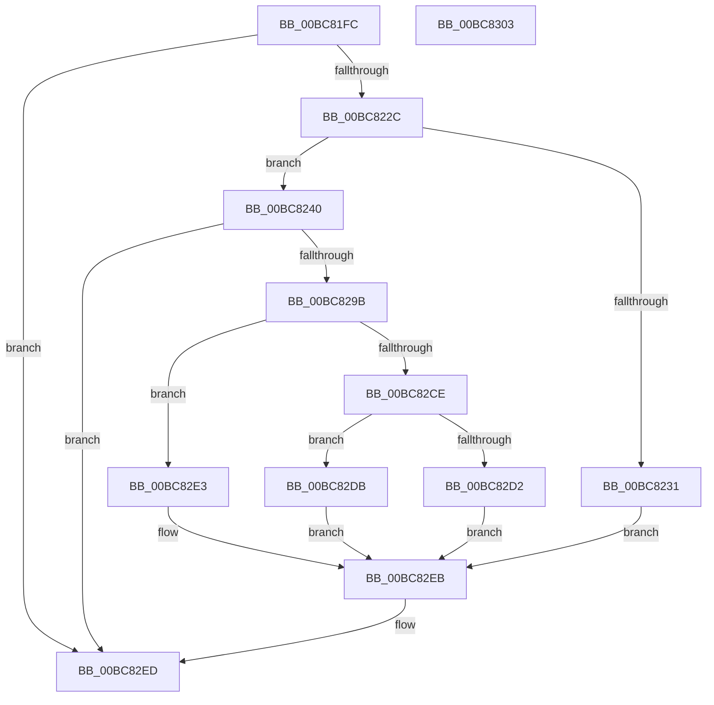

# RtlpIcEmulateMovzx

- RVA: `0x00BC81FC`–`0x00BC8304` (길이 `264` bytes)
- VA: `0x0000000140BC81FC`
- 실행 섹션: `TRACESUP`
- PDB 이름 있음: `예`; PDB Function 태그: `아니요`
- unwind 정보 RVA: `0x000BF5C8`
- 디코드: `75`개 명령, `264/264` bytes 표시
- 미해석 바이트: `0` (있으면 어셈블리에 `.byte`로 보존)

> 이 문서는 커널 이미지의 기계어와 PDB 기호를 분석해 생성했습니다. 4번과 5번은 함수 원형과 자료형을 바이너리 사용 방식에서 추정한 C 해석이며 원본 소스 복구 결과는 아닙니다.

## 1. Dependencies

- 직접 호출 지점: **4**; 고유 호출 대상: **4**
- 직접 호출자로 확인된 함수: **1**
- RIP 상대 이미지 참조: **0**

### Outgoing calls
- `0x00BC821F` → [RtlpIcDecodeModRm](RtlpIcDecodeModRm_function_00BC72B0.md) (function, `0x00BC72B0`)
- `0x00BC8264` → [RtlpIcDecodeModRmOperand](RtlpIcDecodeModRmOperand_function_00BC739C.md) (function, `0x00BC739C`)
- `0x00BC8292` → [RtlpIcAccessMemory](RtlpIcAccessMemory_function_00BC7198.md) (function, `0x00BC7198`)
- `0x00BC82BF` → [RtlpIcGetRegisterAddressByIndex](RtlpIcGetRegisterAddressByIndex_function_00BC8498.md) (function, `0x00BC8498`)

### Direct callers
- [RtlpIcEmulateInstruction](RtlpIcEmulateInstruction_function_00BC7A08.md) at `0x00BC7C2C`

### Static image references
- 디코드된 RIP-relative 메모리 참조가 없습니다.

## 2. Other-region calls and transfers

- 다른 실행 섹션으로 향하는 call: **0**
- 별도 외부 분기/꼬리 이동을 확인하지 못했습니다.

## 3. Assembly (complete function range)

```asm
00BC81FC  48 89 5C 24 08                  mov qword ptr [rsp + 8], rbx
00BC8201  48 89 74 24 10                  mov qword ptr [rsp + 0x10], rsi
00BC8206  48 89 7C 24 18                  mov qword ptr [rsp + 0x18], rdi
00BC820B  55                              push rbp
00BC820C  48 8B EC                        mov rbp, rsp
00BC820F  48 83 EC 60                     sub rsp, 0x60
00BC8213  41 8A F0                        mov sil, r8b
00BC8216  48 8B FA                        mov rdi, rdx
00BC8219  4D 8B C1                        mov r8, r9
00BC821C  48 8B D9                        mov rbx, rcx
00BC821F  E8 8C F0 FF FF                  call 0x140bc72b0
00BC8224  85 C0                           test eax, eax
00BC8226  0F 88 C1 00 00 00               js 0x140bc82ed
00BC822C  48 85 FF                        test rdi, rdi
00BC822F  75 0F                           jne 0x140bc8240
00BC8231  8A 43 01                        mov al, byte ptr [rbx + 1]
00BC8234  88 43 02                        mov byte ptr [rbx + 2], al
00BC8237  40 88 73 01                     mov byte ptr [rbx + 1], sil
00BC823B  E9 AB 00 00 00                  jmp 0x140bc82eb
00BC8240  48 83 65 F0 00                  and qword ptr [rbp - 0x10], 0
00BC8245  48 8D 45 E0                     lea rax, [rbp - 0x20]
00BC8249  4C 8D 4D E1                     lea r9, [rbp - 0x1f]
00BC824D  48 89 44 24 20                  mov qword ptr [rsp + 0x20], rax
00BC8252  4C 8D 45 F0                     lea r8, [rbp - 0x10]
00BC8256  C6 45 E1 00                     mov byte ptr [rbp - 0x1f], 0
00BC825A  48 8B D7                        mov rdx, rdi
00BC825D  C6 45 E0 00                     mov byte ptr [rbp - 0x20], 0
00BC8261  48 8B CB                        mov rcx, rbx
00BC8264  E8 33 F1 FF FF                  call 0x140bc739c
00BC8269  8A 45 E0                        mov al, byte ptr [rbp - 0x20]
00BC826C  48 8D 55 E8                     lea rdx, [rbp - 0x18]
00BC8270  44 8A 4D E1                     mov r9b, byte ptr [rbp - 0x1f]
00BC8274  48 8B CF                        mov rcx, rdi
00BC8277  4C 8B 45 F0                     mov r8, qword ptr [rbp - 0x10]
00BC827B  48 83 65 E8 00                  and qword ptr [rbp - 0x18], 0
00BC8280  C6 44 24 30 00                  mov byte ptr [rsp + 0x30], 0
00BC8285  40 C0 EE 03                     shr sil, 3
00BC8289  40 88 74 24 28                  mov byte ptr [rsp + 0x28], sil
00BC828E  88 44 24 20                     mov byte ptr [rsp + 0x20], al
00BC8292  E8 01 EF FF FF                  call 0x140bc7198
00BC8297  85 C0                           test eax, eax
00BC8299  78 52                           js 0x140bc82ed
00BC829B  44 0F B6 43 1A                  movzx r8d, byte ptr [rbx + 0x1a]
00BC82A0  48 8B D7                        mov rdx, rdi
00BC82A3  44 8A 4B 19                     mov r9b, byte ptr [rbx + 0x19]
00BC82A7  48 8B CB                        mov rcx, rbx
00BC82AA  41 C1 E8 03                     shr r8d, 3
00BC82AE  41 C0 E9 02                     shr r9b, 2
00BC82B2  41 83 E0 07                     and r8d, 7
00BC82B6  41 80 E1 01                     and r9b, 1
00BC82BA  C6 44 24 20 00                  mov byte ptr [rsp + 0x20], 0
00BC82BF  E8 D4 01 00 00                  call 0x140bc8498
00BC82C4  4C 8B C8                        mov r9, rax
00BC82C7  8A 43 02                        mov al, byte ptr [rbx + 2]
00BC82CA  3C 10                           cmp al, 0x10
00BC82CC  74 15                           je 0x140bc82e3
00BC82CE  3C 20                           cmp al, 0x20
00BC82D0  74 09                           je 0x140bc82db
00BC82D2  48 8B 4D E8                     mov rcx, qword ptr [rbp - 0x18]
00BC82D6  49 89 09                        mov qword ptr [r9], rcx
00BC82D9  EB 10                           jmp 0x140bc82eb
00BC82DB  8B 45 E8                        mov eax, dword ptr [rbp - 0x18]
00BC82DE  49 89 01                        mov qword ptr [r9], rax
00BC82E1  EB 08                           jmp 0x140bc82eb
00BC82E3  0F B7 45 E8                     movzx eax, word ptr [rbp - 0x18]
00BC82E7  66 41 89 01                     mov word ptr [r9], ax
00BC82EB  33 C0                           xor eax, eax
00BC82ED  4C 8D 5C 24 60                  lea r11, [rsp + 0x60]
00BC82F2  49 8B 5B 10                     mov rbx, qword ptr [r11 + 0x10]
00BC82F6  49 8B 73 18                     mov rsi, qword ptr [r11 + 0x18]
00BC82FA  49 8B 7B 20                     mov rdi, qword ptr [r11 + 0x20]
00BC82FE  49 8B E3                        mov rsp, r11
00BC8301  5D                              pop rbp
00BC8302  C3                              ret
00BC8303  CC                              int3
```

## 4. C-style interpretation (structured pseudocode)

```c
__int64 __fastcall RtlpIcEmulateMovzx(__int64 a1, __int64 a2, unsigned __int8 a3, __int64 a4)
{
    __int64 result;
    __int64 v_rsi;
    __int64 v_rsp;
    unsigned __int64 v_stack_m18;
    unsigned __int64 v_stack_m20;
    unsigned __int64 v_stack_m27;
    unsigned __int64 v_stack_m28;
    unsigned __int8 v_stack_m38;
    unsigned __int8 v_stack_m40;
    unsigned __int64 v_stack_m48;
    unsigned __int64 v_stack_m8;
    unsigned __int64 v_stack_p10;
    unsigned __int64 v_stack_p18;
    unsigned __int64 v_stack_p8;

    v_stack_p8 = v_rbx;
    v_stack_p10 = v_rsi;
    v_stack_p18 = v_rdi;
    v_rsp = (v_rsp) - (96);
    result = RtlpIcDecodeModRm(a1, a2, a4, a4);
    if (sign_flag) goto loc_00BC82ED;
    if (a2 != 0) goto loc_00BC8240;
    *(unsigned __int8 *)(a1 + 2) = (unsigned __int8)(*(unsigned __int8 *)(a1 + 1));
    *(unsigned __int8 *)(a1 + 1) = a3;
    goto loc_00BC82EB;
loc_00BC8240:
    v_stack_m48 = v_stack_m28;
    v_stack_m27 = 0;
    v_stack_m28 = 0;
    result = RtlpIcDecodeModRmOperand(a1, a2, v_stack_m18, v_stack_m27);
    v_stack_m38 = 0;
    v_rsi = (unsigned __int8)((a3) >> (3));
    v_stack_m40 = (unsigned __int8)(v_rsi);
    v_stack_m48 = (unsigned __int8)(v_stack_m28);
    result = RtlpIcAccessMemory(a2, v_stack_m20, v_stack_m18, v_stack_m27);
    if (sign_flag) goto loc_00BC82ED;
    a3 = (unsigned int)((*(unsigned __int8 *)(a1 + 26)) >> (3));
    a4 = (unsigned __int8)((*(unsigned __int8 *)(a1 + 25)) >> (2));
    a3 = (unsigned int)((a3) & (7));
    a4 = (unsigned __int8)((a4) & (1));
    v_stack_m48 = 0;
    result = RtlpIcGetRegisterAddressByIndex(a1, a2, a3, a4);
    if (((unsigned __int8)(*(unsigned __int8 *)(a1 + 2))) == 16) goto loc_00BC82E3;
    if (((unsigned __int8)(*(unsigned __int8 *)(a1 + 2))) == 32) goto loc_00BC82DB;
    *(unsigned __int64 *)(result) = v_stack_m20;
    goto loc_00BC82EB;
loc_00BC82DB:
    *(unsigned __int64 *)(result) = (unsigned int)(v_stack_m20);
    goto loc_00BC82EB;
loc_00BC82E3:
    *(unsigned __int16 *)(result) = (unsigned __int16)(v_stack_m20);
loc_00BC82EB:
    result = 0;
loc_00BC82ED:
    return result;
}
```

## 5. (Beta) C Style

```c
int64_t RtlpIcEmulateMovzx(void *Arg1, int64_t Arg2, uint8_t Arg3, int64_t Arg4)
{
    uint8_t *arg1 = (uint8_t *)Arg1;

    int64_t result;
    int64_t local_rsi;
    int64_t local_rsp;
    uint64_t v_stack_m18;
    uint64_t v_stack_m20;
    uint64_t v_stack_m27;
    uint64_t v_stack_m28;
    uint8_t v_stack_m38;
    uint8_t v_stack_m40;
    uint64_t v_stack_m48;
    uint64_t v_stack_m8;
    uint64_t v_stack_p10;
    uint64_t v_stack_p18;
    uint64_t v_stack_p8;

    v_stack_p8 = local_rbx;
    v_stack_p10 = local_rsi;
    v_stack_p18 = local_rdi;
    local_rsp = (local_rsp) - (96);
    result = RtlpIcDecodeModRm(Arg1, Arg2, Arg4, Arg4);
    if (sign_flag) goto loc_00BC82ED;
    if (Arg2 != 0) goto loc_00BC8240;
    *(uint8_t *)(arg1 + 0x2) = (uint8_t)(*(uint8_t *)(arg1 + 0x1));
    *(uint8_t *)(arg1 + 0x1) = Arg3;
    goto loc_00BC82EB;
loc_00BC8240:
    v_stack_m48 = v_stack_m28;
    v_stack_m27 = 0;
    v_stack_m28 = 0;
    result = RtlpIcDecodeModRmOperand(Arg1, Arg2, v_stack_m18, v_stack_m27);
    v_stack_m38 = 0;
    local_rsi = (uint8_t)((Arg3) >> (3));
    v_stack_m40 = (uint8_t)(local_rsi);
    v_stack_m48 = (uint8_t)(v_stack_m28);
    result = RtlpIcAccessMemory(Arg2, v_stack_m20, v_stack_m18, v_stack_m27);
    if (sign_flag) goto loc_00BC82ED;
    Arg3 = (uint32_t)((*(uint8_t *)(arg1 + 0x1A)) >> (3));
    Arg4 = (uint8_t)((*(uint8_t *)(arg1 + 0x19)) >> (2));
    Arg3 = (uint32_t)((Arg3) & (7));
    Arg4 = (uint8_t)((Arg4) & (1));
    v_stack_m48 = 0;
    result = RtlpIcGetRegisterAddressByIndex(Arg1, Arg2, Arg3, Arg4);
    if (((uint8_t)(*(uint8_t *)(arg1 + 0x2))) == 16) goto loc_00BC82E3;
    if (((uint8_t)(*(uint8_t *)(arg1 + 0x2))) == 32) goto loc_00BC82DB;
    *(uint64_t *)(result) = v_stack_m20;
    goto loc_00BC82EB;
loc_00BC82DB:
    *(uint64_t *)(result) = (uint32_t)(v_stack_m20);
    goto loc_00BC82EB;
loc_00BC82E3:
    *(uint16_t *)(result) = (uint16_t)(v_stack_m20);
loc_00BC82EB:
    result = 0;
loc_00BC82ED:
    return result;
}
```

### 관측된 메모리 오프셋

구조체 형식이 확인되지 않은 접근은 인자 기준의 오프셋으로만 기록했습니다.

| 기준 인자 | 오프셋 표현 | 폭 (bit) | 접근 |
|---|---:|---:|---|
| `Arg1` | `+ 0x1` | `8` | `R` |
| `Arg1` | `+ 0x1` | `8` | `W` |
| `Arg1` | `+ 0x2` | `8` | `R` |
| `Arg1` | `+ 0x2` | `8` | `W` |
| `Arg1` | `+ 0x19` | `8` | `R` |
| `Arg1` | `+ 0x1A` | `8` | `R` |

## 6. Execution-region graph

[열기: 2D/3D 그래프와 함수 탐색 컨트롤 패널](../../../control-panel.html?section=tracesup&rva=0x00BC81FC&view=graph)

- 2D 그래프는 위에서 아래로 흐르고, 3D 그래프는 빈 공간을 드래그해 회전합니다. Shift+드래그는 이동, 휠은 확대·축소, 함수 노드 선택은 대상 보고서 이동입니다.

### Static fallback


