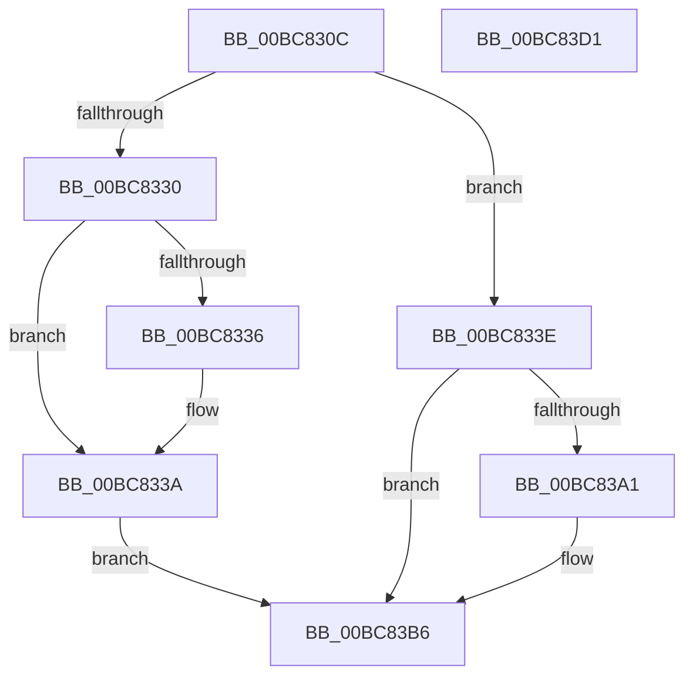

# RtlpIcEmulateRegisterPushPop

- RVA: `0x00BC830C`–`0x00BC83D2` (길이 `198` bytes)
- VA: `0x0000000140BC830C`
- 실행 섹션: `TRACESUP`
- PDB 이름 있음: `예`; PDB Function 태그: `아니요`
- unwind 정보 RVA: `0x00060130`
- 디코드: `56`개 명령, `198/198` bytes 표시
- 미해석 바이트: `0` (있으면 어셈블리에 `.byte`로 보존)

> 이 문서는 커널 이미지의 기계어와 PDB 기호를 분석해 생성했습니다. 4번과 5번은 함수 원형과 자료형을 바이너리 사용 방식에서 추정한 C 해석이며 원본 소스 복구 결과는 아닙니다.

## 1. Dependencies

- 직접 호출 지점: **2**; 고유 호출 대상: **2**
- 직접 호출자로 확인된 함수: **1**
- RIP 상대 이미지 참조: **0**

### Outgoing calls
- `0x00BC8352` → [RtlpIcGetRegisterAddressByIndex](RtlpIcGetRegisterAddressByIndex_function_00BC8498.md) (function, `0x00BC8498`)
- `0x00BC8398` → [RtlpIcAccessMemory](RtlpIcAccessMemory_function_00BC7198.md) (function, `0x00BC7198`)

### Direct callers
- [RtlpIcEmulateInstruction](RtlpIcEmulateInstruction_function_00BC7A08.md) at `0x00BC7A75`

### Static image references
- 디코드된 RIP-relative 메모리 참조가 없습니다.

## 2. Other-region calls and transfers

- 다른 실행 섹션으로 향하는 call: **0**
- 별도 외부 분기/꼬리 이동을 확인하지 못했습니다.

## 3. Assembly (complete function range)

```asm
00BC830C  48 8B C4                        mov rax, rsp
00BC830F  48 89 58 08                     mov qword ptr [rax + 8], rbx
00BC8313  48 89 68 10                     mov qword ptr [rax + 0x10], rbp
00BC8317  48 89 70 18                     mov qword ptr [rax + 0x18], rsi
00BC831B  48 89 78 20                     mov qword ptr [rax + 0x20], rdi
00BC831F  41 56                           push r14
00BC8321  48 83 EC 40                     sub rsp, 0x40
00BC8325  48 8B DA                        mov rbx, rdx
00BC8328  4C 8B D1                        mov r10, rcx
00BC832B  48 85 D2                        test rdx, rdx
00BC832E  75 0E                           jne 0x140bc833e
00BC8330  80 79 01 10                     cmp byte ptr [rcx + 1], 0x10
00BC8334  74 04                           je 0x140bc833a
00BC8336  C6 41 01 40                     mov byte ptr [rcx + 1], 0x40
00BC833A  33 C0                           xor eax, eax
00BC833C  EB 78                           jmp 0x140bc83b6
00BC833E  44 8A 49 19                     mov r9b, byte ptr [rcx + 0x19]
00BC8342  41 8B F0                        mov esi, r8d
00BC8345  41 80 E1 01                     and r9b, 1
00BC8349  C6 44 24 20 01                  mov byte ptr [rsp + 0x20], 1
00BC834E  41 83 E0 07                     and r8d, 7
00BC8352  E8 41 01 00 00                  call 0x140bc8498
00BC8357  41 8A 4A 01                     mov cl, byte ptr [r10 + 1]
00BC835B  48 8B D0                        mov rdx, rax
00BC835E  48 8B 43 08                     mov rax, qword ptr [rbx + 8]
00BC8362  44 8A 4B 10                     mov r9b, byte ptr [rbx + 0x10]
00BC8366  C0 E9 03                        shr cl, 3
00BC8369  0F B6 E9                        movzx ebp, cl
00BC836C  4C 8B B0 98 00 00 00            mov r14, qword ptr [rax + 0x98]
00BC8373  49 8B FE                        mov rdi, r14
00BC8376  48 2B FD                        sub rdi, rbp
00BC8379  83 E6 08                        and esi, 8
00BC837C  4C 8B C7                        mov r8, rdi
00BC837F  0F 94 C0                        sete al
00BC8382  85 F6                           test esi, esi
00BC8384  88 44 24 30                     mov byte ptr [rsp + 0x30], al
00BC8388  88 4C 24 28                     mov byte ptr [rsp + 0x28], cl
00BC838C  4D 0F 45 C6                     cmovne r8, r14
00BC8390  48 8B CB                        mov rcx, rbx
00BC8393  C6 44 24 20 00                  mov byte ptr [rsp + 0x20], 0
00BC8398  E8 FB ED FF FF                  call 0x140bc7198
00BC839D  85 C0                           test eax, eax
00BC839F  78 15                           js 0x140bc83b6
00BC83A1  49 8D 0C 2E                     lea rcx, [r14 + rbp]
00BC83A5  85 F6                           test esi, esi
00BC83A7  48 0F 45 F9                     cmovne rdi, rcx
00BC83AB  48 8B 4B 08                     mov rcx, qword ptr [rbx + 8]
00BC83AF  48 89 B9 98 00 00 00            mov qword ptr [rcx + 0x98], rdi
00BC83B6  48 8B 5C 24 50                  mov rbx, qword ptr [rsp + 0x50]
00BC83BB  48 8B 6C 24 58                  mov rbp, qword ptr [rsp + 0x58]
00BC83C0  48 8B 74 24 60                  mov rsi, qword ptr [rsp + 0x60]
00BC83C5  48 8B 7C 24 68                  mov rdi, qword ptr [rsp + 0x68]
00BC83CA  48 83 C4 40                     add rsp, 0x40
00BC83CE  41 5E                           pop r14
00BC83D0  C3                              ret
00BC83D1  CC                              int3
```

## 4. C-style interpretation (structured pseudocode)

```c
__int64 __fastcall RtlpIcEmulateRegisterPushPop(__int64 a1, __int64 a2, int a3)
{
    __int64 result;
    __int64 v_rdi;
    __int64 v_rsi;
    __int64 v_rsp;
    unsigned __int8 v_stack_m18;
    unsigned __int8 v_stack_m20;
    unsigned __int8 v_stack_m28;
    unsigned __int64 v_stack_p10;
    unsigned __int64 v_stack_p18;
    unsigned __int64 v_stack_p20;
    unsigned __int64 v_stack_p8;

    *(unsigned __int64 *)(v_rsp + 8) = v_rbx;
    *(unsigned __int64 *)(v_rsp + 16) = v_rbp;
    *(unsigned __int64 *)(v_rsp + 24) = v_rsi;
    *(unsigned __int64 *)(v_rsp + 32) = v_rdi;
    v_rsp = (v_rsp) - (64);
    if (a2 != 0) goto loc_00BC833E;
    if ((*(unsigned __int8 *)(a1 + 1)) != 16) {
        *(unsigned __int8 *)(a1 + 1) = 64;
    }
    result = 0;
    goto loc_00BC83B6;
loc_00BC833E:
    a4 = (unsigned __int8)((*(unsigned __int8 *)(a1 + 25)) & (1));
    v_stack_m28 = 1;
    a3 = (unsigned int)((a3) & (7));
    result = RtlpIcGetRegisterAddressByIndex(a1, a2, a3, a4);
    a1 = (unsigned __int8)((*(unsigned __int8 *)(a1 + 1)) >> (3));
    v_rdi = (*(unsigned __int64 *)(*(unsigned __int64 *)(a2 + 8) + 152)) - ((unsigned __int8)(a1));
    v_rsi = (unsigned int)(((unsigned int)(a3)) & (8));
    result = (condition_is_equal) ? 1 : 0;
    v_stack_m18 = (unsigned __int8)(result);
    v_stack_m20 = (unsigned __int8)(a1);
    a3 = v_rdi;
    if ((unsigned int)(v_rsi) != 0) { a3 = *(unsigned __int64 *)(*(unsigned __int64 *)(a2 + 8) + 152); }
    v_stack_m28 = 0;
    result = RtlpIcAccessMemory(a2, result, a3, *(unsigned __int8 *)(a2 + 16));
    if (!(sign_flag)) {
        a1 = *(unsigned __int64 *)(*(unsigned __int64 *)(a2 + 8) + 152) + (unsigned __int8)(a1) * 1;
        if ((unsigned int)(v_rsi) != 0) { v_rdi = a1; }
        a1 = *(unsigned __int64 *)(a2 + 8);
        *(unsigned __int64 *)(a1 + 152) = v_rdi;
    }
    v_rsp = (v_rsp) + (64);
    return result;
}
```

## 5. (Beta) C Style

```c
int64_t RtlpIcEmulateRegisterPushPop(void *Arg1, void *Arg2, int32_t Arg3)
{
    uint8_t *arg1 = (uint8_t *)Arg1;
    uint8_t *arg2 = (uint8_t *)Arg2;

    int64_t result;
    int64_t local_rdi;
    int64_t local_rsi;
    int64_t local_rsp;
    uint8_t v_stack_m18;
    uint8_t v_stack_m20;
    uint8_t v_stack_m28;
    uint64_t v_stack_p10;
    uint64_t v_stack_p18;
    uint64_t v_stack_p20;
    uint64_t v_stack_p8;

    *(uint64_t *)(local_rsp + 0x8) = local_rbx;
    *(uint64_t *)(local_rsp + 0x10) = local_rbp;
    *(uint64_t *)(local_rsp + 0x18) = local_rsi;
    *(uint64_t *)(local_rsp + 0x20) = local_rdi;
    local_rsp = (local_rsp) - (64);
    if (Arg2 != NULL) goto loc_00BC833E;
    if ((*(uint8_t *)(arg1 + 0x1)) != 16) {
        *(uint8_t *)(arg1 + 0x1) = 64;
    }
    result = 0;
    goto loc_00BC83B6;
loc_00BC833E:
    a4 = (uint8_t)((*(uint8_t *)(arg1 + 0x19)) & (1));
    v_stack_m28 = 1;
    Arg3 = (uint32_t)((Arg3) & (7));
    result = RtlpIcGetRegisterAddressByIndex(Arg1, Arg2, Arg3, a4);
    Arg1 = (uint8_t)((*(uint8_t *)(arg1 + 0x1)) >> (3));
    local_rdi = (*(uint64_t *)(*(uint64_t *)(arg2 + 0x8) + 0x98)) - ((uint8_t)(Arg1));
    local_rsi = (uint32_t)(((uint32_t)(Arg3)) & (8));
    result = (condition_is_equal) ? 1 : 0;
    v_stack_m18 = (uint8_t)(result);
    v_stack_m20 = (uint8_t)(Arg1);
    Arg3 = local_rdi;
    if ((uint32_t)(local_rsi) != 0) { Arg3 = *(uint64_t *)(*(uint64_t *)(arg2 + 0x8) + 0x98); }
    v_stack_m28 = 0;
    result = RtlpIcAccessMemory(Arg2, result, Arg3, *(uint8_t *)(arg2 + 0x10));
    if (!(sign_flag)) {
        Arg1 = *(uint64_t *)(*(uint64_t *)(arg2 + 0x8) + 0x98) + (uint8_t)(Arg1) * 1;
        if ((uint32_t)(local_rsi) != 0) { local_rdi = Arg1; }
        Arg1 = *(uint64_t *)(arg2 + 0x8);
        *(uint64_t *)(arg1 + 0x98) = local_rdi;
    }
    local_rsp = (local_rsp) + (64);
    return result;
}
```

### 관측된 메모리 오프셋

구조체 형식이 확인되지 않은 접근은 인자 기준의 오프셋으로만 기록했습니다.

| 기준 인자 | 오프셋 표현 | 폭 (bit) | 접근 |
|---|---:|---:|---|
| `Arg1` | `+ 0x1` | `8` | `R` |
| `Arg1` | `+ 0x1` | `8` | `W` |
| `Arg1` | `+ 0x19` | `8` | `R` |
| `Arg2` | `+ 0x8` | `64` | `R` |
| `Arg2` | `+ 0x10` | `8` | `R` |

## 6. Execution-region graph

[열기: 2D/3D 그래프와 함수 탐색 컨트롤 패널](../../../control-panel.html?section=tracesup&rva=0x00BC830C&view=graph)

- 2D 그래프는 위에서 아래로 흐르고, 3D 그래프는 빈 공간을 드래그해 회전합니다. Shift+드래그는 이동, 휠은 확대·축소, 함수 노드 선택은 대상 보고서 이동입니다.

### Static fallback


