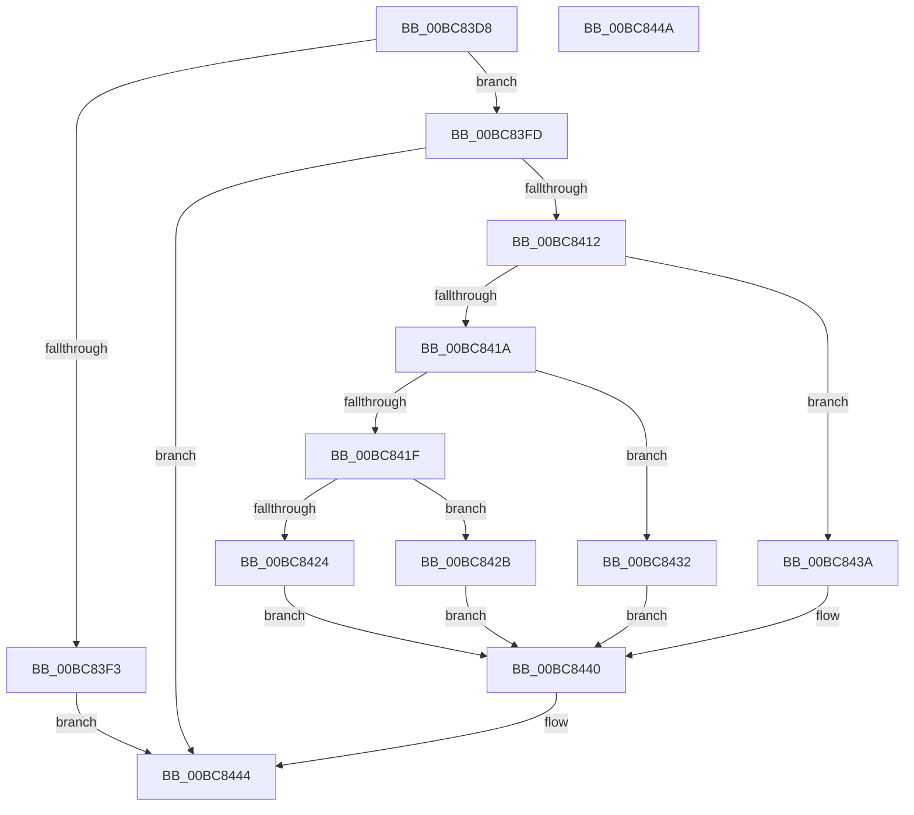

# RtlpIcFetchImmediateOperand

- RVA: `0x00BC83D8`–`0x00BC844B` (길이 `115` bytes)
- VA: `0x0000000140BC83D8`
- 실행 섹션: `TRACESUP`
- PDB 이름 있음: `예`; PDB Function 태그: `아니요`
- unwind 정보 RVA: `0x0005CF00`
- 디코드: `37`개 명령, `115/115` bytes 표시
- 미해석 바이트: `0` (있으면 어셈블리에 `.byte`로 보존)

> 이 문서는 커널 이미지의 기계어와 PDB 기호를 분석해 생성했습니다. 4번과 5번은 함수 원형과 자료형을 바이너리 사용 방식에서 추정한 C 해석이며 원본 소스 복구 결과는 아닙니다.

## 1. Dependencies

- 직접 호출 지점: **1**; 고유 호출 대상: **1**
- 직접 호출자로 확인된 함수: **3**
- RIP 상대 이미지 참조: **0**

### Outgoing calls
- `0x00BC8409` → [RtlpIcFetchInstructionBytes](RtlpIcFetchInstructionBytes_function_00BC8454.md) (function, `0x00BC8454`)

### Direct callers
- [RtlpIcEmulateGroup11Instruction](RtlpIcEmulateGroup11Instruction_function_00BC7750.md) at `0x00BC777E`
- [RtlpIcEmulateGroup1Instruction](RtlpIcEmulateGroup1Instruction_function_00BC7818.md) at `0x00BC784E`
- [RtlpIcEmulateInstruction](RtlpIcEmulateInstruction_function_00BC7A08.md) at `0x00BC7AB9`

### Static image references
- 디코드된 RIP-relative 메모리 참조가 없습니다.

## 2. Other-region calls and transfers

- 다른 실행 섹션으로 향하는 call: **0**
- 별도 외부 분기/꼬리 이동을 확인하지 못했습니다.

## 3. Assembly (complete function range)

```asm
00BC83D8  40 53                           push rbx
00BC83DA  48 83 EC 20                     sub rsp, 0x20
00BC83DE  48 83 64 24 38 00               and qword ptr [rsp + 0x38], 0
00BC83E4  4D 8B C8                        mov r9, r8
00BC83E7  0F B6 41 17                     movzx eax, byte ptr [rcx + 0x17]
00BC83EB  48 8B D9                        mov rbx, rcx
00BC83EE  48 85 D2                        test rdx, rdx
00BC83F1  74 0A                           je 0x140bc83fd
00BC83F3  C1 E8 03                        shr eax, 3
00BC83F6  41 01 00                        add dword ptr [r8], eax
00BC83F9  33 C0                           xor eax, eax
00BC83FB  EB 47                           jmp 0x140bc8444
00BC83FD  44 8B C0                        mov r8d, eax
00BC8400  48 8D 54 24 38                  lea rdx, [rsp + 0x38]
00BC8405  41 C1 E8 03                     shr r8d, 3
00BC8409  E8 46 00 00 00                  call 0x140bc8454
00BC840E  85 C0                           test eax, eax
00BC8410  78 32                           js 0x140bc8444
00BC8412  8A 4B 17                        mov cl, byte ptr [rbx + 0x17]
00BC8415  80 F9 08                        cmp cl, 8
00BC8418  74 20                           je 0x140bc843a
00BC841A  80 F9 10                        cmp cl, 0x10
00BC841D  74 13                           je 0x140bc8432
00BC841F  80 F9 20                        cmp cl, 0x20
00BC8422  75 07                           jne 0x140bc842b
00BC8424  48 63 4C 24 38                  movsxd rcx, dword ptr [rsp + 0x38]
00BC8429  EB 15                           jmp 0x140bc8440
00BC842B  48 8B 4C 24 38                  mov rcx, qword ptr [rsp + 0x38]
00BC8430  EB 0E                           jmp 0x140bc8440
00BC8432  48 0F BF 4C 24 38               movsx rcx, word ptr [rsp + 0x38]
00BC8438  EB 06                           jmp 0x140bc8440
00BC843A  48 0F BE 4C 24 38               movsx rcx, byte ptr [rsp + 0x38]
00BC8440  48 89 4B 20                     mov qword ptr [rbx + 0x20], rcx
00BC8444  48 83 C4 20                     add rsp, 0x20
00BC8448  5B                              pop rbx
00BC8449  C3                              ret
00BC844A  CC                              int3
```

## 4. C-style interpretation (structured pseudocode)

```c
__int64 __fastcall RtlpIcFetchImmediateOperand(__int64 a1, __int64 a2, __int64 a3)
{
    __int64 result;
    __int64 v_rsp;
    unsigned __int64 v_stack_p10;

    v_rsp = (v_rsp) - (32);
    if (a2 == 0) goto loc_00BC83FD;
    result = (unsigned int)((*(unsigned __int8 *)(a1 + 23)) >> (3));
    result = 0;
    goto loc_00BC8444;
loc_00BC83FD:
    a3 = (unsigned int)((0) >> (3));
    result = RtlpIcFetchInstructionBytes(a1, v_stack_p10, a3, a3);
    if (sign_flag) goto loc_00BC8444;
    if (((unsigned __int8)(*(unsigned __int8 *)(a1 + 23))) == 8) goto loc_00BC843A;
    if (((unsigned __int8)(*(unsigned __int8 *)(a1 + 23))) == 16) goto loc_00BC8432;
    if (((unsigned __int8)(*(unsigned __int8 *)(a1 + 23))) != 32) goto loc_00BC842B;
    goto loc_00BC8440;
loc_00BC842B:
    goto loc_00BC8440;
loc_00BC8432:
    goto loc_00BC8440;
loc_00BC843A:
loc_00BC8440:
    *(unsigned __int64 *)(a1 + 32) = (__int8)(v_stack_p10);
loc_00BC8444:
    v_rsp = (v_rsp) + (32);
    return result;
}
```

## 5. (Beta) C Style

```c
int64_t RtlpIcFetchImmediateOperand(void *Arg1, int64_t Arg2, void *Arg3)
{
    uint8_t *arg1 = (uint8_t *)Arg1;
    uint8_t *arg3 = (uint8_t *)Arg3;

    int64_t result;
    int64_t local_rsp;
    uint64_t v_stack_p10;

    local_rsp = (local_rsp) - (32);
    if (Arg2 == 0) goto loc_00BC83FD;
    result = (uint32_t)((*(uint8_t *)(arg1 + 0x17)) >> (3));
    result = 0;
    goto loc_00BC8444;
loc_00BC83FD:
    Arg3 = (uint32_t)((0) >> (3));
    result = RtlpIcFetchInstructionBytes(Arg1, v_stack_p10, Arg3, Arg3);
    if (sign_flag) goto loc_00BC8444;
    if (((uint8_t)(*(uint8_t *)(arg1 + 0x17))) == 8) goto loc_00BC843A;
    if (((uint8_t)(*(uint8_t *)(arg1 + 0x17))) == 16) goto loc_00BC8432;
    if (((uint8_t)(*(uint8_t *)(arg1 + 0x17))) != 32) goto loc_00BC842B;
    goto loc_00BC8440;
loc_00BC842B:
    goto loc_00BC8440;
loc_00BC8432:
    goto loc_00BC8440;
loc_00BC843A:
loc_00BC8440:
    *(uint64_t *)(arg1 + 0x20) = (int8_t)(v_stack_p10);
loc_00BC8444:
    local_rsp = (local_rsp) + (32);
    return result;
}
```

### 관측된 메모리 오프셋

구조체 형식이 확인되지 않은 접근은 인자 기준의 오프셋으로만 기록했습니다.

| 기준 인자 | 오프셋 표현 | 폭 (bit) | 접근 |
|---|---:|---:|---|
| `Arg1` | `+ 0x17` | `8` | `R` |
| `Arg1` | `+ 0x20` | `64` | `W` |
| `Arg3` | `+ 0x0` | `32` | `R/W` |

## 6. Execution-region graph

[열기: 2D/3D 그래프와 함수 탐색 컨트롤 패널](../../../control-panel.html?section=tracesup&rva=0x00BC83D8&view=graph)

- 2D 그래프는 위에서 아래로 흐르고, 3D 그래프는 빈 공간을 드래그해 회전합니다. Shift+드래그는 이동, 휠은 확대·축소, 함수 노드 선택은 대상 보고서 이동입니다.

### Static fallback


