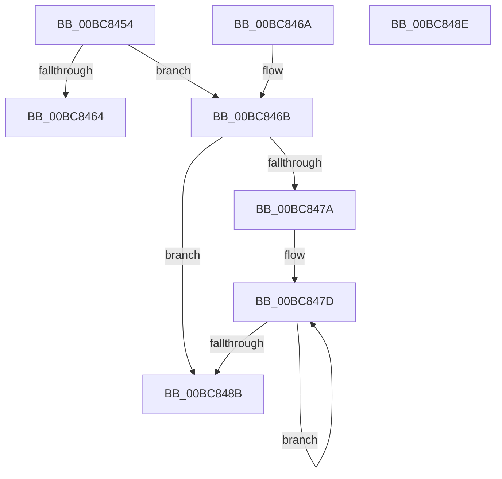

# RtlpIcFetchInstructionBytes

- RVA: `0x00BC8454`–`0x00BC848F` (길이 `59` bytes)
- VA: `0x0000000140BC8454`
- 실행 섹션: `TRACESUP`
- PDB 이름 있음: `예`; PDB Function 태그: `아니요`
- unwind 정보 RVA: `0x000DB714`
- 디코드: `22`개 명령, `59/59` bytes 표시
- 미해석 바이트: `0` (있으면 어셈블리에 `.byte`로 보존)

> 이 문서는 커널 이미지의 기계어와 PDB 기호를 분석해 생성했습니다. 4번과 5번은 함수 원형과 자료형을 바이너리 사용 방식에서 추정한 C 해석이며 원본 소스 복구 결과는 아닙니다.

## 1. Dependencies

- 직접 호출 지점: **0**; 고유 호출 대상: **0**
- 직접 호출자로 확인된 함수: **4**
- RIP 상대 이미지 참조: **0**

### Outgoing calls
- 직접 디코드된 call 명령이 없습니다.

### Direct callers
- [RtlpIcDecodeModRm](RtlpIcDecodeModRm_function_00BC72B0.md) at `0x00BC72E8`
- [RtlpIcDecodeModRm](RtlpIcDecodeModRm_function_00BC72B0.md) at `0x00BC7314`
- [RtlpIcDecodeModRm](RtlpIcDecodeModRm_function_00BC72B0.md) at `0x00BC7349`
- [RtlpIcDecodeModRm](RtlpIcDecodeModRm_function_00BC72B0.md) at `0x00BC7369`
- [RtlpIcEmulateInstruction](RtlpIcEmulateInstruction_function_00BC7A08.md) at `0x00BC7A51`
- [RtlpIcEmulateInstruction](RtlpIcEmulateInstruction_function_00BC7A08.md) at `0x00BC7BF0`
- [RtlpIcEmulateInstruction](RtlpIcEmulateInstruction_function_00BC7A08.md) at `0x00BC803F`
- [RtlpIcFetchImmediateOperand](RtlpIcFetchImmediateOperand_function_00BC83D8.md) at `0x00BC8409`
- [RtlpIcParseInstructionPrefix](RtlpIcParseInstructionPrefix_function_00BC851C.md) at `0x00BC854A`

### Static image references
- 디코드된 RIP-relative 메모리 참조가 없습니다.

## 2. Other-region calls and transfers

- 다른 실행 섹션으로 향하는 call: **0**
- 별도 외부 분기/꼬리 이동을 확인하지 못했습니다.

## 3. Assembly (complete function range)

```asm
00BC8454  45 8B 11                        mov r10d, dword ptr [r9]
00BC8457  0F B6 41 05                     movzx eax, byte ptr [rcx + 5]
00BC845B  47 8D 1C 02                     lea r11d, [r10 + r8]
00BC845F  44 3B D8                        cmp r11d, eax
00BC8462  76 07                           jbe 0x140bc846b
00BC8464  B8 06 02 00 C0                  mov eax, 0xc0000206
00BC8469  C3                              ret
00BC846A  CC                              int3
00BC846B  48 83 C1 06                     add rcx, 6
00BC846F  45 89 19                        mov dword ptr [r9], r11d
00BC8472  49 03 CA                        add rcx, r10
00BC8475  45 85 C0                        test r8d, r8d
00BC8478  74 11                           je 0x140bc848b
00BC847A  48 2B CA                        sub rcx, rdx
00BC847D  8A 04 11                        mov al, byte ptr [rcx + rdx]
00BC8480  88 02                           mov byte ptr [rdx], al
00BC8482  48 FF C2                        inc rdx
00BC8485  41 83 C0 FF                     add r8d, -1
00BC8489  75 F2                           jne 0x140bc847d
00BC848B  33 C0                           xor eax, eax
00BC848D  C3                              ret
00BC848E  CC                              int3
```

## 4. C-style interpretation (structured pseudocode)

```c
__int64 __fastcall RtlpIcFetchInstructionBytes(__int64 a1, __int64 a2, __int64 a3, __int64 a4)
{
    __int64 result;

    if (((unsigned int)((unsigned int)(*(unsigned int *)(a4)) + a3 * 1)) <= ((unsigned int)(*(unsigned __int8 *)(a1 + 5)))) goto loc_00BC846B;
    return (unsigned int)(0xC0000206ULL);
loc_00BC846B:
    a1 = (a1) + (6);
    *(unsigned int *)(a4) = (unsigned int)((unsigned int)(*(unsigned int *)(a4)) + a3 * 1);
    a1 = (a1) + ((unsigned int)(*(unsigned int *)(a4)));
    if ((unsigned int)(a3) == 0) goto loc_00BC848B;
    a1 = (a1) - (a2);
loc_00BC847D:
    *(unsigned __int8 *)(a2) = (unsigned __int8)(*(unsigned __int8 *)(a1 + a2 * 1));
    a2 = (a2) + 1;
    a3 = (unsigned int)((a3) + (-1));
    if (condition_is_not_equal) goto loc_00BC847D;
loc_00BC848B:
    result = 0;
    return result;
}
```

## 5. (Beta) C Style

```c
int64_t RtlpIcFetchInstructionBytes(void *Arg1, int64_t Arg2, int64_t Arg3, void *Arg4)
{
    uint8_t *arg1 = (uint8_t *)Arg1;
    uint8_t *arg4 = (uint8_t *)Arg4;

    int64_t result;

    if (((uint32_t)((uint32_t)(*(uint32_t *)(arg4)) + Arg3 * 1)) <= ((uint32_t)(*(uint8_t *)(arg1 + 0x5)))) goto loc_00BC846B;
    return (uint32_t)(0xC0000206ULL);
loc_00BC846B:
    Arg1 = (Arg1) + (6);
    *(uint32_t *)(arg4) = (uint32_t)((uint32_t)(*(uint32_t *)(arg4)) + Arg3 * 1);
    Arg1 = (Arg1) + ((uint32_t)(*(uint32_t *)(arg4)));
    if ((uint32_t)(Arg3) == 0) goto loc_00BC848B;
    Arg1 = (Arg1) - (Arg2);
loc_00BC847D:
    *(uint8_t *)(Arg2) = (uint8_t)(*(uint8_t *)(arg1 + Arg2 * 1));
    Arg2 = (Arg2) + 1;
    Arg3 = (uint32_t)((Arg3) + (-1));
    if (condition_is_not_equal) goto loc_00BC847D;
loc_00BC848B:
    result = 0;
    return result;
}
```

### 관측된 메모리 오프셋

구조체 형식이 확인되지 않은 접근은 인자 기준의 오프셋으로만 기록했습니다.

| 기준 인자 | 오프셋 표현 | 폭 (bit) | 접근 |
|---|---:|---:|---|
| `Arg1` | `+ 0x0 + rdx*1` | `8` | `R` |
| `Arg1` | `+ 0x5` | `8` | `R` |
| `Arg4` | `+ 0x0` | `32` | `R` |
| `Arg4` | `+ 0x0` | `32` | `W` |

## 6. Execution-region graph

[열기: 2D/3D 그래프와 함수 탐색 컨트롤 패널](../../../control-panel.html?section=tracesup&rva=0x00BC8454&view=graph)

- 2D 그래프는 위에서 아래로 흐르고, 3D 그래프는 빈 공간을 드래그해 회전합니다. Shift+드래그는 이동, 휠은 확대·축소, 함수 노드 선택은 대상 보고서 이동입니다.

### Static fallback


