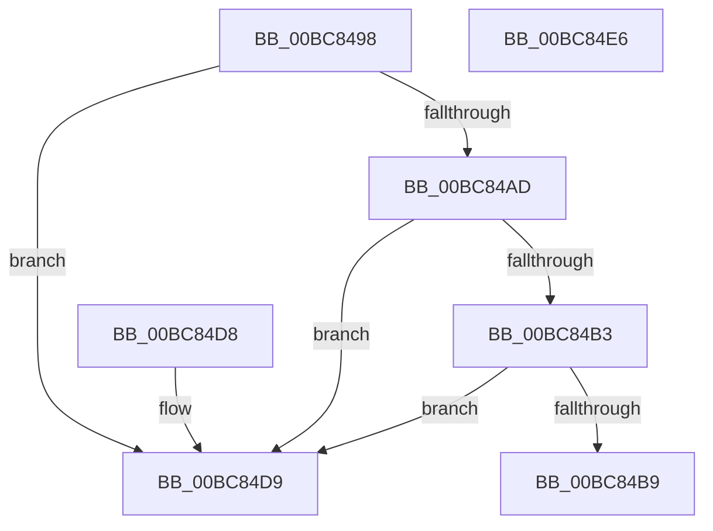

# RtlpIcGetRegisterAddressByIndex

- RVA: `0x00BC8498`–`0x00BC84E7` (길이 `79` bytes)
- VA: `0x0000000140BC8498`
- 실행 섹션: `TRACESUP`
- PDB 이름 있음: `예`; PDB Function 태그: `아니요`
- unwind 정보 RVA: `0x000DB714`
- 디코드: `25`개 명령, `79/79` bytes 표시
- 미해석 바이트: `0` (있으면 어셈블리에 `.byte`로 보존)

> 이 문서는 커널 이미지의 기계어와 PDB 기호를 분석해 생성했습니다. 4번과 5번은 함수 원형과 자료형을 바이너리 사용 방식에서 추정한 C 해석이며 원본 소스 복구 결과는 아닙니다.

## 1. Dependencies

- 직접 호출 지점: **0**; 고유 호출 대상: **0**
- 직접 호출자로 확인된 함수: **6**
- RIP 상대 이미지 참조: **0**

### Outgoing calls
- 직접 디코드된 call 명령이 없습니다.

### Direct callers
- [RtlpIcDecodeModRmOperand](RtlpIcDecodeModRmOperand_function_00BC739C.md) at `0x00BC73F7`
- [RtlpIcDecodeModRmOperand](RtlpIcDecodeModRmOperand_function_00BC739C.md) at `0x00BC743B`
- [RtlpIcDecodeModRmOperand](RtlpIcDecodeModRmOperand_function_00BC739C.md) at `0x00BC7473`
- [RtlpIcDecodeModRmOperand](RtlpIcDecodeModRmOperand_function_00BC739C.md) at `0x00BC74BF`
- [RtlpIcEmulateGroup0Instruction](RtlpIcEmulateGroup0Instruction_function_00BC74F8.md) at `0x00BC75D4`
- [RtlpIcEmulateInstruction](RtlpIcEmulateInstruction_function_00BC7A08.md) at `0x00BC7CA2`
- [RtlpIcEmulateInstruction](RtlpIcEmulateInstruction_function_00BC7A08.md) at `0x00BC7DF2`
- [RtlpIcEmulateInstruction](RtlpIcEmulateInstruction_function_00BC7A08.md) at `0x00BC7EDC`
- [RtlpIcEmulateMovzx](RtlpIcEmulateMovzx_function_00BC81FC.md) at `0x00BC82BF`
- [RtlpIcEmulateRegisterPushPop](RtlpIcEmulateRegisterPushPop_function_00BC830C.md) at `0x00BC8352`
- [RtlpIcWriteRegisterValue](RtlpIcWriteRegisterValue_function_00BC8954.md) at `0x00BC8960`

### Static image references
- 디코드된 RIP-relative 메모리 참조가 없습니다.

## 2. Other-region calls and transfers

- 다른 실행 섹션으로 향하는 call: **0**
- 별도 외부 분기/꼬리 이동을 확인하지 못했습니다.

## 3. Assembly (complete function range)

```asm
00BC8498  45 84 C9                        test r9b, r9b
00BC849B  41 8D 40 08                     lea eax, [r8 + 8]
00BC849F  41 0F 44 C0                     cmove eax, r8d
00BC84A3  80 7C 24 28 00                  cmp byte ptr [rsp + 0x28], 0
00BC84A8  44 8B C0                        mov r8d, eax
00BC84AB  74 2C                           je 0x140bc84d9
00BC84AD  80 79 19 00                     cmp byte ptr [rcx + 0x19], 0
00BC84B1  75 26                           jne 0x140bc84d9
00BC84B3  80 79 01 08                     cmp byte ptr [rcx + 1], 8
00BC84B7  75 20                           jne 0x140bc84d9
00BC84B9  48 8B 52 08                     mov rdx, qword ptr [rdx + 8]
00BC84BD  41 8B C8                        mov ecx, r8d
00BC84C0  83 E1 03                        and ecx, 3
00BC84C3  48 83 C2 78                     add rdx, 0x78
00BC84C7  41 F6 C0 04                     test r8b, 4
00BC84CB  48 8D 14 CA                     lea rdx, [rdx + rcx*8]
00BC84CF  48 8D 42 01                     lea rax, [rdx + 1]
00BC84D3  48 0F 44 C2                     cmove rax, rdx
00BC84D7  C3                              ret
00BC84D8  CC                              int3
00BC84D9  48 8B 42 08                     mov rax, qword ptr [rdx + 8]
00BC84DD  4A 8D 04 C0                     lea rax, [rax + r8*8]
00BC84E1  48 83 C0 78                     add rax, 0x78
00BC84E5  C3                              ret
00BC84E6  CC                              int3
```

## 4. C-style interpretation (structured pseudocode)

```c
__int64 __fastcall RtlpIcGetRegisterAddressByIndex(__int64 a1, __int64 a2, __int64 a3, unsigned __int8 a4, unsigned __int8 a5)
{
    __int64 result;

    result = a3 + 8;
    if (a4 == 0) { result = (unsigned int)(a3); }
    if (a5 == 0) goto loc_00BC84D9;
    if ((*(unsigned __int8 *)(a1 + 25)) != 0) goto loc_00BC84D9;
    if ((*(unsigned __int8 *)(a1 + 1)) != 8) goto loc_00BC84D9;
    a1 = (unsigned int)(((unsigned int)((unsigned int)((unsigned int)((unsigned int)(result))))) & (3));
    a2 = (*(unsigned __int64 *)(a2 + 8)) + (120);
    result = a2 + a1 * 8 + 1;
    if ((((unsigned __int8)((unsigned int)((unsigned int)(result)))) & (4)) == 0) { result = a2 + a1 * 8; }
    return result;
loc_00BC84D9:
    result = (*(unsigned __int64 *)(a2 + a1 * 8 + 8) + (unsigned int)((unsigned int)(result)) * 8) + (120);
    return result;
}
```

## 5. (Beta) C Style

```c
int64_t RtlpIcGetRegisterAddressByIndex(void *Arg1, void *Arg2, void *Arg3, uint8_t Arg4, uint8_t Arg5)
{
    uint8_t *arg1 = (uint8_t *)Arg1;
    uint8_t *arg2 = (uint8_t *)Arg2;
    uint8_t *arg3 = (uint8_t *)Arg3;

    int64_t result;

    result = Arg3 + 8;
    if (Arg4 == 0) { result = (uint32_t)(Arg3); }
    if (Arg5 == 0) goto loc_00BC84D9;
    if ((*(uint8_t *)(arg1 + 0x19)) != 0) goto loc_00BC84D9;
    if ((*(uint8_t *)(arg1 + 0x1)) != 8) goto loc_00BC84D9;
    Arg1 = (uint32_t)(((uint32_t)((uint32_t)((uint32_t)((uint32_t)(result))))) & (3));
    Arg2 = (*(uint64_t *)(arg2 + 0x8)) + (120);
    result = Arg2 + Arg1 * 8 + 1;
    if ((((uint8_t)((uint32_t)((uint32_t)(result)))) & (4)) == 0) { result = Arg2 + Arg1 * 8; }
    return result;
loc_00BC84D9:
    result = (*(uint64_t *)(arg2 + arg1 * 8 + 0x8) + (uint32_t)((uint32_t)(result)) * 8) + (120);
    return result;
}
```

### 관측된 메모리 오프셋

구조체 형식이 확인되지 않은 접근은 인자 기준의 오프셋으로만 기록했습니다.

| 기준 인자 | 오프셋 표현 | 폭 (bit) | 접근 |
|---|---:|---:|---|
| `Arg1` | `+ 0x1` | `8` | `R` |
| `Arg1` | `+ 0x19` | `8` | `R` |
| `Arg2` | `+ 0x8` | `64` | `R` |
| `Arg3` | `+ 0x8` | `32` | `R` |

## 6. Execution-region graph

[열기: 2D/3D 그래프와 함수 탐색 컨트롤 패널](../../../control-panel.html?section=tracesup&rva=0x00BC8498&view=graph)

- 2D 그래프는 위에서 아래로 흐르고, 3D 그래프는 빈 공간을 드래그해 회전합니다. Shift+드래그는 이동, 휠은 확대·축소, 함수 노드 선택은 대상 보고서 이동입니다.

### Static fallback


