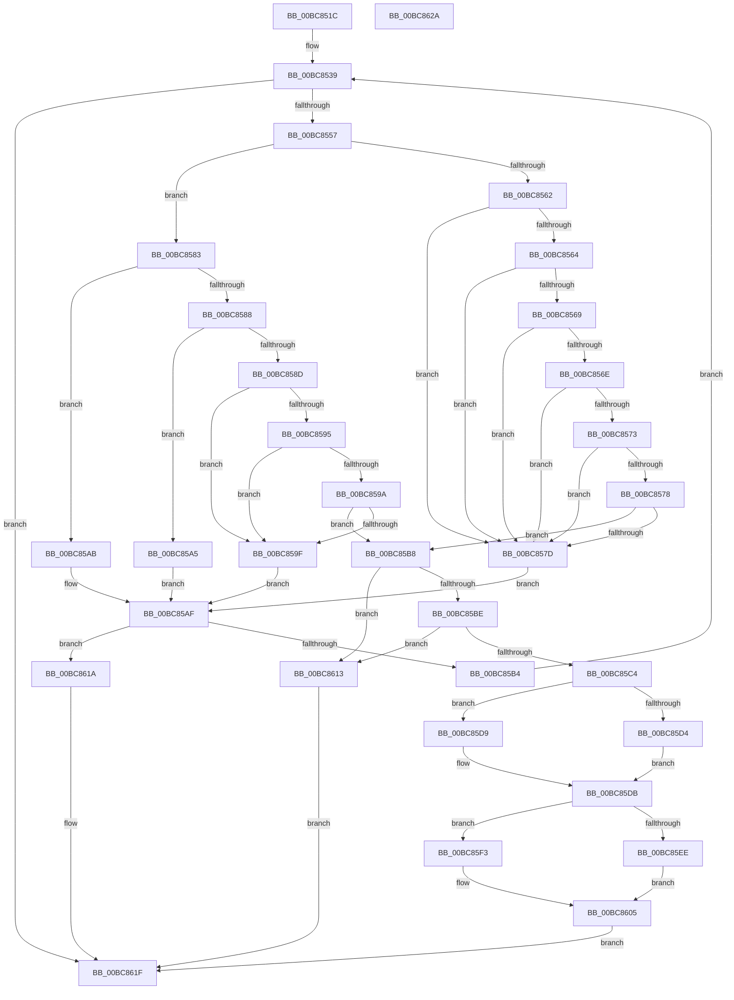

# RtlpIcParseInstructionPrefix

- RVA: `0x00BC851C`–`0x00BC862B` (길이 `271` bytes)
- VA: `0x0000000140BC851C`
- 실행 섹션: `TRACESUP`
- PDB 이름 있음: `예`; PDB Function 태그: `아니요`
- unwind 정보 RVA: `0x000D000C`
- 디코드: `90`개 명령, `271/271` bytes 표시
- 미해석 바이트: `0` (있으면 어셈블리에 `.byte`로 보존)

> 이 문서는 커널 이미지의 기계어와 PDB 기호를 분석해 생성했습니다. 4번과 5번은 함수 원형과 자료형을 바이너리 사용 방식에서 추정한 C 해석이며 원본 소스 복구 결과는 아닙니다.

## 1. Dependencies

- 직접 호출 지점: **1**; 고유 호출 대상: **1**
- 직접 호출자로 확인된 함수: **1**
- RIP 상대 이미지 참조: **0**

### Outgoing calls
- `0x00BC854A` → [RtlpIcFetchInstructionBytes](RtlpIcFetchInstructionBytes_function_00BC8454.md) (function, `0x00BC8454`)

### Direct callers
- [RtlpIcParseInstruction](RtlpIcParseInstruction_function_00BC84F0.md) at `0x00BC84F9`

### Static image references
- 디코드된 RIP-relative 메모리 참조가 없습니다.

## 2. Other-region calls and transfers

- 다른 실행 섹션으로 향하는 call: **0**
- 별도 외부 분기/꼬리 이동을 확인하지 못했습니다.

## 3. Assembly (complete function range)

```asm
00BC851C  48 89 5C 24 08                  mov qword ptr [rsp + 8], rbx
00BC8521  55                              push rbp
00BC8522  48 8B EC                        mov rbp, rsp
00BC8525  48 83 EC 20                     sub rsp, 0x20
00BC8529  83 65 28 00                     and dword ptr [rbp + 0x28], 0
00BC852D  48 8B D9                        mov rbx, rcx
00BC8530  33 C0                           xor eax, eax
00BC8532  C6 45 18 00                     mov byte ptr [rbp + 0x18], 0
00BC8536  89 45 20                        mov dword ptr [rbp + 0x20], eax
00BC8539  4C 8D 4D 28                     lea r9, [rbp + 0x28]
00BC853D  41 B8 01 00 00 00               mov r8d, 1
00BC8543  48 8D 55 18                     lea rdx, [rbp + 0x18]
00BC8547  48 8B CB                        mov rcx, rbx
00BC854A  E8 05 FF FF FF                  call 0x140bc8454
00BC854F  85 C0                           test eax, eax
00BC8551  0F 88 C8 00 00 00               js 0x140bc861f
00BC8557  0F B6 55 18                     movzx edx, byte ptr [rbp + 0x18]
00BC855B  8B CA                           mov ecx, edx
00BC855D  83 FA 65                        cmp edx, 0x65
00BC8560  77 21                           ja 0x140bc8583
00BC8562  74 19                           je 0x140bc857d
00BC8564  83 FA 26                        cmp edx, 0x26
00BC8567  74 14                           je 0x140bc857d
00BC8569  83 FA 2E                        cmp edx, 0x2e
00BC856C  74 0F                           je 0x140bc857d
00BC856E  83 FA 36                        cmp edx, 0x36
00BC8571  74 0A                           je 0x140bc857d
00BC8573  83 FA 3E                        cmp edx, 0x3e
00BC8576  74 05                           je 0x140bc857d
00BC8578  83 FA 64                        cmp edx, 0x64
00BC857B  75 3B                           jne 0x140bc85b8
00BC857D  48 8D 45 21                     lea rax, [rbp + 0x21]
00BC8581  EB 2C                           jmp 0x140bc85af
00BC8583  83 E9 66                        sub ecx, 0x66
00BC8586  74 23                           je 0x140bc85ab
00BC8588  83 E9 01                        sub ecx, 1
00BC858B  74 18                           je 0x140bc85a5
00BC858D  81 E9 89 00 00 00               sub ecx, 0x89
00BC8593  74 0A                           je 0x140bc859f
00BC8595  83 E9 02                        sub ecx, 2
00BC8598  74 05                           je 0x140bc859f
00BC859A  83 F9 01                        cmp ecx, 1
00BC859D  75 19                           jne 0x140bc85b8
00BC859F  48 8D 45 20                     lea rax, [rbp + 0x20]
00BC85A3  EB 0A                           jmp 0x140bc85af
00BC85A5  48 8D 45 23                     lea rax, [rbp + 0x23]
00BC85A9  EB 04                           jmp 0x140bc85af
00BC85AB  48 8D 45 22                     lea rax, [rbp + 0x22]
00BC85AF  80 38 00                        cmp byte ptr [rax], 0
00BC85B2  75 66                           jne 0x140bc861a
00BC85B4  88 10                           mov byte ptr [rax], dl
00BC85B6  EB 81                           jmp 0x140bc8539
00BC85B8  80 7D 20 00                     cmp byte ptr [rbp + 0x20], 0
00BC85BC  75 55                           jne 0x140bc8613
00BC85BE  80 7D 21 00                     cmp byte ptr [rbp + 0x21], 0
00BC85C2  75 4F                           jne 0x140bc8613
00BC85C4  8A C2                           mov al, dl
00BC85C6  B9 40 00 00 00                  mov ecx, 0x40
00BC85CB  24 F0                           and al, 0xf0
00BC85CD  3A C1                           cmp al, cl
00BC85CF  8B 45 28                        mov eax, dword ptr [rbp + 0x28]
00BC85D2  75 05                           jne 0x140bc85d9
00BC85D4  88 53 19                        mov byte ptr [rbx + 0x19], dl
00BC85D7  EB 02                           jmp 0x140bc85db
00BC85D9  FF C8                           dec eax
00BC85DB  F6 43 19 08                     test byte ptr [rbx + 0x19], 8
00BC85DF  41 B8 20 00 00 00               mov r8d, 0x20
00BC85E5  88 43 15                        mov byte ptr [rbx + 0x15], al
00BC85E8  C6 43 04 00                     mov byte ptr [rbx + 4], 0
00BC85EC  74 05                           je 0x140bc85f3
00BC85EE  88 4B 01                        mov byte ptr [rbx + 1], cl
00BC85F1  EB 12                           jmp 0x140bc8605
00BC85F3  80 7D 22 66                     cmp byte ptr [rbp + 0x22], 0x66
00BC85F7  41 8B C0                        mov eax, r8d
00BC85FA  BA 10 00 00 00                  mov edx, 0x10
00BC85FF  0F 44 C2                        cmove eax, edx
00BC8602  88 43 01                        mov byte ptr [rbx + 1], al
00BC8605  80 7D 23 67                     cmp byte ptr [rbp + 0x23], 0x67
00BC8609  41 0F 44 C8                     cmove ecx, r8d
00BC860D  33 C0                           xor eax, eax
00BC860F  88 0B                           mov byte ptr [rbx], cl
00BC8611  EB 0C                           jmp 0x140bc861f
00BC8613  B8 BB 00 00 C0                  mov eax, 0xc00000bb
00BC8618  EB 05                           jmp 0x140bc861f
00BC861A  B8 01 00 00 C0                  mov eax, 0xc0000001
00BC861F  48 8B 5C 24 30                  mov rbx, qword ptr [rsp + 0x30]
00BC8624  48 83 C4 20                     add rsp, 0x20
00BC8628  5D                              pop rbp
00BC8629  C3                              ret
00BC862A  CC                              int3
```

## 4. C-style interpretation (structured pseudocode)

```c
__int64 __fastcall RtlpIcParseInstructionPrefix(__int64 a1)
{
    __int64 result;
    __int64 v_rsp;
    unsigned __int8 v_stack_p10;
    unsigned int v_stack_p18;
    unsigned __int64 v_stack_p19;
    unsigned __int64 v_stack_p1A;
    unsigned __int64 v_stack_p1B;
    unsigned int v_stack_p20;
    unsigned __int64 v_stack_p8;

    v_stack_p8 = v_rbx;
    v_rsp = (v_rsp) - (32);
    result = 0;
    v_stack_p10 = 0;
    v_stack_p18 = 0;
loc_00BC8539:
    result = RtlpIcFetchInstructionBytes(a1, v_stack_p10, 1, v_stack_p20);
    if (sign_flag) goto loc_00BC861F;
    if (((unsigned int)(v_stack_p10)) > 101) goto loc_00BC8583;
    if (((unsigned int)(v_stack_p10)) == 101) goto loc_00BC857D;
    if (((unsigned int)(v_stack_p10)) == 38) goto loc_00BC857D;
    if (((unsigned int)(v_stack_p10)) == 46) goto loc_00BC857D;
    if (((unsigned int)(v_stack_p10)) == 54) goto loc_00BC857D;
    if (((unsigned int)(v_stack_p10)) == 62) goto loc_00BC857D;
    if (((unsigned int)(v_stack_p10)) != 100) goto loc_00BC85B8;
loc_00BC857D:
    goto loc_00BC85AF;
loc_00BC8583:
    a1 = (unsigned int)(((unsigned int)((unsigned int)(v_stack_p10))) - (102));
    if (condition_is_equal) goto loc_00BC85AB;
    a1 = (unsigned int)((a1) - (1));
    if (condition_is_equal) goto loc_00BC85A5;
    a1 = (unsigned int)((a1) - (137));
    if (condition_is_equal) goto loc_00BC859F;
    a1 = (unsigned int)((a1) - (2));
    if (condition_is_equal) goto loc_00BC859F;
    if (((unsigned int)(a1)) != 1) goto loc_00BC85B8;
loc_00BC859F:
    goto loc_00BC85AF;
loc_00BC85A5:
    goto loc_00BC85AF;
loc_00BC85AB:
loc_00BC85AF:
    if ((*(unsigned __int8 *)(v_stack_p1A)) != 0) goto loc_00BC861A;
    *(unsigned __int8 *)(v_stack_p1A) = (unsigned __int8)(v_stack_p10);
    goto loc_00BC8539;
loc_00BC85B8:
    if (v_stack_p18 != 0) goto loc_00BC8613;
    if (v_stack_p19 != 0) goto loc_00BC8613;
    result = (unsigned __int8)(((unsigned __int8)(v_stack_p10)) & (240));
    if (((unsigned __int8)(result)) != 64) goto loc_00BC85D9;
    *(unsigned __int8 *)(a1 + 25) = (unsigned __int8)(v_stack_p10);
    goto loc_00BC85DB;
loc_00BC85D9:
    result = (unsigned int)(((unsigned int)(v_stack_p20)) - 1);
loc_00BC85DB:
    *(unsigned __int8 *)(a1 + 21) = (unsigned __int8)(result);
    *(unsigned __int8 *)(a1 + 4) = 0;
    if (((*(unsigned __int8 *)(a1 + 25)) & (8)) == 0) goto loc_00BC85F3;
    *(unsigned __int8 *)(a1 + 1) = 64;
    goto loc_00BC8605;
loc_00BC85F3:
    result = 32;
    if (v_stack_p1A == 102) { result = 16; }
    *(unsigned __int8 *)(a1 + 1) = (unsigned __int8)(result);
loc_00BC8605:
    a1 = 64;
    if (v_stack_p1B == 103) { a1 = 32; }
    result = 0;
    *(unsigned __int8 *)(a1) = (unsigned __int8)(a1);
    goto loc_00BC861F;
loc_00BC8613:
    goto loc_00BC861F;
loc_00BC861A:
loc_00BC861F:
    v_rsp = (v_rsp) + (32);
    return (unsigned int)(0xC0000001ULL);
}
```

## 5. (Beta) C Style

```c
int64_t RtlpIcParseInstructionPrefix(void *Arg1)
{
    uint8_t *arg1 = (uint8_t *)Arg1;

    int64_t result;
    int64_t local_rsp;
    uint8_t v_stack_p10;
    uint32_t v_stack_p18;
    uint64_t v_stack_p19;
    uint64_t v_stack_p1A;
    uint64_t v_stack_p1B;
    uint32_t v_stack_p20;
    uint64_t v_stack_p8;

    v_stack_p8 = local_rbx;
    local_rsp = (local_rsp) - (32);
    result = 0;
    v_stack_p10 = 0;
    v_stack_p18 = 0;
loc_00BC8539:
    result = RtlpIcFetchInstructionBytes(Arg1, v_stack_p10, 1, v_stack_p20);
    if (sign_flag) goto loc_00BC861F;
    if (((uint32_t)(v_stack_p10)) > 101) goto loc_00BC8583;
    if (((uint32_t)(v_stack_p10)) == 101) goto loc_00BC857D;
    if (((uint32_t)(v_stack_p10)) == 38) goto loc_00BC857D;
    if (((uint32_t)(v_stack_p10)) == 46) goto loc_00BC857D;
    if (((uint32_t)(v_stack_p10)) == 54) goto loc_00BC857D;
    if (((uint32_t)(v_stack_p10)) == 62) goto loc_00BC857D;
    if (((uint32_t)(v_stack_p10)) != 100) goto loc_00BC85B8;
loc_00BC857D:
    goto loc_00BC85AF;
loc_00BC8583:
    Arg1 = (uint32_t)(((uint32_t)((uint32_t)(v_stack_p10))) - (102));
    if (condition_is_equal) goto loc_00BC85AB;
    Arg1 = (uint32_t)((Arg1) - (1));
    if (condition_is_equal) goto loc_00BC85A5;
    Arg1 = (uint32_t)((Arg1) - (137));
    if (condition_is_equal) goto loc_00BC859F;
    Arg1 = (uint32_t)((Arg1) - (2));
    if (condition_is_equal) goto loc_00BC859F;
    if (((uint32_t)(Arg1)) != 1) goto loc_00BC85B8;
loc_00BC859F:
    goto loc_00BC85AF;
loc_00BC85A5:
    goto loc_00BC85AF;
loc_00BC85AB:
loc_00BC85AF:
    if ((*(uint8_t *)(v_stack_p1A)) != 0) goto loc_00BC861A;
    *(uint8_t *)(v_stack_p1A) = (uint8_t)(v_stack_p10);
    goto loc_00BC8539;
loc_00BC85B8:
    if (v_stack_p18 != 0) goto loc_00BC8613;
    if (v_stack_p19 != 0) goto loc_00BC8613;
    result = (uint8_t)(((uint8_t)(v_stack_p10)) & (240));
    if (((uint8_t)(result)) != 64) goto loc_00BC85D9;
    *(uint8_t *)(arg1 + 0x19) = (uint8_t)(v_stack_p10);
    goto loc_00BC85DB;
loc_00BC85D9:
    result = (uint32_t)(((uint32_t)(v_stack_p20)) - 1);
loc_00BC85DB:
    *(uint8_t *)(arg1 + 0x15) = (uint8_t)(result);
    *(uint8_t *)(arg1 + 0x4) = 0;
    if (((*(uint8_t *)(arg1 + 0x19)) & (8)) == 0) goto loc_00BC85F3;
    *(uint8_t *)(arg1 + 0x1) = 64;
    goto loc_00BC8605;
loc_00BC85F3:
    result = 32;
    if (v_stack_p1A == 102) { result = 16; }
    *(uint8_t *)(arg1 + 0x1) = (uint8_t)(result);
loc_00BC8605:
    Arg1 = 64;
    if (v_stack_p1B == 103) { Arg1 = 32; }
    result = 0;
    *(uint8_t *)(arg1) = (uint8_t)(Arg1);
    goto loc_00BC861F;
loc_00BC8613:
    goto loc_00BC861F;
loc_00BC861A:
loc_00BC861F:
    local_rsp = (local_rsp) + (32);
    return (uint32_t)(0xC0000001ULL);
}
```

### 관측된 메모리 오프셋

구조체 형식이 확인되지 않은 접근은 인자 기준의 오프셋으로만 기록했습니다.

| 기준 인자 | 오프셋 표현 | 폭 (bit) | 접근 |
|---|---:|---:|---|
| `Arg1` | `+ 0x0` | `8` | `W` |
| `Arg1` | `+ 0x1` | `8` | `W` |
| `Arg1` | `+ 0x4` | `8` | `W` |
| `Arg1` | `+ 0x15` | `8` | `W` |
| `Arg1` | `+ 0x19` | `8` | `R` |
| `Arg1` | `+ 0x19` | `8` | `W` |

## 6. Execution-region graph

[열기: 2D/3D 그래프와 함수 탐색 컨트롤 패널](../../../control-panel.html?section=tracesup&rva=0x00BC851C&view=graph)

- 2D 그래프는 위에서 아래로 흐르고, 3D 그래프는 빈 공간을 드래그해 회전합니다. Shift+드래그는 이동, 휠은 확대·축소, 함수 노드 선택은 대상 보고서 이동입니다.

### Static fallback


