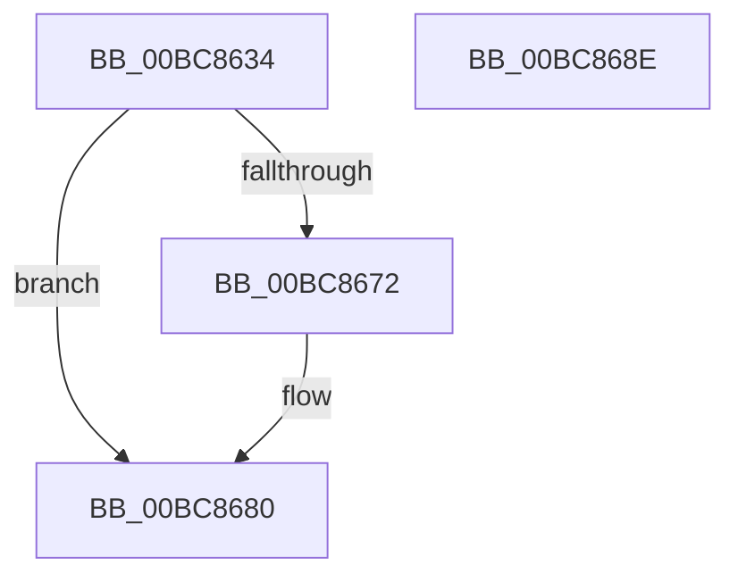

# RtlpIcReadOperandValue

- RVA: `0x00BC8634`–`0x00BC868F` (길이 `91` bytes)
- VA: `0x0000000140BC8634`
- 실행 섹션: `TRACESUP`
- PDB 이름 있음: `예`; PDB Function 태그: `아니요`
- unwind 정보 RVA: `0x00065960`
- 디코드: `28`개 명령, `91/91` bytes 표시
- 미해석 바이트: `0` (있으면 어셈블리에 `.byte`로 보존)

> 이 문서는 커널 이미지의 기계어와 PDB 기호를 분석해 생성했습니다. 4번과 5번은 함수 원형과 자료형을 바이너리 사용 방식에서 추정한 C 해석이며 원본 소스 복구 결과는 아닙니다.

## 1. Dependencies

- 직접 호출 지점: **2**; 고유 호출 대상: **2**
- 직접 호출자로 확인된 함수: **3**
- RIP 상대 이미지 참조: **0**

### Outgoing calls
- `0x00BC8666` → [RtlpIcAccessMemory](RtlpIcAccessMemory_function_00BC7198.md) (function, `0x00BC7198`)
- `0x00BC8678` → [RtlpIcSignExtendOperandValue](RtlpIcSignExtendOperandValue_function_00BC8928.md) (function, `0x00BC8928`)

### Direct callers
- [RtlpIcEmulateGroup0Instruction](RtlpIcEmulateGroup0Instruction_function_00BC74F8.md) at `0x00BC75A0`
- [RtlpIcEmulateGroup1Instruction](RtlpIcEmulateGroup1Instruction_function_00BC7818.md) at `0x00BC78B7`
- [RtlpIcEmulateInstruction](RtlpIcEmulateInstruction_function_00BC7A08.md) at `0x00BC7C70`
- [RtlpIcEmulateInstruction](RtlpIcEmulateInstruction_function_00BC7A08.md) at `0x00BC7D70`
- [RtlpIcEmulateInstruction](RtlpIcEmulateInstruction_function_00BC7A08.md) at `0x00BC7EAA`

### Static image references
- 디코드된 RIP-relative 메모리 참조가 없습니다.

## 2. Other-region calls and transfers

- 다른 실행 섹션으로 향하는 call: **0**
- 별도 외부 분기/꼬리 이동을 확인하지 못했습니다.

## 3. Assembly (complete function range)

```asm
00BC8634  48 89 5C 24 08                  mov qword ptr [rsp + 8], rbx
00BC8639  57                              push rdi
00BC863A  48 83 EC 40                     sub rsp, 0x40
00BC863E  8A 41 01                        mov al, byte ptr [rcx + 1]
00BC8641  4C 8B D2                        mov r10, rdx
00BC8644  48 8B 5C 24 78                  mov rbx, qword ptr [rsp + 0x78]
00BC8649  48 8B F9                        mov rdi, rcx
00BC864C  C0 E8 03                        shr al, 3
00BC864F  48 8B D3                        mov rdx, rbx
00BC8652  C6 44 24 30 00                  mov byte ptr [rsp + 0x30], 0
00BC8657  49 8B CA                        mov rcx, r10
00BC865A  88 44 24 28                     mov byte ptr [rsp + 0x28], al
00BC865E  8A 44 24 70                     mov al, byte ptr [rsp + 0x70]
00BC8662  88 44 24 20                     mov byte ptr [rsp + 0x20], al
00BC8666  E8 2D EB FF FF                  call 0x140bc7198
00BC866B  44 8B C0                        mov r8d, eax
00BC866E  85 C0                           test eax, eax
00BC8670  78 0E                           js 0x140bc8680
00BC8672  48 8B 13                        mov rdx, qword ptr [rbx]
00BC8675  48 8B CF                        mov rcx, rdi
00BC8678  E8 AB 02 00 00                  call 0x140bc8928
00BC867D  48 89 03                        mov qword ptr [rbx], rax
00BC8680  48 8B 5C 24 50                  mov rbx, qword ptr [rsp + 0x50]
00BC8685  41 8B C0                        mov eax, r8d
00BC8688  48 83 C4 40                     add rsp, 0x40
00BC868C  5F                              pop rdi
00BC868D  C3                              ret
00BC868E  CC                              int3
```

## 4. C-style interpretation (structured pseudocode)

```c
__int64 __fastcall RtlpIcReadOperandValue(__int64 a1, __int64 a2, __int64 a3, __int64 a4, unsigned __int8 a5, __int64 a6)
{
    __int64 result;
    __int64 v_rsp;
    unsigned __int8 v_stack_m18;
    unsigned __int8 v_stack_m20;
    unsigned __int8 v_stack_m28;
    unsigned __int64 v_stack_p8;

    v_stack_p8 = v_rbx;
    v_rsp = (v_rsp) - (64);
    result = (unsigned __int8)((*(unsigned __int8 *)(a1 + 1)) >> (3));
    v_stack_m18 = 0;
    v_stack_m20 = (unsigned __int8)(result);
    v_stack_m28 = a5;
    result = RtlpIcAccessMemory(a2, a6, a3, a4);
    if (!(sign_flag)) {
        a2 = *(unsigned __int64 *)(a6);
        a1 = a1;
        result = RtlpIcSignExtendOperandValue(a1, a2, (unsigned int)((unsigned int)(result)), a4);
        *(unsigned __int64 *)(a6) = result;
    }
    v_rsp = (v_rsp) + (64);
    return (unsigned int)((unsigned int)((unsigned int)((unsigned int)(result))));
}
```

## 5. (Beta) C Style

```c
int64_t RtlpIcReadOperandValue(void *Arg1, int64_t Arg2, int64_t Arg3, int64_t Arg4, uint8_t Arg5, void *Arg6)
{
    uint8_t *arg1 = (uint8_t *)Arg1;
    uint8_t *arg6 = (uint8_t *)Arg6;

    int64_t result;
    int64_t local_rsp;
    uint8_t v_stack_m18;
    uint8_t v_stack_m20;
    uint8_t v_stack_m28;
    uint64_t v_stack_p8;

    v_stack_p8 = local_rbx;
    local_rsp = (local_rsp) - (64);
    result = (uint8_t)((*(uint8_t *)(arg1 + 0x1)) >> (3));
    v_stack_m18 = 0;
    v_stack_m20 = (uint8_t)(result);
    v_stack_m28 = Arg5;
    result = RtlpIcAccessMemory(Arg2, Arg6, Arg3, Arg4);
    if (!(sign_flag)) {
        Arg2 = *(uint64_t *)(arg6);
        Arg1 = Arg1;
        result = RtlpIcSignExtendOperandValue(Arg1, Arg2, (uint32_t)((uint32_t)(result)), Arg4);
        *(uint64_t *)(arg6) = result;
    }
    local_rsp = (local_rsp) + (64);
    return (uint32_t)((uint32_t)((uint32_t)((uint32_t)(result))));
}
```

### 관측된 메모리 오프셋

구조체 형식이 확인되지 않은 접근은 인자 기준의 오프셋으로만 기록했습니다.

| 기준 인자 | 오프셋 표현 | 폭 (bit) | 접근 |
|---|---:|---:|---|
| `Arg1` | `+ 0x1` | `8` | `R` |
| `Arg6` | `+ 0x0` | `64` | `R` |
| `Arg6` | `+ 0x0` | `64` | `W` |

## 6. Execution-region graph

[열기: 2D/3D 그래프와 함수 탐색 컨트롤 패널](../../../control-panel.html?section=tracesup&rva=0x00BC8634&view=graph)

- 2D 그래프는 위에서 아래로 흐르고, 3D 그래프는 빈 공간을 드래그해 회전합니다. Shift+드래그는 이동, 휠은 확대·축소, 함수 노드 선택은 대상 보고서 이동입니다.

### Static fallback


