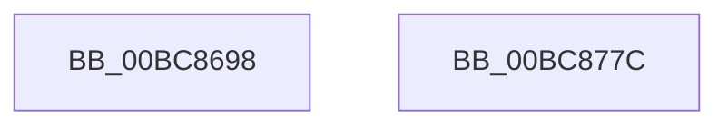

# RtlpIcSetFlagsAdd

- RVA: `0x00BC8698`–`0x00BC877D` (길이 `229` bytes)
- VA: `0x0000000140BC8698`
- 실행 섹션: `TRACESUP`
- PDB 이름 있음: `예`; PDB Function 태그: `아니요`
- unwind 정보 RVA: `0x00060300`
- 디코드: `68`개 명령, `229/229` bytes 표시
- 미해석 바이트: `0` (있으면 어셈블리에 `.byte`로 보존)

> 이 문서는 커널 이미지의 기계어와 PDB 기호를 분석해 생성했습니다. 4번과 5번은 함수 원형과 자료형을 바이너리 사용 방식에서 추정한 C 해석이며 원본 소스 복구 결과는 아닙니다.

## 1. Dependencies

- 직접 호출 지점: **1**; 고유 호출 대상: **1**
- 직접 호출자로 확인된 함수: **2**
- RIP 상대 이미지 참조: **0**

### Outgoing calls
- `0x00BC875E` → [RtlpIcSetFlagsZeroSignParity](RtlpIcSetFlagsZeroSignParity_function_00BC8888.md) (function, `0x00BC8888`)

### Direct callers
- [RtlpIcEmulateGroup0Instruction](RtlpIcEmulateGroup0Instruction_function_00BC74F8.md) at `0x00BC76C8`
- [RtlpIcEmulateGroup1Instruction](RtlpIcEmulateGroup1Instruction_function_00BC7818.md) at `0x00BC79B7`

### Static image references
- 디코드된 RIP-relative 메모리 참조가 없습니다.

## 2. Other-region calls and transfers

- 다른 실행 섹션으로 향하는 call: **0**
- 별도 외부 분기/꼬리 이동을 확인하지 못했습니다.

## 3. Assembly (complete function range)

```asm
00BC8698  48 89 5C 24 08                  mov qword ptr [rsp + 8], rbx
00BC869D  48 89 6C 24 10                  mov qword ptr [rsp + 0x10], rbp
00BC86A2  48 89 74 24 18                  mov qword ptr [rsp + 0x18], rsi
00BC86A7  57                              push rdi
00BC86A8  41 56                           push r14
00BC86AA  41 57                           push r15
00BC86AC  48 83 EC 20                     sub rsp, 0x20
00BC86B0  48 8B 42 08                     mov rax, qword ptr [rdx + 8]
00BC86B4  49 8B F1                        mov rsi, r9
00BC86B7  44 8A 51 01                     mov r10b, byte ptr [rcx + 1]
00BC86BB  49 8B F9                        mov rdi, r9
00BC86BE  49 8B E8                        mov rbp, r8
00BC86C1  4C 8B F2                        mov r14, rdx
00BC86C4  4C 8B F9                        mov r15, rcx
00BC86C7  41 FE CA                        dec r10b
00BC86CA  81 60 44 EF F7 FF FF            and dword ptr [rax + 0x44], 0xfffff7ef
00BC86D1  48 8B DD                        mov rbx, rbp
00BC86D4  48 8B 52 08                     mov rdx, qword ptr [rdx + 8]
00BC86D8  49 8B C1                        mov rax, r9
00BC86DB  4C 8B 4C 24 60                  mov r9, qword ptr [rsp + 0x60]
00BC86E0  48 F7 D3                        not rbx
00BC86E3  48 C1 F8 03                     sar rax, 3
00BC86E7  49 33 F9                        xor rdi, r9
00BC86EA  44 0F B6 C0                     movzx r8d, al
00BC86EE  4C 8B DF                        mov r11, rdi
00BC86F1  49 C1 F9 03                     sar r9, 3
00BC86F5  49 F7 D3                        not r11
00BC86F8  45 33 C8                        xor r9d, r8d
00BC86FB  41 0F B6 CA                     movzx ecx, r10b
00BC86FF  48 23 FB                        and rdi, rbx
00BC8702  48 8B C3                        mov rax, rbx
00BC8705  48 C1 F8 03                     sar rax, 3
00BC8709  44 23 C8                        and r9d, eax
00BC870C  49 8B C3                        mov rax, r11
00BC870F  48 C1 F8 03                     sar rax, 3
00BC8713  41 23 C0                        and eax, r8d
00BC8716  4C 8B C5                        mov r8, rbp
00BC8719  44 0B C8                        or r9d, eax
00BC871C  48 8B C5                        mov rax, rbp
00BC871F  48 33 C6                        xor rax, rsi
00BC8722  41 83 E1 01                     and r9d, 1
00BC8726  49 23 C3                        and rax, r11
00BC8729  4C 23 DE                        and r11, rsi
00BC872C  48 D3 F8                        sar rax, cl
00BC872F  49 0B FB                        or rdi, r11
00BC8732  83 E0 01                        and eax, 1
00BC8735  48 D3 FF                        sar rdi, cl
00BC8738  C1 E0 07                        shl eax, 7
00BC873B  83 E7 01                        and edi, 1
00BC873E  44 0B C8                        or r9d, eax
00BC8741  49 8B CF                        mov rcx, r15
00BC8744  41 C1 E1 04                     shl r9d, 4
00BC8748  44 09 4A 44                     or dword ptr [rdx + 0x44], r9d
00BC874C  49 8B D6                        mov rdx, r14
00BC874F  49 8B 46 08                     mov rax, qword ptr [r14 + 8]
00BC8753  83 60 44 FE                     and dword ptr [rax + 0x44], 0xfffffffe
00BC8757  49 8B 46 08                     mov rax, qword ptr [r14 + 8]
00BC875B  09 78 44                        or dword ptr [rax + 0x44], edi
00BC875E  E8 25 01 00 00                  call 0x140bc8888
00BC8763  48 8B 5C 24 40                  mov rbx, qword ptr [rsp + 0x40]
00BC8768  48 8B 6C 24 48                  mov rbp, qword ptr [rsp + 0x48]
00BC876D  48 8B 74 24 50                  mov rsi, qword ptr [rsp + 0x50]
00BC8772  48 83 C4 20                     add rsp, 0x20
00BC8776  41 5F                           pop r15
00BC8778  41 5E                           pop r14
00BC877A  5F                              pop rdi
00BC877B  C3                              ret
00BC877C  CC                              int3
```

## 4. C-style interpretation (structured pseudocode)

```c
__int64 __fastcall RtlpIcSetFlagsAdd(__int64 a1, __int64 a2, __int64 a3, __int64 a4, __int64 a5)
{
    __int64 result;
    __int64 v_r10;
    __int64 v_r11;
    __int64 v_rbx;
    __int64 v_rdi;
    __int64 v_rsp;
    unsigned __int64 v_stack_p10;
    unsigned __int64 v_stack_p18;
    unsigned __int64 v_stack_p8;

    v_stack_p8 = v_rbx;
    v_stack_p10 = v_rbp;
    v_stack_p18 = v_rsi;
    v_rsp = (v_rsp) - (32);
    v_r10 = (unsigned __int8)((*(unsigned __int8 *)(a1 + 1)) - 1);
    v_rbx = ~(a3);
    result = (a4) >> (3);
    v_rdi = (a4) ^ (a5);
    a4 = (a5) >> (3);
    v_r11 = ~(v_rdi);
    a4 = (unsigned int)((a4) ^ ((unsigned int)((unsigned __int8)(result))));
    v_rdi = (v_rdi) & (v_rbx);
    result = (v_rbx) >> (3);
    a4 = (unsigned int)((a4) & ((unsigned int)(result)));
    result = (v_r11) >> (3);
    result = (unsigned int)((result) & ((unsigned int)((unsigned __int8)(result))));
    a4 = (unsigned int)((a4) | ((unsigned int)(result)));
    result = (a3) ^ (a4);
    a4 = (unsigned int)((a4) & (1));
    result = (result) & (v_r11);
    v_r11 = (v_r11) & (a4);
    result = (result) >> ((unsigned __int8)((unsigned __int8)(v_r10)));
    v_rdi = (v_rdi) | (v_r11);
    result = (unsigned int)((result) & (1));
    v_rdi = (v_rdi) >> ((unsigned __int8)((unsigned __int8)(v_r10)));
    result = (unsigned int)((result) << (7));
    v_rdi = (unsigned int)((v_rdi) & (1));
    a4 = (unsigned int)((a4) | ((unsigned int)(result)));
    a4 = (unsigned int)((a4) << (4));
    result = RtlpIcSetFlagsZeroSignParity(a1, a2, a3, a4);
    v_rsp = (v_rsp) + (32);
    return result;
}
```

## 5. (Beta) C Style

```c
int64_t RtlpIcSetFlagsAdd(void *Arg1, void *Arg2, int64_t Arg3, int64_t Arg4, int64_t Arg5)
{
    uint8_t *arg1 = (uint8_t *)Arg1;
    uint8_t *arg2 = (uint8_t *)Arg2;

    int64_t result;
    int64_t local_r10;
    int64_t local_r11;
    int64_t local_rbx;
    int64_t local_rdi;
    int64_t local_rsp;
    uint64_t v_stack_p10;
    uint64_t v_stack_p18;
    uint64_t v_stack_p8;

    v_stack_p8 = local_rbx;
    v_stack_p10 = local_rbp;
    v_stack_p18 = local_rsi;
    local_rsp = (local_rsp) - (32);
    local_r10 = (uint8_t)((*(uint8_t *)(arg1 + 0x1)) - 1);
    local_rbx = ~(Arg3);
    result = (Arg4) >> (3);
    local_rdi = (Arg4) ^ (Arg5);
    Arg4 = (Arg5) >> (3);
    local_r11 = ~(local_rdi);
    Arg4 = (uint32_t)((Arg4) ^ ((uint32_t)((uint8_t)(result))));
    local_rdi = (local_rdi) & (local_rbx);
    result = (local_rbx) >> (3);
    Arg4 = (uint32_t)((Arg4) & ((uint32_t)(result)));
    result = (local_r11) >> (3);
    result = (uint32_t)((result) & ((uint32_t)((uint8_t)(result))));
    Arg4 = (uint32_t)((Arg4) | ((uint32_t)(result)));
    result = (Arg3) ^ (Arg4);
    Arg4 = (uint32_t)((Arg4) & (1));
    result = (result) & (local_r11);
    local_r11 = (local_r11) & (Arg4);
    result = (result) >> ((uint8_t)((uint8_t)(local_r10)));
    local_rdi = (local_rdi) | (local_r11);
    result = (uint32_t)((result) & (1));
    local_rdi = (local_rdi) >> ((uint8_t)((uint8_t)(local_r10)));
    result = (uint32_t)((result) << (7));
    local_rdi = (uint32_t)((local_rdi) & (1));
    Arg4 = (uint32_t)((Arg4) | ((uint32_t)(result)));
    Arg4 = (uint32_t)((Arg4) << (4));
    result = RtlpIcSetFlagsZeroSignParity(Arg1, Arg2, Arg3, Arg4);
    local_rsp = (local_rsp) + (32);
    return result;
}
```

### 관측된 메모리 오프셋

구조체 형식이 확인되지 않은 접근은 인자 기준의 오프셋으로만 기록했습니다.

| 기준 인자 | 오프셋 표현 | 폭 (bit) | 접근 |
|---|---:|---:|---|
| `Arg1` | `+ 0x1` | `8` | `R` |
| `Arg2` | `+ 0x8` | `64` | `R` |

## 6. Execution-region graph

[열기: 2D/3D 그래프와 함수 탐색 컨트롤 패널](../../../control-panel.html?section=tracesup&rva=0x00BC8698&view=graph)

- 2D 그래프는 위에서 아래로 흐르고, 3D 그래프는 빈 공간을 드래그해 회전합니다. Shift+드래그는 이동, 휠은 확대·축소, 함수 노드 선택은 대상 보고서 이동입니다.

### Static fallback


