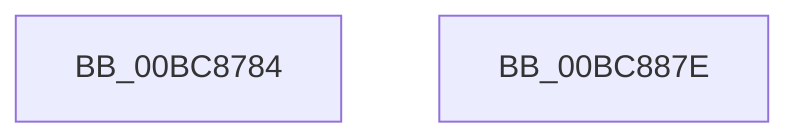

# RtlpIcSetFlagsSub

- RVA: `0x00BC8784`–`0x00BC887F` (길이 `251` bytes)
- VA: `0x0000000140BC8784`
- 실행 섹션: `TRACESUP`
- PDB 이름 있음: `예`; PDB Function 태그: `아니요`
- unwind 정보 RVA: `0x0005E6B4`
- 디코드: `74`개 명령, `251/251` bytes 표시
- 미해석 바이트: `0` (있으면 어셈블리에 `.byte`로 보존)

> 이 문서는 커널 이미지의 기계어와 PDB 기호를 분석해 생성했습니다. 4번과 5번은 함수 원형과 자료형을 바이너리 사용 방식에서 추정한 C 해석이며 원본 소스 복구 결과는 아닙니다.

## 1. Dependencies

- 직접 호출 지점: **1**; 고유 호출 대상: **1**
- 직접 호출자로 확인된 함수: **2**
- RIP 상대 이미지 참조: **0**

### Outgoing calls
- `0x00BC885E` → [RtlpIcSetFlagsZeroSignParity](RtlpIcSetFlagsZeroSignParity_function_00BC8888.md) (function, `0x00BC8888`)

### Direct callers
- [RtlpIcEmulateGroup0Instruction](RtlpIcEmulateGroup0Instruction_function_00BC74F8.md) at `0x00BC7639`
- [RtlpIcEmulateGroup0Instruction](RtlpIcEmulateGroup0Instruction_function_00BC74F8.md) at `0x00BC7675`
- [RtlpIcEmulateGroup1Instruction](RtlpIcEmulateGroup1Instruction_function_00BC7818.md) at `0x00BC7915`
- [RtlpIcEmulateGroup1Instruction](RtlpIcEmulateGroup1Instruction_function_00BC7818.md) at `0x00BC7956`

### Static image references
- 디코드된 RIP-relative 메모리 참조가 없습니다.

## 2. Other-region calls and transfers

- 다른 실행 섹션으로 향하는 call: **0**
- 별도 외부 분기/꼬리 이동을 확인하지 못했습니다.

## 3. Assembly (complete function range)

```asm
00BC8784  48 8B C4                        mov rax, rsp
00BC8787  48 89 58 08                     mov qword ptr [rax + 8], rbx
00BC878B  48 89 68 10                     mov qword ptr [rax + 0x10], rbp
00BC878F  48 89 70 18                     mov qword ptr [rax + 0x18], rsi
00BC8793  48 89 78 20                     mov qword ptr [rax + 0x20], rdi
00BC8797  41 56                           push r14
00BC8799  48 83 EC 20                     sub rsp, 0x20
00BC879D  48 8B 42 08                     mov rax, qword ptr [rdx + 8]
00BC87A1  48 8B EA                        mov rbp, rdx
00BC87A4  44 8A 51 01                     mov r10b, byte ptr [rcx + 1]
00BC87A8  49 8B F0                        mov rsi, r8
00BC87AB  49 C1 F8 03                     sar r8, 3
00BC87AF  4C 8B F1                        mov r14, rcx
00BC87B2  49 8B F9                        mov rdi, r9
00BC87B5  41 FE CA                        dec r10b
00BC87B8  81 60 44 EF F7 FF FF            and dword ptr [rax + 0x44], 0xfffff7ef
00BC87BF  4D 8B D9                        mov r11, r9
00BC87C2  4C 8B 4D 08                     mov r9, qword ptr [rbp + 8]
00BC87C6  49 F7 D3                        not r11
00BC87C9  41 0F B6 DA                     movzx ebx, r10b
00BC87CD  48 8B CE                        mov rcx, rsi
00BC87D0  4C 8B 54 24 50                  mov r10, qword ptr [rsp + 0x50]
00BC87D5  48 C1 F9 03                     sar rcx, 3
00BC87D9  49 8B C2                        mov rax, r10
00BC87DC  48 C1 F8 03                     sar rax, 3
00BC87E0  0F B6 D0                        movzx edx, al
00BC87E3  49 8B C3                        mov rax, r11
00BC87E6  44 0B C2                        or r8d, edx
00BC87E9  48 C1 F8 03                     sar rax, 3
00BC87ED  44 23 C0                        and r8d, eax
00BC87F0  48 8B C7                        mov rax, rdi
00BC87F3  48 C1 F8 03                     sar rax, 3
00BC87F7  23 C8                           and ecx, eax
00BC87F9  48 8B C7                        mov rax, rdi
00BC87FC  23 CA                           and ecx, edx
00BC87FE  49 33 C2                        xor rax, r10
00BC8801  44 0B C1                        or r8d, ecx
00BC8804  48 8B D6                        mov rdx, rsi
00BC8807  49 33 D2                        xor rdx, r10
00BC880A  41 83 E0 01                     and r8d, 1
00BC880E  48 F7 D2                        not rdx
00BC8811  8B CB                           mov ecx, ebx
00BC8813  48 23 D0                        and rdx, rax
00BC8816  48 D3 FA                        sar rdx, cl
00BC8819  83 E2 01                        and edx, 1
00BC881C  C1 E2 07                        shl edx, 7
00BC881F  44 0B C2                        or r8d, edx
00BC8822  48 8B D6                        mov rdx, rsi
00BC8825  49 0B D2                        or rdx, r10
00BC8828  41 C1 E0 04                     shl r8d, 4
00BC882C  45 09 41 44                     or dword ptr [r9 + 0x44], r8d
00BC8830  49 23 D3                        and rdx, r11
00BC8833  48 8B 45 08                     mov rax, qword ptr [rbp + 8]
00BC8837  83 60 44 FE                     and dword ptr [rax + 0x44], 0xfffffffe
00BC883B  48 8B C6                        mov rax, rsi
00BC883E  4C 8B 45 08                     mov r8, qword ptr [rbp + 8]
00BC8842  48 23 C7                        and rax, rdi
00BC8845  49 23 C2                        and rax, r10
00BC8848  48 0B D0                        or rdx, rax
00BC884B  48 D3 FA                        sar rdx, cl
00BC884E  49 8B CE                        mov rcx, r14
00BC8851  83 E2 01                        and edx, 1
00BC8854  41 09 50 44                     or dword ptr [r8 + 0x44], edx
00BC8858  4C 8B C6                        mov r8, rsi
00BC885B  48 8B D5                        mov rdx, rbp
00BC885E  E8 25 00 00 00                  call 0x140bc8888
00BC8863  48 8B 5C 24 30                  mov rbx, qword ptr [rsp + 0x30]
00BC8868  48 8B 6C 24 38                  mov rbp, qword ptr [rsp + 0x38]
00BC886D  48 8B 74 24 40                  mov rsi, qword ptr [rsp + 0x40]
00BC8872  48 8B 7C 24 48                  mov rdi, qword ptr [rsp + 0x48]
00BC8877  48 83 C4 20                     add rsp, 0x20
00BC887B  41 5E                           pop r14
00BC887D  C3                              ret
00BC887E  CC                              int3
```

## 4. C-style interpretation (structured pseudocode)

```c
__int64 __fastcall RtlpIcSetFlagsSub(__int64 a1, __int64 a2, __int64 a3, __int64 a4, __int64 a5)
{
    __int64 result;
    __int64 v_r10;
    __int64 v_r11;
    __int64 v_rsp;
    unsigned __int64 v_stack_p10;
    unsigned __int64 v_stack_p18;
    unsigned __int64 v_stack_p20;
    unsigned __int64 v_stack_p8;

    *(unsigned __int64 *)(v_rsp + 8) = v_rbx;
    *(unsigned __int64 *)(v_rsp + 16) = v_rbp;
    *(unsigned __int64 *)(v_rsp + 24) = v_rsi;
    *(unsigned __int64 *)(v_rsp + 32) = v_rdi;
    v_rsp = (v_rsp) - (32);
    a3 = (a3) >> (3);
    v_r10 = (unsigned __int8)((*(unsigned __int8 *)(a1 + 1)) - 1);
    v_r11 = ~(a4);
    a1 = (a3) >> (3);
    result = (a5) >> (3);
    a3 = (unsigned int)((a3) | ((unsigned int)((unsigned __int8)(result))));
    result = (v_r11) >> (3);
    a3 = (unsigned int)((a3) & ((unsigned int)(result)));
    result = (a4) >> (3);
    a1 = (unsigned int)((a1) & ((unsigned int)(result)));
    a1 = (unsigned int)((a1) & ((unsigned int)((unsigned __int8)(result))));
    result = (a4) ^ (a5);
    a3 = (unsigned int)((a3) | ((unsigned int)(a1)));
    a2 = (a3) ^ (a5);
    a3 = (unsigned int)((a3) & (1));
    a2 = ~(a2);
    a2 = (a2) & (result);
    a2 = (a2) >> ((unsigned __int8)((unsigned int)((unsigned int)((unsigned __int8)(v_r10)))));
    a2 = (unsigned int)((a2) & (1));
    a2 = (unsigned int)((a2) << (7));
    a3 = (unsigned int)((a3) | ((unsigned int)(a2)));
    a2 = (a3) | (a5);
    a3 = (unsigned int)((a3) << (4));
    a2 = (a2) & (v_r11);
    result = (a3) & (a4);
    result = (result) & (a5);
    a2 = (a2) | (result);
    a2 = (a2) >> ((unsigned __int8)((unsigned int)((unsigned int)((unsigned __int8)(v_r10)))));
    a2 = (unsigned int)((a2) & (1));
    result = RtlpIcSetFlagsZeroSignParity(a1, a2, a3, *(unsigned __int64 *)(a2 + 8));
    v_rsp = (v_rsp) + (32);
    return result;
}
```

## 5. (Beta) C Style

```c
int64_t RtlpIcSetFlagsSub(void *Arg1, void *Arg2, int64_t Arg3, int64_t Arg4, int64_t Arg5)
{
    uint8_t *arg1 = (uint8_t *)Arg1;
    uint8_t *arg2 = (uint8_t *)Arg2;

    int64_t result;
    int64_t local_r10;
    int64_t local_r11;
    int64_t local_rsp;
    uint64_t v_stack_p10;
    uint64_t v_stack_p18;
    uint64_t v_stack_p20;
    uint64_t v_stack_p8;

    *(uint64_t *)(local_rsp + 0x8) = local_rbx;
    *(uint64_t *)(local_rsp + 0x10) = local_rbp;
    *(uint64_t *)(local_rsp + 0x18) = local_rsi;
    *(uint64_t *)(local_rsp + 0x20) = local_rdi;
    local_rsp = (local_rsp) - (32);
    Arg3 = (Arg3) >> (3);
    local_r10 = (uint8_t)((*(uint8_t *)(arg1 + 0x1)) - 1);
    local_r11 = ~(Arg4);
    Arg1 = (Arg3) >> (3);
    result = (Arg5) >> (3);
    Arg3 = (uint32_t)((Arg3) | ((uint32_t)((uint8_t)(result))));
    result = (local_r11) >> (3);
    Arg3 = (uint32_t)((Arg3) & ((uint32_t)(result)));
    result = (Arg4) >> (3);
    Arg1 = (uint32_t)((Arg1) & ((uint32_t)(result)));
    Arg1 = (uint32_t)((Arg1) & ((uint32_t)((uint8_t)(result))));
    result = (Arg4) ^ (Arg5);
    Arg3 = (uint32_t)((Arg3) | ((uint32_t)(Arg1)));
    Arg2 = (Arg3) ^ (Arg5);
    Arg3 = (uint32_t)((Arg3) & (1));
    Arg2 = ~(Arg2);
    Arg2 = (Arg2) & (result);
    Arg2 = (Arg2) >> ((uint8_t)((uint32_t)((uint32_t)((uint8_t)(local_r10)))));
    Arg2 = (uint32_t)((Arg2) & (1));
    Arg2 = (uint32_t)((Arg2) << (7));
    Arg3 = (uint32_t)((Arg3) | ((uint32_t)(Arg2)));
    Arg2 = (Arg3) | (Arg5);
    Arg3 = (uint32_t)((Arg3) << (4));
    Arg2 = (Arg2) & (local_r11);
    result = (Arg3) & (Arg4);
    result = (result) & (Arg5);
    Arg2 = (Arg2) | (result);
    Arg2 = (Arg2) >> ((uint8_t)((uint32_t)((uint32_t)((uint8_t)(local_r10)))));
    Arg2 = (uint32_t)((Arg2) & (1));
    result = RtlpIcSetFlagsZeroSignParity(Arg1, Arg2, Arg3, *(uint64_t *)(arg2 + 0x8));
    local_rsp = (local_rsp) + (32);
    return result;
}
```

### 관측된 메모리 오프셋

구조체 형식이 확인되지 않은 접근은 인자 기준의 오프셋으로만 기록했습니다.

| 기준 인자 | 오프셋 표현 | 폭 (bit) | 접근 |
|---|---:|---:|---|
| `Arg1` | `+ 0x1` | `8` | `R` |
| `Arg2` | `+ 0x8` | `64` | `R` |

## 6. Execution-region graph

[열기: 2D/3D 그래프와 함수 탐색 컨트롤 패널](../../../control-panel.html?section=tracesup&rva=0x00BC8784&view=graph)

- 2D 그래프는 위에서 아래로 흐르고, 3D 그래프는 빈 공간을 드래그해 회전합니다. Shift+드래그는 이동, 휠은 확대·축소, 함수 노드 선택은 대상 보고서 이동입니다.

### Static fallback


