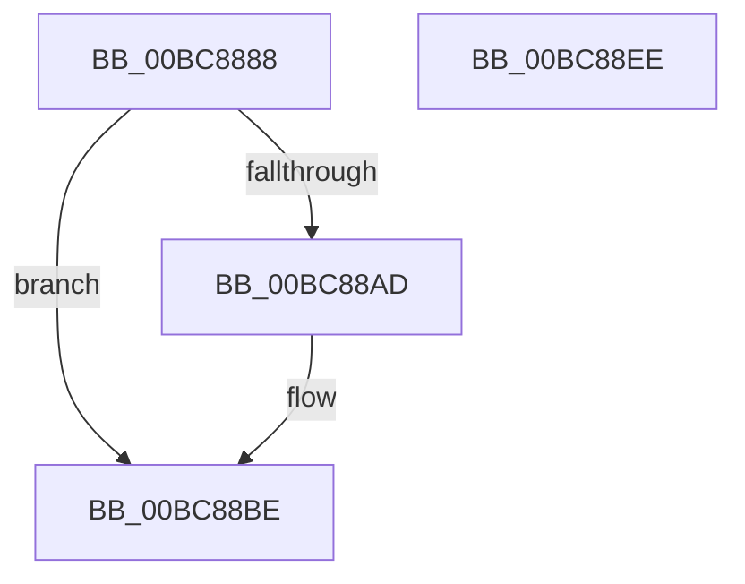

# RtlpIcSetFlagsZeroSignParity

- RVA: `0x00BC8888`–`0x00BC88EF` (길이 `103` bytes)
- VA: `0x0000000140BC8888`
- 실행 섹션: `TRACESUP`
- PDB 이름 있음: `예`; PDB Function 태그: `아니요`
- unwind 정보 RVA: `0x000DB714`
- 디코드: `29`개 명령, `103/103` bytes 표시
- 미해석 바이트: `0` (있으면 어셈블리에 `.byte`로 보존)

> 이 문서는 커널 이미지의 기계어와 PDB 기호를 분석해 생성했습니다. 4번과 5번은 함수 원형과 자료형을 바이너리 사용 방식에서 추정한 C 해석이며 원본 소스 복구 결과는 아닙니다.

## 1. Dependencies

- 직접 호출 지점: **0**; 고유 호출 대상: **0**
- 직접 호출자로 확인된 함수: **5**
- RIP 상대 이미지 참조: **1**

### Outgoing calls
- 직접 디코드된 call 명령이 없습니다.

### Direct callers
- [RtlpIcEmulateGroup0Instruction](RtlpIcEmulateGroup0Instruction_function_00BC74F8.md) at `0x00BC765A`
- [RtlpIcEmulateGroup1Instruction](RtlpIcEmulateGroup1Instruction_function_00BC7818.md) at `0x00BC7937`
- [RtlpIcEmulateInstruction](RtlpIcEmulateInstruction_function_00BC7A08.md) at `0x00BC7CCB`
- [RtlpIcSetFlagsAdd](RtlpIcSetFlagsAdd_function_00BC8698.md) at `0x00BC875E`
- [RtlpIcSetFlagsSub](RtlpIcSetFlagsSub_function_00BC8784.md) at `0x00BC885E`

### Static image references
- `0x00BC888D` → RVA `0x00034720` (`.rdata`; read)

## 2. Other-region calls and transfers

- 다른 실행 섹션으로 향하는 call: **0**
- 별도 외부 분기/꼬리 이동을 확인하지 못했습니다.

## 3. Assembly (complete function range)

```asm
00BC8888  44 0F B6 51 01                  movzx r10d, byte ptr [rcx + 1]
00BC888D  4C 8D 1D 8C BE 46 FF            lea r11, [rip - 0xb94174]
00BC8894  4D 8B C8                        mov r9, r8
00BC8897  41 0F B6 C0                     movzx eax, r8b
00BC889B  41 8D 4A FF                     lea ecx, [r10 - 1]
00BC889F  46 0F B6 1C 18                  movzx r11d, byte ptr [rax + r11]
00BC88A4  49 D3 F9                        sar r9, cl
00BC88A7  41 80 FA 40                     cmp r10b, 0x40
00BC88AB  73 11                           jae 0x140bc88be
00BC88AD  41 8B CA                        mov ecx, r10d
00BC88B0  B8 01 00 00 00                  mov eax, 1
00BC88B5  48 D3 E0                        shl rax, cl
00BC88B8  48 FF C8                        dec rax
00BC88BB  4C 23 C0                        and r8, rax
00BC88BE  48 8B 42 08                     mov rax, qword ptr [rdx + 8]
00BC88C2  41 83 E1 01                     and r9d, 1
00BC88C6  41 C1 E1 05                     shl r9d, 5
00BC88CA  81 60 44 3B FF FF FF            and dword ptr [rax + 0x44], 0xffffff3b
00BC88D1  48 8B 4A 08                     mov rcx, qword ptr [rdx + 8]
00BC88D5  49 F7 D8                        neg r8
00BC88D8  1B C0                           sbb eax, eax
00BC88DA  F7 D0                           not eax
00BC88DC  83 E0 10                        and eax, 0x10
00BC88DF  44 0B C8                        or r9d, eax
00BC88E2  45 0B CB                        or r9d, r11d
00BC88E5  41 C1 E1 02                     shl r9d, 2
00BC88E9  44 09 49 44                     or dword ptr [rcx + 0x44], r9d
00BC88ED  C3                              ret
00BC88EE  CC                              int3
```

## 4. C-style interpretation (structured pseudocode)

```c
__int64 __fastcall RtlpIcSetFlagsZeroSignParity(__int64 a1, __int64 a2, __int64 a3)
{
    __int64 result;

    a4 = (a3) >> ((unsigned __int8)(*(unsigned __int8 *)(a1 + 1) - 1));
    result = (unsigned __int8)(a3);
    if (((unsigned __int8)(*(unsigned __int8 *)(a1 + 1))) < 64) {
        a1 = (unsigned int)(*(unsigned __int8 *)(a1 + 1));
        result = 1;
        result = (result) << ((unsigned __int8)(a1));
        result = (result) - 1;
        a3 = (a3) & (result);
    }
    a4 = (unsigned int)((a4) & (1));
    a4 = (unsigned int)((a4) << (5));
    a3 = -(a3);
    result = (unsigned int)(~(*(unsigned __int64 *)(a2 + 8)));
    result = (unsigned int)((result) & (16));
    a4 = (unsigned int)((a4) | ((unsigned int)(result)));
    a4 = (unsigned int)((a4) | ((unsigned int)(*(unsigned __int8 *)((unsigned __int8)(a3) + v_rip - 12140916 * 1))));
    a4 = (unsigned int)((a4) << (2));
    return result;
}
```

## 5. (Beta) C Style

```c
int64_t RtlpIcSetFlagsZeroSignParity(void *Arg1, void *Arg2, void *Arg3)
{
    uint8_t *arg1 = (uint8_t *)Arg1;
    uint8_t *arg2 = (uint8_t *)Arg2;
    uint8_t *arg3 = (uint8_t *)Arg3;

    int64_t result;

    a4 = (Arg3) >> ((uint8_t)(*(uint8_t *)(arg1 + 0x1) - 1));
    result = (uint8_t)(Arg3);
    if (((uint8_t)(*(uint8_t *)(arg1 + 0x1))) < 64) {
        Arg1 = (uint32_t)(*(uint8_t *)(arg1 + 0x1));
        result = 1;
        result = (result) << ((uint8_t)(Arg1));
        result = (result) - 1;
        Arg3 = (Arg3) & (result);
    }
    a4 = (uint32_t)((a4) & (1));
    a4 = (uint32_t)((a4) << (5));
    Arg3 = -(Arg3);
    result = (uint32_t)(~(*(uint64_t *)(arg2 + 0x8)));
    result = (uint32_t)((result) & (16));
    a4 = (uint32_t)((a4) | ((uint32_t)(result)));
    a4 = (uint32_t)((a4) | ((uint32_t)(*(uint8_t *)((uint8_t)(arg3) + v_rip - 0xB94174 * 1))));
    a4 = (uint32_t)((a4) << (2));
    return result;
}
```

### 관측된 메모리 오프셋

구조체 형식이 확인되지 않은 접근은 인자 기준의 오프셋으로만 기록했습니다.

| 기준 인자 | 오프셋 표현 | 폭 (bit) | 접근 |
|---|---:|---:|---|
| `Arg1` | `+ 0x1` | `8` | `R` |
| `Arg2` | `+ 0x8` | `64` | `R` |
| `Arg3` | `+ 0x0 + r11*1` | `8` | `R` |

## 6. Execution-region graph

[열기: 2D/3D 그래프와 함수 탐색 컨트롤 패널](../../../control-panel.html?section=tracesup&rva=0x00BC8888&view=graph)

- 2D 그래프는 위에서 아래로 흐르고, 3D 그래프는 빈 공간을 드래그해 회전합니다. Shift+드래그는 이동, 휠은 확대·축소, 함수 노드 선택은 대상 보고서 이동입니다.

### Static fallback


