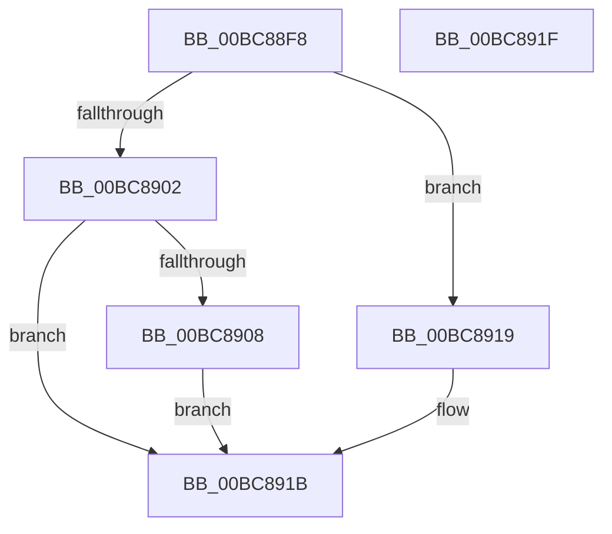

# RtlpIcSetImmediateOperandSize

- RVA: `0x00BC88F8`–`0x00BC8920` (길이 `40` bytes)
- VA: `0x0000000140BC88F8`
- 실행 섹션: `TRACESUP`
- PDB 이름 있음: `예`; PDB Function 태그: `아니요`
- unwind 정보 RVA: `0x000DB714`
- 디코드: `14`개 명령, `40/40` bytes 표시
- 미해석 바이트: `0` (있으면 어셈블리에 `.byte`로 보존)

> 이 문서는 커널 이미지의 기계어와 PDB 기호를 분석해 생성했습니다. 4번과 5번은 함수 원형과 자료형을 바이너리 사용 방식에서 추정한 C 해석이며 원본 소스 복구 결과는 아닙니다.

## 1. Dependencies

- 직접 호출 지점: **0**; 고유 호출 대상: **0**
- 직접 호출자로 확인된 함수: **1**
- RIP 상대 이미지 참조: **0**

### Outgoing calls
- 직접 디코드된 call 명령이 없습니다.

### Direct callers
- [RtlpIcEmulateInstruction](RtlpIcEmulateInstruction_function_00BC7A08.md) at `0x00BC7AAA`
- [RtlpIcEmulateInstruction](RtlpIcEmulateInstruction_function_00BC7A08.md) at `0x00BC7BC9`
- [RtlpIcEmulateInstruction](RtlpIcEmulateInstruction_function_00BC7A08.md) at `0x00BC8018`

### Static image references
- 디코드된 RIP-relative 메모리 참조가 없습니다.

## 2. Other-region calls and transfers

- 다른 실행 섹션으로 향하는 call: **0**
- 별도 외부 분기/꼬리 이동을 확인하지 못했습니다.

## 3. Assembly (complete function range)

```asm
00BC88F8  44 8A 51 01                     mov r10b, byte ptr [rcx + 1]
00BC88FC  41 80 FA 08                     cmp r10b, 8
00BC8900  74 17                           je 0x140bc8919
00BC8902  41 80 FA 10                     cmp r10b, 0x10
00BC8906  74 13                           je 0x140bc891b
00BC8908  41 80 FA 20                     cmp r10b, 0x20
00BC890C  41 0F B6 D0                     movzx edx, r8b
00BC8910  41 0F B6 C1                     movzx eax, r9b
00BC8914  0F 45 D0                        cmovne edx, eax
00BC8917  EB 02                           jmp 0x140bc891b
00BC8919  B2 08                           mov dl, 8
00BC891B  88 51 17                        mov byte ptr [rcx + 0x17], dl
00BC891E  C3                              ret
00BC891F  CC                              int3
```

## 4. C-style interpretation (structured pseudocode)

```c
__int64 __fastcall RtlpIcSetImmediateOperandSize(__int64 a1, __int64 a2, unsigned __int8 a3, unsigned __int8 a4)
{
    if (((unsigned __int8)(*(unsigned __int8 *)(a1 + 1))) == 8) goto loc_00BC8919;
    if (((unsigned __int8)(*(unsigned __int8 *)(a1 + 1))) == 16) goto loc_00BC891B;
    if (((unsigned __int8)(*(unsigned __int8 *)(a1 + 1))) != 32) { a3 = a4; }
    goto loc_00BC891B;
loc_00BC8919:
loc_00BC891B:
    *(unsigned __int8 *)(a1 + 23) = 8;
    return a4;
}
```

## 5. (Beta) C Style

```c
int64_t RtlpIcSetImmediateOperandSize(void *Arg1, int64_t Arg2, uint8_t Arg3, uint8_t Arg4)
{
    uint8_t *arg1 = (uint8_t *)Arg1;

    if (((uint8_t)(*(uint8_t *)(arg1 + 0x1))) == 8) goto loc_00BC8919;
    if (((uint8_t)(*(uint8_t *)(arg1 + 0x1))) == 16) goto loc_00BC891B;
    if (((uint8_t)(*(uint8_t *)(arg1 + 0x1))) != 32) { Arg3 = Arg4; }
    goto loc_00BC891B;
loc_00BC8919:
loc_00BC891B:
    *(uint8_t *)(arg1 + 0x17) = 8;
    return Arg4;
}
```

### 관측된 메모리 오프셋

구조체 형식이 확인되지 않은 접근은 인자 기준의 오프셋으로만 기록했습니다.

| 기준 인자 | 오프셋 표현 | 폭 (bit) | 접근 |
|---|---:|---:|---|
| `Arg1` | `+ 0x1` | `8` | `R` |
| `Arg1` | `+ 0x17` | `8` | `W` |

## 6. Execution-region graph

[열기: 2D/3D 그래프와 함수 탐색 컨트롤 패널](../../../control-panel.html?section=tracesup&rva=0x00BC88F8&view=graph)

- 2D 그래프는 위에서 아래로 흐르고, 3D 그래프는 빈 공간을 드래그해 회전합니다. Shift+드래그는 이동, 휠은 확대·축소, 함수 노드 선택은 대상 보고서 이동입니다.

### Static fallback


