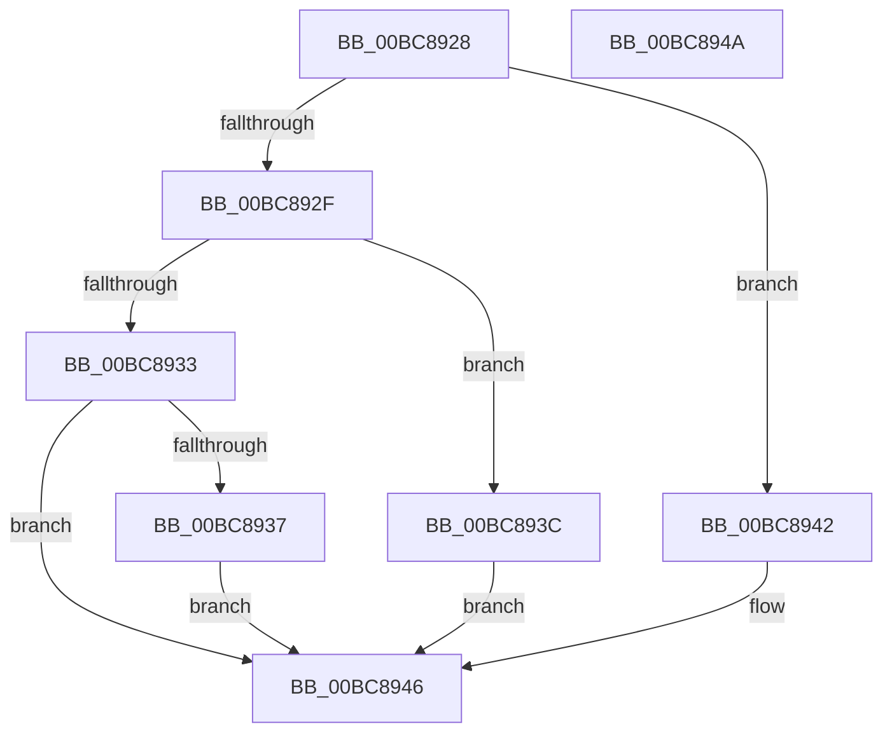

# RtlpIcSignExtendOperandValue

- RVA: `0x00BC8928`–`0x00BC894B` (길이 `35` bytes)
- VA: `0x0000000140BC8928`
- 실행 섹션: `TRACESUP`
- PDB 이름 있음: `예`; PDB Function 태그: `아니요`
- unwind 정보 RVA: `0x000DB714`
- 디코드: `15`개 명령, `35/35` bytes 표시
- 미해석 바이트: `0` (있으면 어셈블리에 `.byte`로 보존)

> 이 문서는 커널 이미지의 기계어와 PDB 기호를 분석해 생성했습니다. 4번과 5번은 함수 원형과 자료형을 바이너리 사용 방식에서 추정한 C 해석이며 원본 소스 복구 결과는 아닙니다.

## 1. Dependencies

- 직접 호출 지점: **0**; 고유 호출 대상: **0**
- 직접 호출자로 확인된 함수: **3**
- RIP 상대 이미지 참조: **0**

### Outgoing calls
- 직접 디코드된 call 명령이 없습니다.

### Direct callers
- [RtlpIcEmulateGroup0Instruction](RtlpIcEmulateGroup0Instruction_function_00BC74F8.md) at `0x00BC75DF`
- [RtlpIcEmulateInstruction](RtlpIcEmulateInstruction_function_00BC7A08.md) at `0x00BC7CAD`
- [RtlpIcEmulateInstruction](RtlpIcEmulateInstruction_function_00BC7A08.md) at `0x00BC7DFD`
- [RtlpIcEmulateInstruction](RtlpIcEmulateInstruction_function_00BC7A08.md) at `0x00BC7EE7`
- [RtlpIcReadOperandValue](RtlpIcReadOperandValue_function_00BC8634.md) at `0x00BC8678`

### Static image references
- 디코드된 RIP-relative 메모리 참조가 없습니다.

## 2. Other-region calls and transfers

- 다른 실행 섹션으로 향하는 call: **0**
- 별도 외부 분기/꼬리 이동을 확인하지 못했습니다.

## 3. Assembly (complete function range)

```asm
00BC8928  8A 41 01                        mov al, byte ptr [rcx + 1]
00BC892B  3C 08                           cmp al, 8
00BC892D  74 13                           je 0x140bc8942
00BC892F  3C 10                           cmp al, 0x10
00BC8931  74 09                           je 0x140bc893c
00BC8933  3C 20                           cmp al, 0x20
00BC8935  75 0F                           jne 0x140bc8946
00BC8937  48 63 D2                        movsxd rdx, edx
00BC893A  EB 0A                           jmp 0x140bc8946
00BC893C  48 0F BF D2                     movsx rdx, dx
00BC8940  EB 04                           jmp 0x140bc8946
00BC8942  48 0F BE D2                     movsx rdx, dl
00BC8946  48 8B C2                        mov rax, rdx
00BC8949  C3                              ret
00BC894A  CC                              int3
```

## 4. C-style interpretation (structured pseudocode)

```c
__int64 __fastcall RtlpIcSignExtendOperandValue(__int64 a1, int a2)
{
    if (((unsigned __int8)(*(unsigned __int8 *)(a1 + 1))) == 8) goto loc_00BC8942;
    if (((unsigned __int8)(*(unsigned __int8 *)(a1 + 1))) == 16) goto loc_00BC893C;
    if (((unsigned __int8)(*(unsigned __int8 *)(a1 + 1))) != 32) goto loc_00BC8946;
    goto loc_00BC8946;
loc_00BC893C:
    goto loc_00BC8946;
loc_00BC8942:
loc_00BC8946:
    return (__int8)((unsigned __int8)((__int16)((unsigned __int16)((int)(a2)))));
}
```

## 5. (Beta) C Style

```c
int64_t RtlpIcSignExtendOperandValue(void *Arg1, int32_t Arg2)
{
    uint8_t *arg1 = (uint8_t *)Arg1;

    if (((uint8_t)(*(uint8_t *)(arg1 + 0x1))) == 8) goto loc_00BC8942;
    if (((uint8_t)(*(uint8_t *)(arg1 + 0x1))) == 16) goto loc_00BC893C;
    if (((uint8_t)(*(uint8_t *)(arg1 + 0x1))) != 32) goto loc_00BC8946;
    goto loc_00BC8946;
loc_00BC893C:
    goto loc_00BC8946;
loc_00BC8942:
loc_00BC8946:
    return (int8_t)((uint8_t)((int16_t)((uint16_t)((int32_t)(Arg2)))));
}
```

### 관측된 메모리 오프셋

구조체 형식이 확인되지 않은 접근은 인자 기준의 오프셋으로만 기록했습니다.

| 기준 인자 | 오프셋 표현 | 폭 (bit) | 접근 |
|---|---:|---:|---|
| `Arg1` | `+ 0x1` | `8` | `R` |

## 6. Execution-region graph

[열기: 2D/3D 그래프와 함수 탐색 컨트롤 패널](../../../control-panel.html?section=tracesup&rva=0x00BC8928&view=graph)

- 2D 그래프는 위에서 아래로 흐르고, 3D 그래프는 빈 공간을 드래그해 회전합니다. Shift+드래그는 이동, 휠은 확대·축소, 함수 노드 선택은 대상 보고서 이동입니다.

### Static fallback


