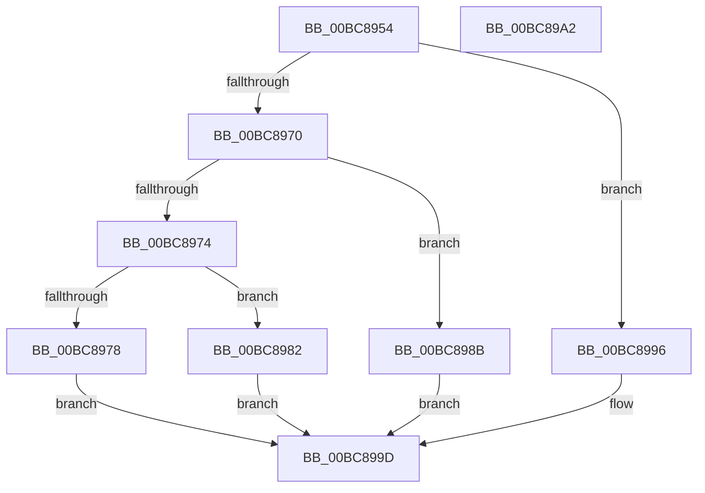

# RtlpIcWriteRegisterValue

- RVA: `0x00BC8954`–`0x00BC89A3` (길이 `79` bytes)
- VA: `0x0000000140BC8954`
- 실행 섹션: `TRACESUP`
- PDB 이름 있음: `예`; PDB Function 태그: `아니요`
- unwind 정보 RVA: `0x0005D2F4`
- 디코드: `26`개 명령, `79/79` bytes 표시
- 미해석 바이트: `0` (있으면 어셈블리에 `.byte`로 보존)

> 이 문서는 커널 이미지의 기계어와 PDB 기호를 분석해 생성했습니다. 4번과 5번은 함수 원형과 자료형을 바이너리 사용 방식에서 추정한 C 해석이며 원본 소스 복구 결과는 아닙니다.

## 1. Dependencies

- 직접 호출 지점: **1**; 고유 호출 대상: **1**
- 직접 호출자로 확인된 함수: **2**
- RIP 상대 이미지 참조: **0**

### Outgoing calls
- `0x00BC8960` → [RtlpIcGetRegisterAddressByIndex](RtlpIcGetRegisterAddressByIndex_function_00BC8498.md) (function, `0x00BC8498`)

### Direct callers
- [RtlpIcEmulateGroup0Instruction](RtlpIcEmulateGroup0Instruction_function_00BC74F8.md) at `0x00BC76F6`
- [RtlpIcEmulateInstruction](RtlpIcEmulateInstruction_function_00BC7A08.md) at `0x00BC7AEE`
- [RtlpIcEmulateInstruction](RtlpIcEmulateInstruction_function_00BC7A08.md) at `0x00BC7F4D`

### Static image references
- 디코드된 RIP-relative 메모리 참조가 없습니다.

## 2. Other-region calls and transfers

- 다른 실행 섹션으로 향하는 call: **0**
- 별도 외부 분기/꼬리 이동을 확인하지 못했습니다.

## 3. Assembly (complete function range)

```asm
00BC8954  48 83 EC 38                     sub rsp, 0x38
00BC8958  4C 8B D1                        mov r10, rcx
00BC895B  C6 44 24 20 01                  mov byte ptr [rsp + 0x20], 1
00BC8960  E8 33 FB FF FF                  call 0x140bc8498
00BC8965  4C 8B C8                        mov r9, rax
00BC8968  41 8A 42 01                     mov al, byte ptr [r10 + 1]
00BC896C  3C 08                           cmp al, 8
00BC896E  74 26                           je 0x140bc8996
00BC8970  3C 10                           cmp al, 0x10
00BC8972  74 17                           je 0x140bc898b
00BC8974  3C 20                           cmp al, 0x20
00BC8976  74 0A                           je 0x140bc8982
00BC8978  48 8B 4C 24 60                  mov rcx, qword ptr [rsp + 0x60]
00BC897D  49 89 09                        mov qword ptr [r9], rcx
00BC8980  EB 1B                           jmp 0x140bc899d
00BC8982  8B 44 24 60                     mov eax, dword ptr [rsp + 0x60]
00BC8986  49 89 01                        mov qword ptr [r9], rax
00BC8989  EB 12                           jmp 0x140bc899d
00BC898B  0F B7 44 24 60                  movzx eax, word ptr [rsp + 0x60]
00BC8990  66 41 89 01                     mov word ptr [r9], ax
00BC8994  EB 07                           jmp 0x140bc899d
00BC8996  8A 44 24 60                     mov al, byte ptr [rsp + 0x60]
00BC899A  41 88 01                        mov byte ptr [r9], al
00BC899D  48 83 C4 38                     add rsp, 0x38
00BC89A1  C3                              ret
00BC89A2  CC                              int3
```

## 4. C-style interpretation (structured pseudocode)

```c
__int64 __fastcall RtlpIcWriteRegisterValue(__int64 a1, __int64 a2, __int64 a3, __int64 a4, unsigned __int8 a5)
{
    __int64 result;
    __int64 v_rsp;
    unsigned __int8 v_stack_m18;

    v_rsp = (v_rsp) - (56);
    v_stack_m18 = 1;
    result = RtlpIcGetRegisterAddressByIndex(a1, a2, a3, a4);
    if (((unsigned __int8)(*(unsigned __int8 *)(a1 + 1))) == 8) goto loc_00BC8996;
    if (((unsigned __int8)(*(unsigned __int8 *)(a1 + 1))) == 16) goto loc_00BC898B;
    if (((unsigned __int8)(*(unsigned __int8 *)(a1 + 1))) == 32) goto loc_00BC8982;
    *(unsigned __int64 *)(result) = a5;
    goto loc_00BC899D;
loc_00BC8982:
    *(unsigned __int64 *)(result) = (unsigned int)(a5);
    goto loc_00BC899D;
loc_00BC898B:
    *(unsigned __int16 *)(result) = a5;
    goto loc_00BC899D;
loc_00BC8996:
    *(unsigned __int8 *)(result) = a5;
loc_00BC899D:
    v_rsp = (v_rsp) + (56);
    return a5;
}
```

## 5. (Beta) C Style

```c
int64_t RtlpIcWriteRegisterValue(int64_t Arg1, int64_t Arg2, int64_t Arg3, int64_t Arg4, uint8_t Arg5)
{
    int64_t result;
    int64_t local_rsp;
    uint8_t v_stack_m18;

    local_rsp = (local_rsp) - (56);
    v_stack_m18 = 1;
    result = RtlpIcGetRegisterAddressByIndex(Arg1, Arg2, Arg3, Arg4);
    if (((uint8_t)(*(uint8_t *)(Arg1 + 0x1))) == 8) goto loc_00BC8996;
    if (((uint8_t)(*(uint8_t *)(Arg1 + 0x1))) == 16) goto loc_00BC898B;
    if (((uint8_t)(*(uint8_t *)(Arg1 + 0x1))) == 32) goto loc_00BC8982;
    *(uint64_t *)(result) = Arg5;
    goto loc_00BC899D;
loc_00BC8982:
    *(uint64_t *)(result) = (uint32_t)(Arg5);
    goto loc_00BC899D;
loc_00BC898B:
    *(uint16_t *)(result) = Arg5;
    goto loc_00BC899D;
loc_00BC8996:
    *(uint8_t *)(result) = Arg5;
loc_00BC899D:
    local_rsp = (local_rsp) + (56);
    return Arg5;
}
```

## 6. Execution-region graph

[열기: 2D/3D 그래프와 함수 탐색 컨트롤 패널](../../../control-panel.html?section=tracesup&rva=0x00BC8954&view=graph)

- 2D 그래프는 위에서 아래로 흐르고, 3D 그래프는 빈 공간을 드래그해 회전합니다. Shift+드래그는 이동, 휠은 확대·축소, 함수 노드 선택은 대상 보고서 이동입니다.

### Static fallback


